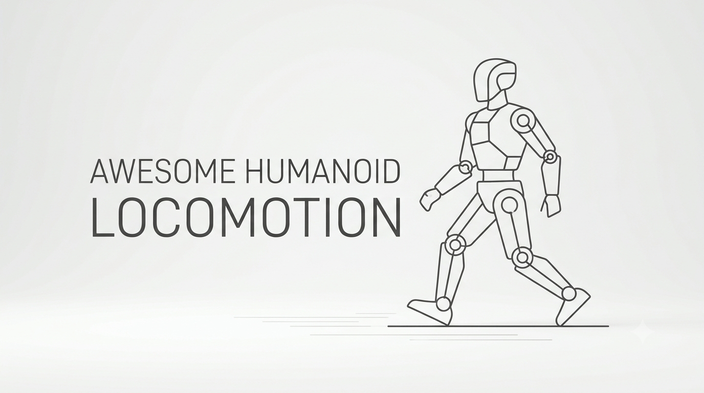

# Awesome Humanoid Locomotion

**English** · [한국어](README.ko.md) · [中文](README.zh-CN.md)

A curated year-by-year collection of **272 papers** on humanoid locomotion and related work, with a one-sentence summary of each.

[2026](#2026) · [2025](#2025) · [2024](#2024) · [2023](#2023)

Papers are grouped by conference year or journal issue year; works without a confirmed venue use their public release year. Within each year, newer release months appear first.

**Scope:** **Core** = walking/running, foothold planning, terrain traversal, balance and recovery; **Enabling** = motion tracking/retargeting, estimation, datasets and learning/control methods; **Related** = navigation, loco-manipulation, non-walking mobility and general robot-control methods evaluated on humanoid mobility. Categories reflect the main contribution, not every experiment.

Confirmed conference and journal entries show only the venue name and year; workshop papers are labeled separately. **—** means no confirmed venue (including submissions and works under review), not that the work is unpublished. Bibliographic snapshot: 2026-11-11.

## 2026

| Paper | Scope | Venue | One-line takeaway | Resources |
| :--- | :--- | :--- | :--- | :--- |
| [**LHNav:** Long-Horizon Humanoid Navigation via Multirate Coordination and Physics-Grounded Action Data](https://arxiv.org/abs/2611.12136) | Related | — | Asynchronous task reasoning, local motion generation and whole-body execution use physics-grounded demonstrations to achieve 75.56% long-horizon simulation success and zero-shot multi-goal navigation on a physical G1. | [arXiv 2026.11](https://arxiv.org/abs/2611.12136) [Project](https://robbyant-research.github.io/LHNav/) |
| [**HINT-VLM:** Humanoid Interactive Navigation over Rough Terrain with Embodiment-Grounded Vision-Language Model](https://arxiv.org/abs/2611.11665) | Related | [CoRL 2026 Workshop (SISREN)](https://yzwfromk.github.io/HINT_VLM/) | A Gaussian-process model corrects VLM predictions of object movability using robot interaction data, enabling a physical G1 to plan whether to push obstacles or detour on rough terrain. | [arXiv 2026.11](https://arxiv.org/abs/2611.11665) [Project](https://yzwfromk.github.io/HINT_VLM/) |
| [**Kimodo-Policy:** Learning Kinematic Action Models for Humanoid Loco-Manipulation](https://arxiv.org/abs/2611.11554) | Related | — | A frozen text-to-motion model with visual conditioning and hierarchical root–body–hand control supports humanoid loco-manipulation, reaching 72.14% success in HumanoidArena and 60% across eight physical tasks. | [arXiv 2026.11](https://arxiv.org/abs/2611.11554) [Project](https://kimodo-policy.github.io/) |
| [From Festival Video to the Stage: A Sim-to-Real Ladder for Long-Horizon Expressive Whole-Body Dance on a Commercial Humanoid](https://arxiv.org/abs/2611.11127) | Related | — | Monocular-video motion recovery, retargeting and RL tracking transfer Awa Odori dance to a physical G1, including a 9.7-minute continuous performance and handoff to its walking controller. | [arXiv 2026.11](https://arxiv.org/abs/2611.11127) |
| [Large-Scale Hierarchical Decision-Making in Robot Control via ADMM](https://arxiv.org/abs/2611.11090) | Related | — | An ADMM solver accelerates hierarchical robot control at moderate accuracy, but a G1 stepping-stone whole-body control benchmark exposes its disadvantage when high-accuracy solutions are required. | [arXiv 2026.11](https://arxiv.org/abs/2611.11090) |
| [**RoboMoCap:** A Large-Scale Whole-Body Motion Capture Dataset with Egocentric Vision for Robot Learning](https://arxiv.org/abs/2611.10994) | Enabling | — | Over 200 hours of synchronized egocentric video and 120-Hz full-body motion capture from 14 people cover walking, terrain traversal and loco-manipulation, with benchmarks for foot contact and humanoid retargeting. | [arXiv 2026.11](https://arxiv.org/abs/2611.10994) [Project](https://bitrobot-foundation.github.io/robomocap/) |
| [**DreamVLA:** From Generated Human Motions to Humanoid Vision-Language-Action Policies](https://arxiv.org/abs/2611.10872) | Related | [CoRL 2026 Workshops (G2A, Loco-Manipulation)](https://arxiv.org/abs/2611.10872) | Generated human motions guide simulation RL, and reference-conditioned DAgger collects corrective expert trajectories after VLA failures for whole-body interaction tasks including walking and picking. | [arXiv 2026.11](https://arxiv.org/abs/2611.10872) [Project](https://ember-center-berkeley.github.io/DreamVLA/) |
| [Capturability-Aware Footstep Planning in Cluttered Environments: A Recursively Feasible Sequential MPC on Axis-Aligned Safe Corridors](https://arxiv.org/abs/2611.10169) | Core | [Humanoids 2026](https://arxiv.org/abs/2611.10169) | Sequential linear-inverted-pendulum MPC couples capturability constraints with overlapping rectangular safe corridors, maintaining planning-layer recursive feasibility for Digit footsteps in cluttered simulations. | [arXiv 2026.11](https://arxiv.org/abs/2611.10169) |
| [A Unified Inertial Encoder for Human and Humanoid Motion](https://arxiv.org/abs/2611.10137) | Enabling | — | Synthesized IMU signals unify human and humanoid motion learning, enabling zero-shot velocity estimation on a physical G1 with 0.099 m/s error and no real-robot training data. | [arXiv 2026.11](https://arxiv.org/abs/2611.10137) |
| [**DKWBC:** Decoupling Motion Tracking and Balancing for Humanoid Whole-Body Control](https://arxiv.org/abs/2611.09605) | Enabling | — | Inverse-dynamics feedforward and PD feedback handle motion tracking, while a learned residual torque policy maintains balance across varied motions, payloads and physical interactions on real humanoid hardware. | [arXiv 2026.11](https://arxiv.org/abs/2611.09605) [Project](https://robbyant-research.github.io/DKWBC/) |
| [**SUGARv2:** Learning Diverse Visual Humanoid Loco-Manipulation Skills from Synthesized Interaction References](https://arxiv.org/abs/2611.09266) | Related | — | Reusable task templates synthesize robot–object interaction references, and imitation, visual-policy distillation and RL learn five loco-manipulation tasks with 91% mean simulation success and real-world transfer. | [arXiv 2026.11](https://arxiv.org/abs/2611.09266) [Project](https://tianshuwu.github.io/sugarv2-humanoid/) |
| [**STRIDE:** Learning Humanoid Locomotion in Minutes with Acceleration-Based Rewards](https://arxiv.org/abs/2611.08857) | Core | [CoRL 2026 Workshop (R2RL)](https://r2rl-workshop.github.io/) | An IMU-measurable commanded-acceleration reward, off-policy RL and symmetry augmentation train walking on simulated G1 and Booster T1 humanoids within 14 minutes of samples, without requiring base-velocity estimates. | [arXiv 2026.11](https://arxiv.org/abs/2611.08857) |
| [**ForPC:** Force-Aware Whole-Body Control for Precise Humanoid Cart Pushing](https://arxiv.org/abs/2611.08664) | Related | — | A force-aware residual whole-body policy uses onboard observations without external force sensors, enabling a physical G1 to push carts carrying up to 30 kg at 0.5 m/s after simulation-only training. | [arXiv 2026.11](https://arxiv.org/abs/2611.08664) [Project](https://roboforpc.github.io/) |
| [**STEP:** Spatiotemporal Training with Explicit Prediction for Perceptive Humanoid Locomotion](https://arxiv.org/abs/2611.08097) | Core | — | Cross-modal masked prediction and action-conditioned next-state prediction jointly train a perceptive locomotion policy, which succeeds in 98 of 100 real-world terrain trials on Noetix E1. | [arXiv 2026.11](https://arxiv.org/abs/2611.08097) |
| [Terrain-Indexed Motion Priors and Geometric Support for Extreme Humanoid Parkour](https://arxiv.org/abs/2611.08056) | Core | — | Three-stage imitation combines terrain-indexed motion priors with geometric hand–knee support guidance, enabling Noetix E1 to complete 29 of 30 real-world obstacle trials without policy fine-tuning. | [arXiv 2026.11](https://arxiv.org/abs/2611.08056) |
| [**HITCH:** Teaching a Vision-Language Model to Operate a Humanoid through a Whole-Body Harness](https://arxiv.org/abs/2611.08039) | Related | — | An image-grounded VLM harness translates pelvis, torso, hand, walking and gaze commands into whole-body actions via a learned tracker; a physical G1 carries a box to a goal without real-robot training data. | [arXiv 2026.11](https://arxiv.org/abs/2611.08039) |
| [Perceptive Humanoid Motion from Simulation](https://arxiv.org/abs/2611.06908) | Core | — | Synthesizing vision-language-motion data in 1,000 simulated homes enables a perceptive humanoid system to execute walking, crawling, and multi-skill tasks zero-shot on real hardware. | [arXiv 2026.11](https://arxiv.org/abs/2611.06908) [Project](https://apple-aiml-research.github.io/ml-halo/) |
| [Playing Soccer Like Humans Do: Learning Versatile and Agile Humanoid Soccer via Latent Motion Priors](https://arxiv.org/abs/2611.06564) | Related | [CoRL 2026](https://openreview.net/forum?id=XnyoJXimAK) | A motion prior learned from human soccer captures lets a hierarchical RL policy combine locomotion, dribbling, trapping, and kicking with zero-shot transfer to Unitree G1. | [arXiv 2026.11](https://arxiv.org/abs/2611.06564) |
| [**H^2MARL:** Hierarchical Heterogeneous Multi-agent Reinforcement Learning for Humanoid Robot Control](https://arxiv.org/abs/2611.06523) | Core | — | Joint-specific physical descriptors and joint optimization of high-level planning and low-level execution improve locomotion stability and whole-body coordination in simulation. | [arXiv 2026.11](https://arxiv.org/abs/2611.06523) |
| [**GRASP:** Gradient-Guided Sampling for Contact-Rich Physics-Based Motion Retargeting](https://arxiv.org/abs/2611.05754) | Enabling | — | Recovering gradient guidance from past simulator rollouts enables contact-aware motion retargeting without a differentiable simulator and improves PPO tracking of retargeted motions. | [arXiv 2026.11](https://arxiv.org/abs/2611.05754) [Project](https://computationalrobotics.seas.harvard.edu/GRASP/) [Code](https://github.com/ComputationalRobotics/GRASP_code) |
| [**Ctrl-F:** Force as an Interface for Humanoid Loco-Manipulation](https://arxiv.org/abs/2611.05507) | Related | — | Explicit contact-force commands and an online force planner augment humanoid motion tracking, enabling G1 to push, drag, and kick objects while adapting to changing loads. | [arXiv 2026.11](https://arxiv.org/abs/2611.05507) [Project](https://forcectrl.github.io/) |
| [Online iLQR-MPC with Whole-Body Control for Robust Humanoid Locomotion](https://arxiv.org/abs/2611.04204) | Core | — | Single-rigid-body iLQR-MPC jointly optimizes footsteps and contact wrenches at 100 Hz, while a 500 Hz whole-body controller executes the plan; G1 simulations demonstrate walking and push recovery. | [arXiv 2026.11](https://arxiv.org/abs/2611.04204) |
| [**MAPO:** Mixture of Experts with Alternating Policy Optimization for Universal Humanoid Motion Tracking](https://arxiv.org/abs/2611.02613) | Enabling | [CoRL 2026](https://mapo-corl2026.github.io/MAPO/) | Alternating optimization of the MoE router and experts prevents misestimated policy divergence and improves universal motion-tracking performance. | [arXiv 2026.11](https://arxiv.org/abs/2611.02613) [Project](https://mapo-corl2026.github.io/MAPO/) |
| [**FORGE:** Feasible Online Reduced-Order Reference Generation and Whole-Body Execution for Agile Humanoid Locomotion](https://arxiv.org/abs/2610.37974) | Core | [Humanoids 2026](https://arxiv.org/abs/2610.37974) | A reduced-order dynamics model generates whole-body references online; a separate policy tracks them on G1 for forward, backward and lateral travel and single-leg hopping. | [arXiv 2026.10](https://arxiv.org/abs/2610.37974) |
| [**HC2Robot:** Hyper-Connection Transformers with Predicted Foresight for Multi-Terrain Humanoid Parkour](https://arxiv.org/abs/2610.36825) | Core | — | From onboard sensing, a Transformer receives predictions of when and where each foot will land and how well it will be supported, guiding steps on stairs and across gaps. | [arXiv 2026.10](https://arxiv.org/abs/2610.36825) |
| [**REACH:** An RL-based Hierarchical Humanoid Crawling Framework for Adaptable Confined Space Traversal](https://arxiv.org/abs/2610.36546) | Core | [Humanoids 2026](https://aislab-sustech.github.io/REACH/) | G1 uses LiDAR to anticipate overhead clearance and learns transitions in both directions between crouched walking and crawling. | [arXiv 2026.10](https://arxiv.org/abs/2610.36546) [Project](https://aislab-sustech.github.io/REACH/) |
| [**HumanoidNDM:** Closing the Training-Deployment Gap of Motion Tracking via Humanoid Neural Dynamics Model](https://arxiv.org/abs/2610.34126) | Enabling | [CoRL 2026](https://jaywu109.github.io/papers/corl-2026/) | A neural dynamics model trained on real robot data enables gradient-based online tracking-policy fine-tuning without external motion capture. | [arXiv 2026.10](https://arxiv.org/abs/2610.34126) |
| [Active Reachability Learning for Humanoid Recoverability Monitoring](https://arxiv.org/abs/2610.33317) | Enabling | — | Actively sampling the boundary of recoverable states reduces the risk of declaring a poorly observed state recoverable. | [arXiv 2026.10](https://arxiv.org/abs/2610.33317) |
| [Humanoid Mobility via Attention-based Contacts](https://arxiv.org/abs/2610.31608) | Core | — | Instead of copying a human trajectory, an attention module predicts the next body contact and a separate controller moves the robot to make it. | [arXiv 2026.10](https://arxiv.org/abs/2610.31608) |
| [**MPBRS:** Multi-Potential-Based Reward Shaping for Unified Reward Configuration in Humanoid Locomotion](https://arxiv.org/abs/2610.30334) | Core | — | Rewards built from changes in multiple potential functions transfer across nine humanoids without retuning reward weights for each robot. | [arXiv 2026.10](https://arxiv.org/abs/2610.30334) |
| [Do Earth-Trained Humanoid Controllers Walk on the Moon? Gravity, Terrain, and Soil Transfer](https://arxiv.org/abs/2610.30080) | Core | — | In simulation, training on rough granular terrain with randomized gravity transferred most consistently between Earth and Moon conditions; Moon-only policies all fell on Earth. | [arXiv 2026.10](https://arxiv.org/abs/2610.30080) |
| [Test-Time Motion Steering for Perceptive Humanoid Fall Recovery](https://arxiv.org/abs/2610.30061) | Core | — | A vision-conditioned diffusion planner changes the direction, speed or path of a get-up motion at test time without retraining the recovery policy. | [arXiv 2026.10](https://arxiv.org/abs/2610.30061) [Project](https://osheraz.github.io/RISE/) |
| [Watch Your Step: Anticipated Perception for Humanoid Locomotion](https://arxiv.org/abs/2610.29612) | Core | — | Proprioception and velocity commands predict the next footfall, so the policy reads only the relevant patch of the heightmap rather than the whole map, speeding up training. | [arXiv 2026.10](https://arxiv.org/abs/2610.29612) [Project](https://leggedrobotics.github.io/watch-your-step) |
| [**SuperMimic:** Scaling Humanoid Whole-Body Control with One Differentiable World Model](https://arxiv.org/abs/2610.28480) | Enabling | [CoRL 2026](https://supermimic.github.io/) | One differentiable world model supplies imagined rollouts and analytic gradients, scaling whole-body tracking to vast motion libraries with far less compute. | [arXiv 2026.10](https://arxiv.org/abs/2610.28480) [Project](https://supermimic.github.io/) |
| [Validation of Human Motor Development Scales with Humanoid Robots](https://arxiv.org/abs/2610.25701) | Enabling | — | Testing four infant motor-development scales as RL curricula shows that restoring a missing intermediate step in one scale allows the robot to learn the target skill. | [arXiv 2026.10](https://arxiv.org/abs/2610.25701) |
| [Push the Limit: Learning High-Speed Sprinting and Aggressive Cornering on a Full-Scale Humanoid](https://arxiv.org/abs/2610.14840) | Core | [CoRL 2026](https://arxiv.org/abs/2610.14840) | Rewarding travel direction rather than instantaneous yaw rate, with separate motion discriminators for each skill, allows sharp turns without suppressing natural torso motion during sprinting. | [arXiv 2026.10](https://arxiv.org/abs/2610.14840) |
| [**DAMP:** Humanoid Locomotion via Denoised Belief Learning and Adversarial Motion Priors](https://arxiv.org/abs/2610.11505) | Core | — | A recurrent network estimates hidden locomotion states from noisy observations, while an adversarial motion prior shapes gait style on the physical robot. | [arXiv 2026.10](https://arxiv.org/abs/2610.11505) |
| [**HuMBLE:** Human Motion-Driven Behavior Learning for Embodied Locomotion](https://arxiv.org/abs/2610.10489) | Core | — | After pretraining on human movement, joint fine-tuning on motion imitation and arbitrary commands preserves gait style while making Atlas and G1 steerable. | [arXiv 2026.10](https://arxiv.org/abs/2610.10489) |
| [**QF3:** Fast Flow RL with Filtered Q-Gradients](https://arxiv.org/abs/2610.08789) | Enabling | — | Filtered Q-gradients stabilize off-policy flow RL for humanoid locomotion and motion tracking, including zero-shot transfer of locomotion policies to hardware. | [arXiv 2026.10](https://arxiv.org/abs/2610.08789) [Project](https://qf3-rl.github.io/) |
| [**RISE:** Learning Humanoid Loco-Manipulation with Responsibility-Induced Specialized Experts for Vision-Language-Action Models](https://rllab-snu.github.io/projects/RISE/) | Related | [IROS 2026](https://rllab-snu.github.io/projects/RISE/) | A responsibility-weighted VLA expert mixture learns locomotion and manipulation from separate demonstrations and connects them into long-horizon tasks. | [Project](https://rllab-snu.github.io/projects/RISE/) |
| [Reactive Humanoid Multi-Contact Using Learned Stability Models](https://arxiv.org/abs/2610.00823) | Core | — | Predicting feasible center-of-pressure regions after impact lets the robot rapidly choose where to brace a hand as well as where to step after a push. | [arXiv 2026.10](https://arxiv.org/abs/2610.00823) |
| [Passive-Dynamic-Walking-Inspired Dynamics Guidance for Energy-Efficient Humanoid Locomotion](https://arxiv.org/abs/2609.35935) | Core | — | Tilting gravity during early training encourages passive forward walking on flat ground; the assistance is then removed to optimize energy use under normal gravity. | [arXiv 2026.09](https://arxiv.org/abs/2609.35935) |
| [Model-Informed Safe Reinforcement Learning for Bipedal Locomotion via Step-to-Step Prediction](https://arxiv.org/abs/2609.34486) | Core | [IROS 2026](https://arxiv.org/abs/2609.34486) | A reduced-order walking model predicts the safety of the next step, informing both the training reward and a foot-placement filter at deployment. | [arXiv 2026.09](https://arxiv.org/abs/2609.34486) |
| [Generate, Track, Improve: Perceptive Multi-Skill Humanoid Locomotion with RL-Fine-Tuned Motion Generators](https://arxiv.org/abs/2609.31577) | Core | — | A generator proposes terrain-conditioned reference motions; off-policy fine-tuning on the tracker’s actual outcomes improves motion selection on new obstacles. | [arXiv 2026.09](https://arxiv.org/abs/2609.31577) [Project](https://zolkin1.github.io/generate-track-improve/) |
| [Echo in the Steps: Learning Perceptive Humanoid Parkour with Gated Memory](https://arxiv.org/abs/2609.28960) | Core | [CoRL 2026](https://echo-in-the-steps.github.io/) | Gated memory retains depth features relevant to foot placement so the robot can use supports that have already left the camera’s field of view. | [arXiv 2026.09](https://arxiv.org/abs/2609.28960) |
| [**TactileStep:** Sole Tactile Learning for Regulating Foot-Terrain Interaction in Humanoid Locomotion](https://arxiv.org/abs/2609.28959) | Core | [CoRL 2026](https://tactilestep.github.io/) | Aligning simulated and insole pressure features and rewarding touchdown and stance separately reduced peak landing impact on G1 by up to 48.8% against the comparison policy. | [arXiv 2026.09](https://arxiv.org/abs/2609.28959) |
| [Learning Expressive Humanoid Locomotion from Monocular Runway Videos for Robot Fashion Shows](https://arxiv.org/abs/2609.27003) | Core | [IROS 2026](https://arxiv.org/abs/2609.27003) | Human runway gaits reconstructed from monocular fashion-show videos are adapted to Booster K1’s proportions and reproduced on the robot. | [arXiv 2026.09](https://arxiv.org/abs/2609.27003) |
| [Humanoid Locomotion with a Fly-Inspired Recurrent Controller](https://arxiv.org/abs/2609.27001) | Core | — | In a simulated G1 with a fly-inspired controller, changing depth inputs did not change actions, but resetting motor-circuit memory cut success in the reference direction from 19/21 to 0/21. | [arXiv 2026.09](https://arxiv.org/abs/2609.27001) |
| [Smoothness as a Constraint for Stable Humanoid Locomotion](https://arxiv.org/abs/2609.24552) | Core | — | Separate upper- and lower-body motion limits replace a single smoothness reward, with penalties beginning as motion approaches each limit. | [arXiv 2026.09](https://arxiv.org/abs/2609.24552) |
| [**UniPoint:** Unified Point-Level Sensor Fusion for Humanoid Locomotion Across Challenging Terrains](https://arxiv.org/abs/2609.23666) | Enabling | — | Returns from a 360-degree LiDAR and two depth cameras are fused into one point cloud and compressed into a fixed number of tokens for whole-body control. | [arXiv 2026.09](https://arxiv.org/abs/2609.23666) |
| [**FootQuery:** Future-Touchdown-Guided Retrieval from Depth History for Perceptive Humanoid Locomotion](https://arxiv.org/abs/2609.21447) | Enabling | — | Predicted touchdown positions and their uncertainty guide retrieval from depth-image history, revealing footholds that are no longer visible. | [arXiv 2026.09](https://arxiv.org/abs/2609.21447) |
| [Learning Scene-Aware Humanoid Locomotion through 3D Clutter from Immersive Human Demonstrations](https://arxiv.org/abs/2609.21107) | Core | — | Whole-body demonstrations collected in virtual reality are retargeted to G1 while preserving clearance between the body and surrounding obstacles. | [arXiv 2026.09](https://arxiv.org/abs/2609.21107) |
| [Learning Slope-Adaptive Whole-Body Locomotion for Humanoid Robots in Roofing Construction](https://arxiv.org/abs/2609.20558) | Core | — | Human demonstrations collected on sloping roofs are adapted to a roof model by correcting foot supports and task positions, preserving the working posture as slope changes. | [arXiv 2026.09](https://arxiv.org/abs/2609.20558) |
| [**PASSAGE:** Scaling Scene-Aligned Motion Learning for Perceptive Humanoid Traversal in Cluttered Environments](https://arxiv.org/abs/2609.18732) | Core | — | A planner and tracker learn from scene-aligned motions; refining only the planner lets the robot chain obstacle-crossing skills without explicit skill labels. | [arXiv 2026.09](https://arxiv.org/abs/2609.18732) |
| [**ResSafe:** Learning Safety Filtering with Residual Reinforcement Learning for Humanoids](https://arxiv.org/abs/2609.15988) | Enabling | [CoRL 2026](https://sciautonomy.github.io/ResSafe_Web/) | A residual RL safety filter corrects actions of an existing motion-control policy, reducing instability and falls under disturbances. | [arXiv 2026.09](https://arxiv.org/abs/2609.15988) [Project](https://sciautonomy.github.io/ResSafe_Web/) |
| [Flow-Matched Motion Priors: Online Optimal-Transport Rewards for Imitation Learning](https://arxiv.org/abs/2609.15631) | Enabling | — | Flow matching and optimal transport learn a motion-prior reward from rollout-to-expert paths, improving Unitree G1 forward-walking training over AMP baselines. | [arXiv 2026.09](https://arxiv.org/abs/2609.15631) |
| [**EMoG:** Emotion-Modulated Gait Generation for Expressive Humanoid Locomotion](https://arxiv.org/abs/2609.14432) | Core | — | A periodic motion generator conditioned on emotion and travel commands learns from actors’ gaits, and a single policy tracks the resulting motions. | [arXiv 2026.09](https://arxiv.org/abs/2609.14432) |
| [**DWMP:** Leveraging Dual World Models for Humanoid Obstacle Traversal](https://arxiv.org/abs/2609.12347) | Core | — | A Koopman model encodes proprioceptive dynamics and a probabilistic visual world model encodes obstacle geometry from depth; their predictions jointly guide actions. | [arXiv 2026.09](https://arxiv.org/abs/2609.12347) |
| [**CAP:** Continuously Adaptive Perception-Blind Humanoid Locomotion via Learned Denoising](https://arxiv.org/abs/2609.11553) | Core | [CoRL 2026](https://arxiv.org/abs/2609.11553) | A depth-denoising encoder trained alongside a proprioceptive encoder adapts to gradual loss of visual quality without a binary switch between sighted and blind policies. | [arXiv 2026.09](https://arxiv.org/abs/2609.11553) |
| [**GM-Loco:** Terrain-Adaptive Humanoid Locomotion on Granular Media](https://arxiv.org/abs/2609.10286) | Core | — | A three-dimensional resistive-force model simulates foot sinkage in granular media, allowing the robot to train on sand-like terrain rather than rigid ground alone. | [arXiv 2026.09](https://arxiv.org/abs/2609.10286) [Project](https://humanoid-gm-locomotion.github.io/HUMANOID-GM/) |
| [**SwingBot:** Learning Whole-Body Brachiation for Humanoid Robots](https://arxiv.org/abs/2609.10283) | Related | [CoRL 2026](https://arxiv.org/abs/2609.10283) | Biomimetic keyframes guide exploration of releasing, swinging and reattaching, allowing a humanoid with passive wrist hooks to traverse consecutive bars. | [arXiv 2026.09](https://arxiv.org/abs/2609.10283) |
| [**TANGO:** Humanoid Navigation in Cluttered Environments with a Whole-Body Vision-Language-Action Model](https://arxiv.org/abs/2609.09158) | Core | [CoRL 2026](https://tango-vla.github.io/) | A language-conditioned whole-body VLA learns collision-free traversals from simulated planning and RL tracking, transferring zero-shot to G1. | [arXiv 2026.09](https://arxiv.org/abs/2609.09158) [Project](https://tango-vla.github.io/) |
| [**RoboDreamer:** Anticipatory Humanoid Locomotion with Predictive State-Space Models](https://arxiv.org/abs/2609.07096) | Enabling | [CoRL 2026](https://jaywu109.github.io/papers/corl-2026/) | Masked-observation training and distillation teach a Mamba predictive model to track whole-body motions even when some observations are unavailable. | [arXiv 2026.09](https://arxiv.org/abs/2609.07096) |
| [World-Model-Augmented Visual Locomotion for Humanoids on Foothold-Constrained Terrain](https://arxiv.org/abs/2609.02542) | Core | — | A world model trained alongside PPO predicts near-future observations and rewards from one depth image and proprioception, enabling traversal without foothold labels. | [arXiv 2026.09](https://arxiv.org/abs/2609.02542) |
| [Humanoid Safe Stop via Learned Stoppability Value](https://arxiv.org/abs/2609.02358) | Enabling | — | The system separately estimates a stopping policy’s success probability and physical recoverability, executing the stop only when both checks pass and using damping otherwise. | [arXiv 2026.09](https://arxiv.org/abs/2609.02358) |
| [Learning Agile Perceptive Traversal of Sparse 3D Structures for Humanoids](https://arxiv.org/abs/2608.29769) | Related | — | Jumping, hanging and landing experts are distilled into one policy that uses LiDAR and passive hooks to traverse sparse three-dimensional structures. | [arXiv 2026.08](https://arxiv.org/abs/2608.29769) |
| [Stay Seated: Learning Omnidirectional Humanoid Locomotion on a Passive Mobile Chair with Casters](https://arxiv.org/abs/2608.28090) | Related | — | A seated humanoid propels a passive caster chair in any direction using only body state and velocity commands, without chair-state or contact sensors. | [arXiv 2026.08](https://arxiv.org/abs/2608.28090) |
| [**SOLO:** Stable Omni-terrain Long-Horizon Perceptive Humanoid Locomotion](https://arxiv.org/abs/2608.26583) | Core | [CoRL 2026](https://jiahao-ma.github.io/) | A student reconstructs individual heightmap cells from depth and learns from predicted future teacher–student discrepancies; the robot demonstrated a continuous 1.5 km outdoor walk. | [arXiv 2026.08](https://arxiv.org/abs/2608.26583) [Project](https://sunpihai-up.github.io/solo/) |
| [Demonstration-Guided Humanoid Stand-Up on an Emulated Deformable Surface](https://arxiv.org/abs/2608.20852) | Core | — | A demonstration-trained get-up policy is exposed to progressively softer ground so it can recover even when the robot sinks into the support surface. | [arXiv 2026.08](https://arxiv.org/abs/2608.20852) |
| [Natural Sit-to-Stand Motion Synthesis For Humanoids via Guided Assistance Curricula and Staged Rewards](https://arxiv.org/abs/2608.20823) | Core | — | Gradually removing upward assistance at the pelvis while varying seat height teaches the robot to use momentum and center-of-pressure shifts to stand up. | [arXiv 2026.08](https://arxiv.org/abs/2608.20823) |
| [**MILD:** Tractable Terrain Modeling for Learning Improved Bipedal Locomotion on Deformable Surfaces](https://doi.org/10.1109/LRA.2025.3645520) | Core | [IEEE RA-L 2026](https://doi.org/10.1109/LRA.2025.3645520) | A discrete-element contact model simulates spatially varying ground deformation, and a policy infers the terrain from the body’s response to adapt on real soft surfaces. | [arXiv 2026.08](https://arxiv.org/abs/2608.19955) |
| [**Tac4Loco:** Learning Spatiotemporal Plantar Pressure Representations for Humanoid Locomotion](https://arxiv.org/abs/2608.15766) | Enabling | — | Preserving the spatial layout and time history of plantar pressure, rather than reducing it to one resultant force, tells the policy which part of the foot is supported. | [arXiv 2026.08](https://arxiv.org/abs/2608.15766) |
| [Whole-Body Planning for Humanoids Navigating Confined Spaces via Self-Collision Avoidance References](https://arxiv.org/abs/2608.10220) | Enabling | — | Body-part reachability and differentiable collision constraints produce a path through confined spaces that initializes whole-body trajectory optimization. | [arXiv 2026.08](https://arxiv.org/abs/2608.10220) |
| [**Light-Loco-Parkour:** Versatile Perceptive Whole-Body Locomotion via Multi-Skill Distillation](https://arxiv.org/abs/2608.02653) | Core | — | A few demonstrations are expanded to different obstacle geometries and distilled into one policy that switches between walking and parkour using depth and velocity commands. | [arXiv 2026.08](https://arxiv.org/abs/2608.02653) [Project](https://light-loco-parkour.github.io/) |
| [**P3:** Probabilistic Policy Propagation for Stable VAE-Based Robot Learning](https://arxiv.org/abs/2607.25541) | Enabling | — | Moment propagation and sample-based correction reduce bias and variance in VAE-based PPO updates, with validation on humanoid parkour tasks. | [arXiv 2026.07](https://arxiv.org/abs/2607.25541) [Code](https://github.com/ylyem9x/P3_Open) |
| [Learning Reusable Hybrid Motion Priors for Humanoid Locomotion from Motion Imitation](https://arxiv.org/abs/2607.24083) | Enabling | — | Human-motion experts are distilled into a frozen discrete codebook and decoder, so new tasks can select useful motion codes instead of relearning the movements. | [arXiv 2026.07](https://arxiv.org/abs/2607.24083) |
| [Koopman DCM: Unstable Eigenfunctions as Data-driven Representations for Legged Balancing](https://arxiv.org/abs/2607.18760) | Enabling | — | Unstable Koopman eigenfunctions learned from physical biped data identify directions in which balance diverges and guide gait-pattern tracking. | [arXiv 2026.07](https://arxiv.org/abs/2607.18760) |
| [**GaitSpan:** Growing Humanoid Locomotion from Walking to Running](https://arxiv.org/abs/2607.12114) | Core | — | A frozen walking policy is extended to running by changing its internal rhythm and stride and learning only the remaining tracking error. | [arXiv 2026.07](https://arxiv.org/abs/2607.12114) [Project](https://gaitspan2026.github.io/) |
| [Physics-Guided Biomechanical Gait Adaptation for Humanoid Locomotion on Extreme Sloped Terrains](https://arxiv.org/abs/2607.07830) | Core | [CoRL 2026](https://www.linkedin.com/posts/addison-lin-wang-62542b222_corl26-bioinspired-mechanical-activity-7507799470663974912-zQeE) | A slope-relative zero-moment point guides balance while training encourages hip propulsion uphill and knee braking downhill; only proprioception is needed at execution. | [arXiv 2026.07](https://arxiv.org/abs/2607.07830) |
| [**ADP:** Adversarial Dynamics Priors for Physically Grounded Humanoid Locomotion](https://arxiv.org/abs/2607.03454) | Enabling | — | An imitation discriminator learns to distinguish dynamics features from trajectory optimization rather than the appearance of poses, encouraging physically desirable gaits. | [arXiv 2026.07](https://arxiv.org/abs/2607.03454) |
| [Reinforcement Learning-Based Control for an Inline Skating Humanoid Robot](https://arxiv.org/abs/2606.31807) | Related | [IROS 2026](https://arxiv.org/abs/2606.31807) | Booster T1 learns to propel itself and turn on ordinary inline skates by controlling skate placement and tilt without human demonstrations. | [arXiv 2026.06](https://arxiv.org/abs/2606.31807) |
| [**FastDSAC:** Enhancing Policy Plasticity via Constrained Exploration for Scalable Humanoid Locomotion](https://arxiv.org/abs/2606.31691) | Enabling | [IROS 2026](https://2026.ieee-iros.org/program/paper_index/) | Truncated-Gaussian exploration limits extreme actions in massively parallel off-policy RL, reducing the damage frequent updates can do to value estimates and the policy’s ability to keep learning. | [arXiv 2026.06](https://arxiv.org/abs/2606.31691) [Code](https://github.com/luge66/FastDSAC) |
| [**ReactiveBFM:** Reactive Closed-Loop Motion Planning Towards Universal Humanoid Whole-Body Control](https://arxiv.org/abs/2606.30362) | Enabling | [CoRL 2026](https://xiao-chen.tech/reactivebfm/) | A generative motion planner and tracking controller replan in closed loop, learning to correct deviations instead of accumulating open-loop errors. | [arXiv 2026.06](https://arxiv.org/abs/2606.30362) [Project](https://xiao-chen.tech/reactivebfm/) |
| [Booster Lab: A Data-Centric Pipeline for Learning Deployable Humanoid Locomotion Policies](https://arxiv.org/abs/2606.27813) | Enabling | — | A pipeline connects motion-data selection, simulator calibration from measurements, adversarial motion-prior training and hardware deployment for Booster T1. | [arXiv 2026.06](https://arxiv.org/abs/2606.27813) |
| [**WOLF-VLA:** Whole-Body Humanoid Optimal Locomotion Framework for Vision-Language-Action Learning](https://arxiv.org/abs/2606.25591) | Core | [IROS 2026](https://www.dfki.de/en/web/research/projects-and-publications/publication/17788) | Optimal-control trajectories supply physically feasible demonstrations for a vision-language-action model of language-directed whole-body locomotion. | [arXiv 2026.06](https://arxiv.org/abs/2606.25591) |
| [Vision-Assisted Bipedal Locomotion on Challenging Terrains via Terrain-Related Adversarial Motion Priors](https://doi.org/10.1109/LRA.2026.3707326) | Core | [IEEE RA-L 2026](https://doi.org/10.1109/LRA.2026.3707326) | Single-stage depth-and-proprioception RL combines terrain-aware mixture-of-experts control with adversarial gait priors for slopes, stairs and gaps. | [IEEE 2026.06](https://doi.org/10.1109/LRA.2026.3707326) |
| [**TACT-ful:** Multi-Channel Terrain Affordance and Compliance Training for Payload-Robust Perceptive Humanoid Locomotion](https://arxiv.org/abs/2606.20645) | Core | — | Flatness, slope and reachable height guide foothold selection, while simulated payload forces and moments train the robot to remain compliant when carrying loads. | [arXiv 2026.06](https://arxiv.org/abs/2606.20645) [Project](https://fai-rl-tech.github.io/tact-locomotion.github.io/) |
| [Comparative Study on Agility, Efficiency, and Impact Absorption of Bipedal Robots with Active Toes](https://arxiv.org/abs/2606.19699) | Core | — | Under matched RL training, active toes reduced cost of transport by 17.5% and heel-strike ground reaction force by 5.0% at 1.33 m/s in simulation. | [arXiv 2026.06](https://arxiv.org/abs/2606.19699) |
| [**ADAPT:** Analytical Disturbance-Aware Policy Training for Humanoid Locomotion](https://arxiv.org/abs/2606.16542) | Core | [CoRL 2026](https://blyu413.github.io/adapt-locomotion/) | A whole-body dynamics observer estimates external forces and torques without force sensors, helping G1 respond to torso pushes or a load in one hand. | [arXiv 2026.06](https://arxiv.org/abs/2606.16542) |
| [**GuideWalk:** Learning Unified Autonomous Navigation and Locomotion for Humanoid Robots across Versatile Terrains](https://arxiv.org/abs/2606.10449) | Core | — | Distilling navigation velocity commands and a terrain-traversal teacher’s actions into one policy brings goal-directed obstacle avoidance and foot placement together. | [arXiv 2026.06](https://arxiv.org/abs/2606.10449) [Project](https://guide-walk.github.io/GuideWalk) |
| [**MARCH:** Model-Assisted Reinforcement Learning for the Perceptive Control of Humanoids over Sparse Footholds](https://arxiv.org/abs/2606.10288) | Core | [CoRL 2026](https://openreview.net/forum?id=IY6ti85pg0) | A reduced-order model supplies safe trajectories to a teacher trained with a control Lyapunov function reward; a distilled visual policy traverses sparse stepping stones. | [arXiv 2026.06](https://arxiv.org/abs/2606.10288) |
| [**UniReLo:** Learning a Unified Humanoid Policy from Fall Recovery to Locomotion across Diverse Terrains](https://arxiv.org/abs/2606.08922) | Core | — | Continuously adjusting the imitation signal to get-up progress and evaluating available support lets the robot resume walking after a fall on varied surfaces. | [arXiv 2026.06](https://arxiv.org/abs/2606.08922) [Project](https://vsislab.github.io/UniReLo/) |
| [Mind Your Steps: A General Learning Framework for Accurate Humanoid Foothold Tracking](https://roboticsproceedings.org/rss22/p028.html) | Core | [RSS 2026](https://roboticsproceedings.org/rss22/p028.html) | A policy tracks commanded three-dimensional foot poses instead of body velocities, allowing a higher-level planner to specify exactly where the robot steps. | [arXiv 2026.06](https://arxiv.org/abs/2606.08253) |
| [Predictive Style Matching: Natural and Robust Humanoid Locomotion](https://arxiv.org/abs/2606.07083) | Core | — | Rather than prescribing time-indexed human poses, the method predicts style targets from recent lower-body motion and speed so recovery from disturbances is not obstructed. | [arXiv 2026.06](https://arxiv.org/abs/2606.07083) |
| [**T-GMP:** Terrain-conditioned Generative Motion Priors for Versatile and Natural Humanoid Locomotion](https://arxiv.org/abs/2606.06944) | Core | — | A terrain-conditioned discriminator varies the desired motion style while a separate penalty discourages unsafe landings, combining natural gait and foothold selection. | [arXiv 2026.06](https://arxiv.org/abs/2606.06944) |
| [**TAGA:** Terrain-aware Active Gaze Learning for Generalizable Agile Humanoid Locomotion](https://arxiv.org/abs/2606.05880) | Core | — | RL learns gaze direction together with locomotion, directing the robot’s view toward footholds and gaps without gaze labels. | [arXiv 2026.06](https://arxiv.org/abs/2606.05880) |
| [**LadderMan:** Learning Humanoid Perceptive Ladder Climbing](https://arxiv.org/abs/2606.05873) | Core | [CoRL 2026](https://ladderman-submission.github.io/) | Tracking-based climbing experts are distilled into a depth-driven RL policy that transfers to different physical ladders. | [arXiv 2026.06](https://arxiv.org/abs/2606.05873) [Project](https://ladderman-submission.github.io/) |
| [**CoRe-MoE:** Contrastive Reweighted Mixture of Experts for Multi-Terrain Humanoid Locomotion with Gait Adaptation](https://arxiv.org/abs/2606.04718) | Core | — | Contrastive learning selects and weights terrain-specific experts whose outputs augment a shared walking policy. | [arXiv 2026.06](https://arxiv.org/abs/2606.04718) |
| [Global-Local Attention Decomposition for Terrain Encoding in Humanoid Perceptive Locomotion](https://doi.org/10.1109/LRA.2026.3743710) | Enabling | [IEEE RA-L 2026](https://doi.org/10.1109/LRA.2026.3743710) | Separate attention paths encode broad terrain shape and fine geometry near the next footfall, preserving details of small support surfaces in a heightmap. | [arXiv 2026.06](https://arxiv.org/abs/2606.00637) |
| [**SSR:** Scaling Surefooted and Symmetric Humanoid Traversal to the Open World](https://arxiv.org/abs/2605.30770) | Core | [CoRL 2026](https://nosb-robotics.com/en/work.html) | Evaluating the swing foot’s likely contact area before touchdown and training for left–right symmetry reduces slipping at terrain edges. | [arXiv 2026.05](https://arxiv.org/abs/2605.30770) |
| [**SPRINT:** Efficient Spectral Priors for Humanoid Athletic Sprints](https://arxiv.org/abs/2605.28549) | Core | — | Frequency-domain structure from five human motions produces references faster than the demonstrations, enabling a physical G1 to sprint at up to 6 m/s. | [arXiv 2026.05](https://arxiv.org/abs/2605.28549) [Project](https://anonymous.4open.science/w/SPRINT-138A/) |
| [**ParkourFormer:** Integrating Predictive Supervision and Sequence Modeling into Parkour Locomotion](https://arxiv.org/abs/2605.25782) | Core | — | A Transformer trained to predict short-term state changes anticipates contact transitions when choosing parkour actions. | [arXiv 2026.05](https://arxiv.org/abs/2605.25782) [Project](https://mronaldo-gif.github.io/parkourformer.github.io/) |
| [**MuGen:** Multi-Skill Generative Locomotion Controller for Humanoid Robots](https://arxiv.org/abs/2605.24592) | Enabling | — | Human movements are discretized with a VQ-VAE and distilled into an execution policy that tracks unseen motions and reuses the codes for other tasks. | [arXiv 2026.05](https://arxiv.org/abs/2605.24592) |
| [Unified Walking, Running, and Recovery for Humanoids via State-Dependent Adversarial Motion Priors](https://arxiv.org/abs/2605.18611) | Core | — | Switching between a recovery discriminator at high body tilt and speed-specific gait discriminators otherwise teaches walking, running and recovery from three demonstration clips. | [arXiv 2026.05](https://arxiv.org/abs/2605.18611) |
| [Terrain Consistent Reference-Guided RL for Humanoid Navigation Autonomy](https://arxiv.org/abs/2605.15517) | Core | — | During training, reference footsteps are moved onto feasible supports and swing-foot and center-of-mass trajectories are adjusted, enabling rough-terrain travel from planar navigation commands. | [arXiv 2026.05](https://arxiv.org/abs/2605.15517) |
| [Explicit Stair Geometry Conditioning for Robust Humanoid Locomotion](https://arxiv.org/abs/2605.09944) | Core | — | Directly conditioning the policy on stair rise, tread depth and approach angle lets it adjust stride and foot clearance without a high-dimensional terrain encoding. | [arXiv 2026.05](https://arxiv.org/abs/2605.09944) |
| [Stability of Control Lyapunov Function Guided Reinforcement Learning](https://arxiv.org/abs/2605.01978) | Enabling | [CDC 2026](https://www.zacholkin.com/research/stability_of_clf_rl/) | Treating RL with a control Lyapunov function reward as optimal control gives a proof of exponential stability for the optimal controller in continuous and discrete time under stated assumptions. | [arXiv 2026.05](https://arxiv.org/abs/2605.01978) |
| [**QuietWalk:** Physics-Informed Reinforcement Learning for Ground Reaction Force-Aware Humanoid Locomotion Under Diverse Footwear](https://arxiv.org/abs/2604.23702) | Core | — | An inverse-dynamics-constrained network estimates vertical ground reaction force per foot for an RL impact penalty, enabling softer walking across footwear without force sensors. | [arXiv 2026.04](https://arxiv.org/abs/2604.23702) |
| [**RecoverFormer:** End-to-End Contact-Aware Recovery for Humanoid Robots](https://arxiv.org/abs/2604.22911) | Core | — | Observation history predicts both a recovery strategy and nearby surfaces such as a wall or handrail that a simulated G1 can use to regain balance. | [arXiv 2026.04](https://arxiv.org/abs/2604.22911) |
| [Reinforcement Learning Enabled Adaptive Multi-Task Control for Bipedal Soccer Robots](https://arxiv.org/abs/2604.19104) | Related | — | An oscillator supplies the base gait, RL adjusts soccer motions, and the robot’s posture determines whether to activate ball search and kicking or fall recovery. | [arXiv 2026.04](https://arxiv.org/abs/2604.19104) |
| [Multi-Gait Learning for Humanoid Robots Using Reinforcement Learning with Selective Adversarial Motion Prior](https://arxiv.org/abs/2604.19102) | Core | — | Adversarial motion priors constrain skills that need periodicity, such as walking and stair climbing, but leave running and jumping freer to explore alternative motions. | [arXiv 2026.04](https://arxiv.org/abs/2604.19102) |
| [Learning Whole-Body Humanoid Locomotion via Motion Generation and Motion Tracking](https://arxiv.org/abs/2604.17335) | Core | [IEEE RA-L 2026](https://doi.org/10.1109/LRA.2026.3710365) | A diffusion model generates terrain-conditioned whole-body references; fixing the generator and fine-tuning only the RL tracker lets it cope with imperfect references. | [arXiv 2026.04](https://arxiv.org/abs/2604.17335) |
| [Model-Based Reinforcement Learning Exploits Passive Body Dynamics for High-Performance Biped Robot Locomotion](https://arxiv.org/abs/2604.14565) | Core | — | Model-based RL on a biped with passive components reveals how stable cycles emerging from body–ground interaction contribute to robustness and energy efficiency. | [arXiv 2026.04](https://arxiv.org/abs/2604.14565) |
| [**DreamControl-v2:** Simpler and Scalable Autonomous Humanoid Skills via Trainable Guided Diffusion Priors](https://arxiv.org/abs/2604.00202) | Related | [IROS 2026](https://sudarshan-s-harithas.github.io/) | Trainable guided diffusion motion priors steer RL toward feasible autonomous whole-body skills for contact-rich loco-manipulation. | [arXiv 2026.04](https://arxiv.org/abs/2604.00202) |
| [**CReF:** Cross-modal and Recurrent Fusion for Depth-conditioned Humanoid Locomotion](https://arxiv.org/abs/2603.29452) | Core | [IEEE RA-L 2026](https://www.ieee-ras.org/news/cref-cross-modal-and-recurrent-fusion-for-depth-conditioned-humanoid-locomotion/) | A recurrent network fuses forward depth images with body state to learn walking actions directly, without an intermediate heightmap or a teacher–student stage. | [arXiv 2026.03](https://arxiv.org/abs/2603.29452) |
| [Cost-Matching Model Predictive Control for Efficient Reinforcement Learning in Humanoid Locomotion](https://arxiv.org/abs/2603.28243) | Enabling | — | Matching MPC-predicted costs against observed returns on stored walking trajectories learns controller parameters without resolving MPC at every training step. | [arXiv 2026.03](https://arxiv.org/abs/2603.28243) |
| [Chasing Autonomy: Dynamic Retargeting and Control Guided RL for Performant and Controllable Humanoid Running](https://arxiv.org/abs/2603.25902) | Core | [IROS 2026](https://2026.ieee-iros.org/program/paper_index/) | One human running demonstration is retargeted into several periodic trajectories under dynamics constraints and combined with a control reward conditioned on commanded speed. | [arXiv 2026.03](https://arxiv.org/abs/2603.25902) |
| [**PCHC:** Enabling Preference Conditioned Humanoid Control via Multi-Objective Reinforcement Learning](https://arxiv.org/abs/2603.24047) | Related | — | Providing objective weights as policy inputs produces different behaviors from one controller without retraining when preferences change. | [arXiv 2026.03](https://arxiv.org/abs/2603.24047) |
| [Learning Safe-Stoppability Monitors for Humanoid Robots](https://arxiv.org/abs/2603.22703) | Enabling | [IROS 2026](https://2026.ieee-iros.org/program/paper_index/) | A monitor predicts whether a particular stopping policy can stop safely from the current state, focusing samples on rare cases near the success–failure boundary. | [arXiv 2026.03](https://arxiv.org/abs/2603.22703) |
| [Evaluating Factor-Wise Auxiliary Dynamics Supervision for Latent Structure and Robustness in Simulated Humanoid Locomotion](https://arxiv.org/abs/2603.21268) | Enabling | — | In simulation, supervising five dynamics factors individually did not establish that the learned latent representation separated them or allowed them to be reliably recovered. | [arXiv 2026.03](https://arxiv.org/abs/2603.21268) |
| [**AGILE:** A Comprehensive Workflow for Humanoid Loco-Manipulation Learning](https://arxiv.org/abs/2603.20147) | Related | [IROS 2026](https://robotics.gatech.edu/gt-iros-2026) | A reproducible workflow connects locomotion and whole-body skill learning, evaluation and deployment with real-world humanoid tests. | [arXiv 2026.03](https://arxiv.org/abs/2603.20147) |
| [**PRIOR:** Perceptive Learning for Humanoid Locomotion with Reference Gait Priors](https://arxiv.org/abs/2603.18979) | Core | — | A motion-capture gait generator, a recurrent depth-based terrain estimator and a foothold reward enable rough-terrain walking without adversarial training. | [arXiv 2026.03](https://arxiv.org/abs/2603.18979) [Project](https://prior-iros2026.github.io/) |
| [**ADAPT:** Adaptive Dual-projection Architecture for Perceptive Traversal](https://arxiv.org/abs/2603.16328) | Enabling | — | Horizontal height and vertical distance maps describe the terrain; the policy learns to look farther ahead at speed and closer to the body in clutter. | [arXiv 2026.03](https://arxiv.org/abs/2603.16328) |
| [Task-Specified Compliance Bounds for Humanoids via Lipschitz-Constrained Policies](https://arxiv.org/abs/2603.16180) | Related | — | Mapping directional task-space stiffness bounds into constraints on the policy Jacobian lets the robot yield differently to forces from different directions. | [arXiv 2026.03](https://arxiv.org/abs/2603.16180) |
| [Load-Aware Locomotion Control for Humanoid Robots in Industrial Transportation Tasks](https://arxiv.org/abs/2603.14308) | Core | — | The robot estimates disturbances caused by upper-body work and payloads from state history and adds a residual action to its nominal lower-body posture to keep balancing while carrying objects. | [arXiv 2026.03](https://arxiv.org/abs/2603.14308) |
| [**SPARK:** Skeleton-Parameter Aligned Retargeting on Humanoid Robots with Kinodynamic Trajectory Optimization](https://arxiv.org/abs/2603.11480) | Enabling | [IROS 2026](https://renkunzhao.github.io/publications/spark/) | Skeleton alignment followed by staged kinodynamic optimization turns human demonstrations into feasible reference motions and torque trajectories. | [arXiv 2026.03](https://arxiv.org/abs/2603.11480) [Project](https://renkunzhao.github.io/publications/spark/) |
| [**SteadyTray:** Learning Object Balancing Tasks in Humanoid Tray Transport via Residual Reinforcement Learning](https://arxiv.org/abs/2603.10306) | Related | [IROS 2026](https://ucsdarclab.com/autopublication/steadytray-learning-object-balancing-tasks-in-humanoid-tray-transport-via-residual-reinforcement-learning/) | Residual RL stabilizes an unsecured tray payload above a base walking policy, reducing gait-induced shaking without degrading biped balance. | [arXiv 2026.03](https://arxiv.org/abs/2603.10306) [Project](https://steadytray.github.io/) |
| [**SCDP:** Learning Humanoid Locomotion from Partial Observations via Mixed-Observation Distillation](https://arxiv.org/abs/2603.09574) | Core | — | A diffusion policy sees only sensor history as input but learns from future simulator state and action trajectories, helping it infer missing information under partial observation. | [arXiv 2026.03](https://arxiv.org/abs/2603.09574) |
| [Omnidirectional Humanoid Locomotion on Stairs via Unsafe Stepping Penalty and Sparse LiDAR Elevation Mapping](https://arxiv.org/abs/2603.07928) | Core | [IROS 2026](https://2026.ieee-iros.org/program/paper_index/) | Accumulating sparse LiDAR returns produces a stair elevation map; penalizing proximity to unsafe foot placements teaches the robot to traverse stairs in different directions. | [arXiv 2026.03](https://arxiv.org/abs/2603.07928) |
| [**GeoLoco:** Leveraging 3D Geometric Priors from Visual Foundation Model for Robust RGB-Only Humanoid Locomotion](https://arxiv.org/abs/2603.07624) | Core | [IROS 2026](https://2026.ieee-iros.org/program/paper_index/) | A frozen vision foundation model extracts 3D geometry from a single RGB camera, and the robot’s walking state selects relevant features without a depth sensor. | [arXiv 2026.03](https://arxiv.org/abs/2603.07624) |
| [Learning From Failures: Efficient Reinforcement Learning Control with Episodic Memory](https://arxiv.org/abs/2603.07110) | Enabling | — | A separate memory stores short experiences just before falls and retrieves them in similar situations to avoid repeatedly visiting the same failure states. | [arXiv 2026.03](https://arxiv.org/abs/2603.07110) |
| [Moving Through Clutter: Scaling Data Collection and Benchmarking for 3D Scene-Aware Humanoid Locomotion via Virtual Reality](https://arxiv.org/abs/2603.05993) | Enabling | — | A virtual-reality dataset of 348 whole-body trajectories in 145 cluttered scenes supports a benchmark for obstacle density, traversal stability and collisions. | [arXiv 2026.03](https://arxiv.org/abs/2603.05993) |
| [**X-Loco:** Towards Generalist Humanoid Locomotion Control via Synergetic Policy Distillation](https://roboticsproceedings.org/rss22/p022.html) | Core | [RSS 2026](https://roboticsproceedings.org/rss22/p022.html) | Context-dependent expert selection distills standing up, walking and obstacle traversal into one visual policy driven by velocity commands rather than reference motions. | [arXiv 2026.03](https://arxiv.org/abs/2603.03733) [Project](https://x-loco-humanoid.github.io/) |
| [**CMoE:** Contrastive Mixture of Experts for Motion Control and Terrain Adaptation of Humanoid Robots](https://doi.org/10.1109/ICRA57385.2026.11696024) | Core | [ICRA 2026](https://doi.org/10.1109/ICRA57385.2026.11696024) | A contrastive objective encourages similar terrain to activate similar experts and different terrain to activate different experts, helping G1 learn distinct foot-placement strategies. | [arXiv 2026.03](https://arxiv.org/abs/2603.03067) |
| [**OmniXtreme:** Breaking the Generality Barrier in High-Dynamic Humanoid Control](https://arxiv.org/abs/2602.23843) | Enabling | [RSS 2026](https://roboticsproceedings.org/rss22/p031.html) | A scalable flow-matching tracker is refined for actuator feasibility, preserving fidelity across diverse highly dynamic motions on real humanoids. | [arXiv 2026.02](https://arxiv.org/abs/2602.23843) |
| [Biomechanical Comparisons Reveal Divergence of Human and Humanoid Gaits](https://arxiv.org/abs/2602.21666) | Enabling | — | Across 28 speeds, human and humanoid walking differed systematically in symmetry, joint coordination and energy distribution even when the gaits looked similar. | [arXiv 2026.02](https://arxiv.org/abs/2602.21666) |
| [Generalizing from References using a Multi-Task Reference and Goal-Driven RL Framework](https://arxiv.org/abs/2602.20375) | Enabling | [RSS 2026](https://roboticsproceedings.org/rss22/p026.html) | Multi-task RL uses reference motions as a behavioral prior while optimizing goal-driven skills, improving adaptation beyond fixed imitation trajectories. | [arXiv 2026.02](https://arxiv.org/abs/2602.20375) |
| [Perceptive Humanoid Parkour: Chaining Dynamic Human Skills via Motion Matching](https://arxiv.org/abs/2602.15827) | Core | [RSS 2026](https://roboticsproceedings.org/rss22/p020.html) | Motion matching composes retargeted human skills, and RL tracking plus depth perception lets a physical G1 chain dynamic parkour maneuvers. | [arXiv 2026.02](https://arxiv.org/abs/2602.15827) |
| [**MeshMimic:** Geometry-Aware Humanoid Motion Learning through 3D Scene Reconstruction](https://arxiv.org/abs/2602.15733) | Enabling | [CoRL 2026](https://meshmimic.github.io/) | Monocular videos reconstruct human motion and terrain meshes; contact-aware retargeting supplies physically consistent RL demonstrations. | [arXiv 2026.02](https://arxiv.org/abs/2602.15733) [Project](https://meshmimic.github.io/) |
| [**PMG:** Parameterized Motion Generator for Human-like Locomotion Control](https://arxiv.org/abs/2602.12656) | Enabling | [ICRA 2026](https://pmg-icra26.github.io/) | A compact parameterization of a small human-motion dataset generates whole-body references online in response to high-dimensional control commands. | [arXiv 2026.02](https://arxiv.org/abs/2602.12656) [Project](https://pmg-icra26.github.io/) |
| [**FAST:** General Humanoid Whole-Body Control via Pretraining and Fast Adaptation](https://arxiv.org/abs/2602.11929) | Enabling | [CoRL 2026](https://research.beingbeyond.com/fast) | A residual policy adapts a pretrained whole-body tracker to novel motions while preserving balance through center-of-mass-aware control. | [arXiv 2026.02](https://arxiv.org/abs/2602.11929) [Project](https://research.beingbeyond.com/fast) |
| [**APEX:** Learning Adaptive High-Platform Traversal for Humanoid Robots](https://arxiv.org/abs/2602.11143) | Core | [IROS 2026](https://2026.ieee-iros.org/program/paper_index/) | Rewarding progress beyond the previous best, rather than speed, teaches climbing, descending, crawling and standing up on high platforms. | [arXiv 2026.02](https://arxiv.org/abs/2602.11143) [Project](https://apex-humanoid.github.io/) |
| [**TeleGate:** Whole-Body Humanoid Teleoperation via Gated Expert Selection with Motion Prior](https://arxiv.org/abs/2602.09628) | Enabling | [RSS 2026](https://roboticsproceedings.org/rss22/p025.html) | A lightweight gate selects motion-tracking experts instead of distilling them into one policy, retaining accuracy during agile whole-body teleoperation. | [arXiv 2026.02](https://arxiv.org/abs/2602.09628) |
| [**ECO:** Energy-Constrained Optimization with Reinforcement Learning for Humanoid Walking](https://doi.org/10.1109/TASE.2026.3662755) | Core | [IEEE T-ASE 2026](https://doi.org/10.1109/TASE.2026.3662755) | Lagrange multipliers enforce energy and reference-motion constraints explicitly rather than blending energy into the reward, reducing walking energy use on the physical BRUCE robot. | [arXiv 2026.02](https://arxiv.org/abs/2602.06445) [Project](https://sites.google.com/view/eco-humanoid) [Code](https://github.com/bigai-ai/ECO-humanoid) |
| [Now You See That: Learning End-to-End Humanoid Locomotion from Raw Pixels](https://roboticsproceedings.org/rss22/p027.html) | Core | [RSS 2026](https://roboticsproceedings.org/rss22/p027.html) | Simulating stereo-camera errors and distilling a clean-heightmap teacher into a policy that sees noisy depth images enables traversal with a real camera. | [arXiv 2026.02](https://arxiv.org/abs/2602.06382) |
| [**HiWET:** Hierarchical World-Frame End-Effector Tracking for Long-Horizon Humanoid Loco-Manipulation](https://arxiv.org/abs/2602.06341) | Related | [RSS 2026](https://roboticsproceedings.org/rss22/p030.html) | Hierarchical RL tracks world-frame end-effector targets despite base-motion drift, supporting long-horizon walking and manipulation. | [arXiv 2026.02](https://arxiv.org/abs/2602.06341) |
| [A Hybrid Autoencoder for Robust Heightmap Generation from Fused Lidar and Depth Data for Humanoid Robot Locomotion](https://arxiv.org/abs/2602.05855) | Enabling | — | LiDAR, depth and IMU observations are fused with a spatial CNN and a temporal GRU, yielding more accurate heightmaps than single-sensor inputs. | [arXiv 2026.02](https://arxiv.org/abs/2602.05855) |
| [Scalable and General Whole-Body Control for Cross-Humanoid Locomotion](https://proceedings.mlr.press/v306/xue26g.html) | Core | [ICML 2026](https://proceedings.mlr.press/v306/xue26g.html) | Physically consistent morphology randomization and consistent meanings for actions and observations let one whole-body policy control different humanoids. | [arXiv 2026.02](https://arxiv.org/abs/2602.05791) |
| [**TOLEBI:** Learning Fault-Tolerant Bipedal Locomotion via Online Status Estimation and Fallibility Rewards](https://arxiv.org/abs/2602.05596) | Core | [ICRA 2026](https://arxiv.org/abs/2602.05596) | Training with joint locks, drive failures and disturbances, then classifying joint status from observations on the physical TOCABI, enables continued walking after faults. | [arXiv 2026.02](https://arxiv.org/abs/2602.05596) |
| [**HoRD:** Robust Humanoid Control via History-Conditioned Reinforcement Learning and Online Distillation](https://arxiv.org/abs/2602.04412) | Enabling | — | A teacher uses observation history to adapt to environmental changes and is distilled online into a Transformer that tracks motions under unseen dynamics from sparse joint keypoints. | [arXiv 2026.02](https://arxiv.org/abs/2602.04412) |
| [**CMR:** Contractive Mapping Embeddings for Robust Humanoid Locomotion on Unstructured Terrains](https://arxiv.org/abs/2602.03511) | Core | — | Contrastive learning and Lipschitz regularization preserve terrain differences important for walking while making small observation disturbances decay over time in the latent representation. | [arXiv 2026.02](https://arxiv.org/abs/2602.03511) |
| [**HUSKY:** Humanoid Skateboarding System via Physics-Aware Whole-Body Control](https://arxiv.org/abs/2602.03205) | Related | [RSS 2026](https://roboticsproceedings.org/rss22/p019.html) | A physics-aware AMP controller learns skateboard pushing, lean-to-steer maneuvers and smooth transitions, enabling real-world riding on G1. | [arXiv 2026.02](https://arxiv.org/abs/2602.03205) |
| [**RPL:** Learning Robust Humanoid Perceptive Locomotion on Challenging Terrains](https://arxiv.org/abs/2602.03002) | Core | [CoRL 2026](https://rpl-humanoid.github.io/) | Terrain-specific heightmap experts are distilled into a multi-depth-camera policy, with command-conditioned visual features and lateral masking for multidirectional travel. | [arXiv 2026.02](https://arxiv.org/abs/2602.03002) |
| [Curriculum-Enhanced Reinforcement Learning for Robust Humanoid Locomotion](https://doi.org/10.1109/TASE.2026.3669985) | Core | [IEEE T-ASE 2026](https://doi.org/10.1109/TASE.2026.3669985) | A Mamba-2 actor-critic and command-guided curriculum improve robust humanoid velocity-command tracking and sim-to-real deployment. | [IEEE 2026.01](https://doi.org/10.1109/TASE.2026.3669985) |
| [Efficiently Learning Robust Torque-based Locomotion Through Reinforcement with Model-Based Supervision](https://doi.org/10.1109/LRA.2026.3664534) | Core | [IEEE RA-L 2026](https://doi.org/10.1109/LRA.2026.3664534) | A model-based teacher with access to exact simulator dynamics supervises a residual torque policy, helping it learn to compensate for model mismatch and sensor noise. | [arXiv 2026.01](https://arxiv.org/abs/2601.16109) |
| [Collision-Free Humanoid Traversal in Cluttered Indoor Scenes](https://arxiv.org/abs/2601.16035) | Core | [IEEE RA-L 2026](https://zczeng.com/) | A humanoid potential-field representation guides RL skills for hurdling, crouching and squeezing through cluttered 3D indoor spaces. | [arXiv 2026.01](https://arxiv.org/abs/2601.16035) [Project](https://axian12138.github.io/CAT/) |
| [**FastStair:** Learning to Run Up Stairs with Humanoid Robots](https://ieeexplore.ieee.org/document/11554391) | Core | [IEEE RA-L 2026](https://ieeexplore.ieee.org/document/11554391) | After learning safe stair ascent from a foothold planner and combining speed-specific experts, the physical Oli robot climbed 33 spiral steps with 17 cm risers in 12 seconds. | [arXiv 2026.01](https://arxiv.org/abs/2601.10365) |
| [**AME-2:** Agile and Generalized Legged Locomotion via Attention-Based Neural Map Encoding](https://doi.org/10.1109/TRO.2026.3742243) | Enabling | [IEEE T-RO 2026](https://doi.org/10.1109/TRO.2026.3742243) | Depth and odometry jointly estimate height and uncertainty, and attention to local and global map features helps identify useful supports despite occlusion or noise. | [arXiv 2026.01](https://arxiv.org/abs/2601.08485) |
| [Hiking in the Wild: A Scalable Perceptive Parkour Framework for Humanoids](https://arxiv.org/abs/2601.07718) | Core | [CoRL 2026](https://project-instinct.github.io/hiking-in-the-wild/) | An end-to-end depth-conditioned RL policy learns perceptive parkour over uneven and discontinuous natural terrain. | [arXiv 2026.01](https://arxiv.org/abs/2601.07718) [Project](https://project-instinct.github.io/hiking-in-the-wild/) |
| [**Walk the PLANC:** Physics-Guided RL for Agile Humanoid Locomotion on Constrained Footholds](https://arxiv.org/abs/2601.06286) | Core | [IROS 2026](https://2026.ieee-iros.org/program/paper_index/) | A reduced-order planner supplies dynamically feasible footsteps through a control Lyapunov function reward, guiding precise placement on narrow, disconnected stepping stones. | [arXiv 2026.01](https://arxiv.org/abs/2601.06286) [Project](https://caltech-amber.github.io/planc/) |
| [**SKATER:** Synthesized Kinematics for Advanced Traversing Efficiency on a Humanoid Robot via Roller Skate Swizzles](https://arxiv.org/abs/2601.04948) | Related | [Humanoids 2026](https://arxiv.org/abs/2601.04948) | With four passive wheels on each foot, the humanoid learns a skating stroke that spreads and closes its feet, reducing impact and cost of transport relative to walking. | [arXiv 2026.01](https://arxiv.org/abs/2601.04948) |
| [Locomotion Beyond Feet](https://arxiv.org/abs/2601.03607) | Core | — | Keyframes teach skills that use hands and other non-foot contacts, while a visual planner selects terrain-appropriate skills and recovery motions. | [arXiv 2026.01](https://arxiv.org/abs/2601.03607) [Project](https://locomotion-beyond-feet.github.io/) |
| [Gait-Adaptive Perceptive Humanoid Locomotion with Real-Time Under-Base Terrain Reconstruction](https://ieeexplore.ieee.org/document/11395279) | Core | [IEEE RA-L 2026](https://ieeexplore.ieee.org/document/11395279) | A downward-looking depth camera and compact U-Net reconstruct the terrain around both feet every control cycle, guiding gait selection and whole-body actions. | [arXiv 2025.12](https://arxiv.org/abs/2512.07464) |
| [**H-Zero:** Cross-Humanoid Locomotion Pretraining Enables Few-shot Novel Embodiment Transfer](https://arxiv.org/abs/2512.00971) | Core | [ICRA 2026](https://minghuanliu.com/) | Pretraining a walking policy across several humanoids supports transfer to previously unseen morphologies either directly or after brief fine-tuning. | [arXiv 2025.12](https://arxiv.org/abs/2512.00971) |
| [Beyond Topology: A Morphological Symmetry Graph Representation for Locomotion Policy Learning](https://arxiv.org/abs/2512.00727) | Enabling | [CoRL 2026 Workshop (R2RL)](https://r2rl-workshop.github.io/) | Encoding joint swaps and sign flips in the robot graph builds morphological symmetry into the actor and critic without symmetry rewards or data augmentation. | [arXiv 2025.12](https://arxiv.org/abs/2512.00727) [Project](https://msppo.github.io/) |
| [Reference-Free Sampling-Based Model Predictive Control](https://arxiv.org/abs/2511.19204) | Core | [ICRA 2026](https://arxiv.org/abs/2511.19204) | CPU-capable sampling MPC discovers contacts without fixed gait references; the study demonstrates Go2 hardware locomotion and humanoid locomotion in simulation. | [arXiv 2025.11](https://arxiv.org/abs/2511.19204) |
| [**AMS:** Agility Meets Stability: Versatile Humanoid Control with Heterogeneous Data](https://arxiv.org/abs/2511.17373) | Enabling | [ICRA 2026](https://github.com/OpenDriveLab/AMS) | Training on heterogeneous human and robot motions combines agile dynamic skills with stable whole-body motion control. | [arXiv 2025.11](https://arxiv.org/abs/2511.17373) [Project](https://github.com/OpenDriveLab/AMS) |
| [**MOBIUS:** A Multi-Modal Bipedal Robot that can Walk, Crawl, Climb, and Roll](https://arxiv.org/abs/2511.01774) | Core | [RSS 2026](https://roboticsproceedings.org/rss22/p024.html) | A hybrid architecture combines RL locomotion with model-based contact control and mode planning so a biped can walk, crawl, climb and roll. | [arXiv 2025.11](https://arxiv.org/abs/2511.01774) |
| [**PHUMA:** Physically Reliable Humanoid Locomotion Dataset](https://davian-robotics.github.io/PHUMA/) | Enabling | [CoRL 2026](https://davian-robotics.github.io/PHUMA/) | Filtering floating motions, penetration and foot sliding from motion capture and online video, then retargeting under physical constraints, yields 73 hours of humanoid locomotion data. | [arXiv 2025.10](https://arxiv.org/abs/2510.26236 "PHUMA: Physically-Grounded Humanoid Locomotion Dataset") |
| [**SoftMimic:** Learning Compliant Whole-body Control from Examples](https://arxiv.org/abs/2510.17792) | Enabling | [ICRA 2026](https://ras.papercept.net/conferences/conferences/ICRA26/program/ICRA26_ContentListWeb_5.html) | IK-generated compliant reference variations teach an RL tracker to yield to external forces without losing posture and balance. | [arXiv 2025.10](https://arxiv.org/abs/2510.17792) [Project](https://github.com/Improbable-AI/softmimic) |
| [**AdaMimic:** Towards Adaptable Humanoid Control via Adaptive Motion Tracking](https://arxiv.org/abs/2510.14454) | Enabling | [ICRA 2026](https://taohuang13.github.io/adamimic.github.io/) | Adaptive motion tracking augments one demonstration with sparse keyframes and motion edits to preserve imitation quality under changing commands. | [arXiv 2025.10](https://arxiv.org/abs/2510.14454) [Project](https://taohuang13.github.io/adamimic.github.io/) |
| [**PolygMap:** A Perceptive Locomotion Framework for Humanoid Robot Stair Climbing](https://ieeexplore.ieee.org/document/11696224) | Enabling | [ICRA 2026](https://ieeexplore.ieee.org/document/11696224) | LiDAR, RGB-D and IMU measurements are used to segment stair planes into a polygon map that feeds an onboard whole-body planner in real time. | [arXiv 2025.10](https://arxiv.org/abs/2510.12346) |
| [Ego-Vision World Model for Humanoid Contact Planning](https://arxiv.org/abs/2510.11682) | Enabling | [ICRA 2026](https://ras.papercept.net/conferences/conferences/ICRA26/program/ICRA26_ContentListWeb_4.html) | A learned egocentric world model and sampling-based MPC plan contact-rich humanoid actions from offline data without task-specific online RL. | [arXiv 2025.10](https://arxiv.org/abs/2510.11682) [Project](https://ego-vcp.github.io/) |
| [**NaviGait:** Navigating Dynamically Feasible Gait Libraries using Deep Reinforcement Learning](https://arxiv.org/abs/2510.11542) | Core | [ICRA 2026](https://arxiv.org/abs/2510.11542) | RL selects, modifies and stabilizes entries in a trajectory-optimized gait library to preserve reference style while responding to disturbances. | [arXiv 2025.10](https://arxiv.org/abs/2510.11542) [Project](https://dynamicmobility.github.io/navigait/) |
| [**DPL:** Depth-only Perceptive Humanoid Locomotion via Realistic Depth Synthesis and Cross-Attention Terrain Reconstruction](https://doi.org/10.1109/LRA.2026.3703584) | Core | [IEEE RA-L 2026](https://doi.org/10.1109/LRA.2026.3703584) | Synthetic depth images reproduce self-occlusion and sensor noise, and cross-attention reconstructs terrain for adaptive walking from depth cameras alone. | [arXiv 2025.10](https://arxiv.org/abs/2510.07152) |
| [Retargeting Matters: General Motion Retargeting for Humanoid Motion Tracking](https://arxiv.org/abs/2510.02252) | Enabling | [ICRA 2026](https://pei-xu.github.io/GMR) | A general retargeting pipeline reduces foot sliding and physically infeasible references before RL training, improving whole-body tracking robustness. | [arXiv 2025.10](https://arxiv.org/abs/2510.02252) [Project](https://pei-xu.github.io/GMR) |
| [**OmniRetarget:** Interaction-Preserving Data Generation for Humanoid Whole-Body Loco-Manipulation and Scene Interaction](https://arxiv.org/abs/2509.26633) | Enabling | [ICRA 2026](https://doi.org/10.1109/ICRA57385.2026.11696487) | Interaction-preserving retargeting keeps body–scene contacts consistent when converting human demonstrations for RL-based parkour and loco-manipulation. | [arXiv 2025.09](https://arxiv.org/abs/2509.26633) [Project](https://omniretarget.github.io/) |
| [RL-augmented Adaptive Model Predictive Control for Bipedal Locomotion over Challenging Terrain](https://doi.org/10.1109/ICRA57385.2026.11697426) | Core | [ICRA 2026](https://doi.org/10.1109/ICRA57385.2026.11697426) | RL adapts a single-rigid-body MPC model, swing-leg control and gait frequency to handle uneven or slippery ground. | [arXiv 2025.09](https://arxiv.org/abs/2509.18466) |
| [**DreamControl:** Human-Inspired Whole-Body Humanoid Control for Scene Interaction via Guided Diffusion](https://arxiv.org/abs/2509.14353) | Related | [ICRA 2026](https://genrobo.github.io/DreamControl/) | Guided diffusion supplies human-motion priors during RL training so a humanoid learns coordinated whole-body interaction with surrounding objects. | [arXiv 2025.09](https://arxiv.org/abs/2509.14353) [Project](https://genrobo.github.io/DreamControl/) |
| [**Any2Track:** Track Any Motions under Any Disturbances](https://arxiv.org/abs/2509.13833) | Enabling | [ICRA 2026](https://ras.papercept.net/conferences/conferences/ICRA26/program/ICRA26_ContentListWeb_5.html) | A general motion tracker trains for diverse reference motions and disturbances, preserving motion execution when external perturbations occur. | [arXiv 2025.09](https://arxiv.org/abs/2509.13833) [Project](https://zzk273.github.io/Any2Track/) |
| [**CLF-RL:** Control Lyapunov Function Guided Reinforcement Learning](https://doi.org/10.1109/LRA.2026.3653329) | Core | [IEEE RA-L 2026](https://doi.org/10.1109/LRA.2026.3653329) | Control Lyapunov function rewards derived from an inverted-pendulum planner or whole-body gait library train the policy to decrease joint and end-effector errors rapidly, not just keep them small. | [arXiv 2025.08](https://arxiv.org/abs/2508.09354) |
| [**BeyondMimic:** From Motion Tracking to Versatile Humanoid Control via Guided Diffusion](https://arxiv.org/abs/2508.08241) | Enabling | [Science Robotics 2026](https://doi.org/10.1126/scirobotics.adx8924) | High-fidelity motion-tracking skills are distilled into a diffusion policy whose test-time guidance enables navigation and obstacle avoidance. | [arXiv 2025.08](https://arxiv.org/abs/2508.08241) [Project](https://beyondmimic.github.io/) |
| [Coordinated Humanoid Robot Locomotion with Symmetry Equivariant Reinforcement Learning Policy](https://doi.org/10.1609/aaai.v40i22.38918) | Core | [AAAI 2026](https://doi.org/10.1609/aaai.v40i22.38918) | An equivariant architecture mirrors actions and leaves values unchanged when the robot is reflected left to right, encouraging whole-body coordination without a symmetry reward. | [arXiv 2025.08](https://arxiv.org/abs/2508.01247) |
| [**UniTracker:** Learning Universal Whole-Body Motion Tracker for Humanoid Robots](https://arxiv.org/abs/2507.07356) | Enabling | [IEEE RA-L 2026](https://doi.org/10.1109/LRA.2026.3692091) | A privileged teacher and CVAE student learn general whole-body tracking, with a lightweight adaptation stage for difficult motions. | [arXiv 2025.07](https://arxiv.org/abs/2507.07356) |
| [**GMT:** General Motion Tracking for Humanoid Whole-Body Control](https://arxiv.org/abs/2506.14770) | Enabling | [IROS 2026](https://zixuan.ai/) | Adaptive motion sampling and a mixture-of-experts architecture train one policy to follow diverse whole-body motions on physical humanoids. | [arXiv 2025.06](https://arxiv.org/abs/2506.14770) [Project](https://gmt-humanoid.github.io/) |
| [**DoublyAware:** Dual Planning and Policy Awareness for Temporal Difference Learning in Humanoid Locomotion](https://doi.org/10.1109/LRA.2025.3648611) | Enabling | [IEEE RA-L 2026](https://doi.org/10.1109/LRA.2025.3648611) | Separating planning and policy uncertainty in TD-MPC filters high-risk candidate trajectories and adjusts the size of policy updates for each candidate group. | [arXiv 2025.06](https://arxiv.org/abs/2506.12095) |
| [**AURA:** Autonomous Upskilling with Retrieval-Augmented Agents](https://arxiv.org/abs/2506.02507) | Related | [ICRA 2026](https://aura-research.org/) | LLM agents iteratively design reward functions and curricula from previous training results, including demonstrated humanoid locomotion and hardware deployment. | [arXiv 2025.06](https://arxiv.org/abs/2506.02507) [Project](https://aura-research.org/) |
| [Dribble Master: Learning Agile Humanoid Dribbling Through Legged Locomotion](https://doi.org/10.1109/ICRA57385.2026.11697201) | Related | [ICRA 2026](https://doi.org/10.1109/ICRA57385.2026.11697201) | A walking policy is fine-tuned for dribbling and rewarded for keeping the ball in view, enabling a physical humanoid to control the ball while moving. | [arXiv 2025.05](https://arxiv.org/abs/2505.12679) |
| [**HWC-Loco:** A Hierarchical Whole-Body Control Approach to Robust Humanoid Locomotion](https://proceedings.iclr.cc/paper_files/paper/2026/hash/8c854e7870dc67e0b410a266cd45e0ad-Abstract-Conference.html) | Core | [ICLR 2026](https://proceedings.iclr.cc/paper_files/paper/2026/hash/8c854e7870dc67e0b410a266cd45e0ad-Abstract-Conference.html) | A hierarchy trades off task tracking and recovery, avoiding overly conservative behavior in normal walking while prioritizing recovery when balance is lost. | [arXiv 2025.03](https://arxiv.org/abs/2503.00923) [Project](https://simonlinsx.github.io/HWC_Loco/) |
| [**VB-Com:** Learning Vision-Blind Composite Humanoid Locomotion Against Deficient Perception](https://doi.org/10.1109/ICRA57385.2026.11695836) | Core | [ICRA 2026](https://doi.org/10.1109/ICRA57385.2026.11695836) | The controller uses vision when terrain is clearly visible and switches to a blind policy when moving ground or sensor noise makes visual information misleading. | [arXiv 2025.02](https://arxiv.org/abs/2502.14814) [Project](https://renjunli99.github.io/vbcom.github.io/) |
| [**ExBody2:** Advanced Expressive Humanoid Whole-Body Control](https://arxiv.org/abs/2412.13196) | Enabling | [ICRA 2026](https://ieeexplore.ieee.org/abstract/document/11696204) | Separating motion-keypoint tracking from velocity commands and distilling a privileged teacher enables real-world walking, crouching and dancing. | [arXiv 2024.12](https://arxiv.org/abs/2412.13196) |
| [Deep reinforcement learning for robotic bipedal locomotion: a brief survey](https://doi.org/10.1007/s10462-025-11451-z) | Enabling | [Artificial Intelligence Review 2026](https://doi.org/10.1007/s10462-025-11451-z) | This survey compares end-to-end sensor-to-action learning with hierarchical control for bipedal locomotion, outlining the architecture, advantages and limits of each approach. | [arXiv 2024.04](https://arxiv.org/abs/2404.17070 "Deep Reinforcement Learning for Bipedal Locomotion: A Brief Survey") |

## 2025

| Paper | Scope | Venue | One-line takeaway | Resources |
| :--- | :--- | :--- | :--- | :--- |
| [Contact-Implicit Whole-Body Trajectory Optimization for Dynamic Humanoid Locomotion on Parameterizable Uneven Terrain](https://doi.org/10.1109/LRA.2025.3614066) | Core | [IEEE RA-L 2025](https://doi.org/10.1109/LRA.2025.3614066) | A smooth terrain representation and contact-implicit whole-body optimization generate dynamic humanoid trajectories on uneven ground without predefined contact sequences, with preliminary ErgoCub tests. | [arXiv 2026.11](https://arxiv.org/abs/2611.05585) |
| [**RoboMirror:** Understand Before You Imitate for Video to Humanoid Locomotion](https://arxiv.org/abs/2512.23649) | Enabling | — | A diffusion policy imitates movement intent extracted from first- or third-person video without explicit human pose reconstruction or retargeting. | [arXiv 2025.12](https://arxiv.org/abs/2512.23649) |
| [**E-SDS:** Environment-aware See it, Do it, Sorted - Automated Environment-Aware Reinforcement Learning for Humanoid Locomotion](https://arxiv.org/abs/2512.16446) | Enabling | — | A vision–language model writes rewards from demonstrations and terrain-sensor information, enabling stair descent in a case where hand-designed rewards failed. | [arXiv 2025.12](https://arxiv.org/abs/2512.16446) |
| [Learning Terrain Aware Bipedal Locomotion via Reduced Dimensional Perceptual Representations](https://arxiv.org/abs/2512.12993) | Enabling | — | Comparing compact terrain representations identifies what walking needs; distillation then teaches a student to estimate a history-aware representation directly from depth images. | [arXiv 2025.12](https://arxiv.org/abs/2512.12993) |
| [Sim2Real Reinforcement Learning for Soccer skills](https://arxiv.org/abs/2512.12437) | Related | — | Soccer kicking, walking and jumping policies improved in simulation, but the authors did not succeed in transferring them to their physical robot. | [arXiv 2025.12](https://arxiv.org/abs/2512.12437) |
| [Learning Sim-to-Real Humanoid Locomotion in 15 Minutes](https://arxiv.org/abs/2512.01996) | Core | — | With parallel FastSAC or FastTD3 and simple rewards, the authors trained a hardware-transferable walking policy in 15 minutes on a single RTX 4090 in their setup. | [arXiv 2025.12](https://arxiv.org/abs/2512.01996) |
| [A Hierarchical Framework for Humanoid Locomotion with Supernumerary Limbs](https://arxiv.org/abs/2512.00077) | Core | — | A lower-level policy walks while an upper-level controller uses extra attached limbs for balance, comparing active use of those limbs with carrying them as dead weight. | [arXiv 2025.12](https://arxiv.org/abs/2512.00077) |
| [Human Imitated Bipedal Locomotion with Frequency Based Gait Generator Network](https://arxiv.org/abs/2511.17387) | Core | — | Frequency components from human steps generate cyclic gait references for RL, encouraging natural walking while keeping training costs low. | [arXiv 2025.11](https://arxiv.org/abs/2511.17387) |
| [Heuristic Step Planning for Learning Dynamic Bipedal Locomotion: A Comparative Study of Model-Based and Model-Free Approaches](https://arxiv.org/abs/2511.00840) | Core | — | Comparing a Raibert-style foot-placement rule driven by velocity error with an inverted-pendulum planner shows that the simpler rule can remain robust on uneven ground. | [arXiv 2025.11](https://arxiv.org/abs/2511.00840) |
| [**GaussGym:** An open-source real-to-sim framework for learning locomotion from pixels](https://arxiv.org/abs/2510.15352) | Enabling | — | GPU-parallel Gaussian-splatting simulation trains pixel-based locomotion policies, including simulated Booster T1 slope navigation and quadruped stair-climbing transfer. | [arXiv 2025.10](https://arxiv.org/abs/2510.15352) |
| [Architecture Is All You Need: Diversity-Enabled Sweet Spots for Robust Humanoid Locomotion](https://arxiv.org/abs/2510.14947) | Core | — | Separating fast blind stabilization from slower visual adaptation lets a physical G1 traverse stairs and ledges where a policy trained at a single rate failed. | [arXiv 2025.10](https://arxiv.org/abs/2510.14947) |
| [Preference-Conditioned Multi-Objective RL for Integrated Command Tracking and Force Compliance in Humanoid Locomotion](https://arxiv.org/abs/2510.10851) | Core | — | A user-specified preference continuously trades command tracking against yielding to external forces in the same walking policy. | [arXiv 2025.10](https://arxiv.org/abs/2510.10851) |
| [Stabilizing Humanoid Robot Trajectory Generation via Physics-Informed Learning](https://arxiv.org/abs/2509.24697) | Enabling | [IROS 2025](https://arxiv.org/abs/2509.24697) | A physics loss keeps stance-foot velocity near zero, reducing foot sliding in generated trajectories and making them easier for the physical ergoCub to track. | [arXiv 2025.09](https://arxiv.org/abs/2509.24697) |
| [**LocoFormer:** Generalist Locomotion via Long-Context Adaptation](https://proceedings.mlr.press/v305/liu25a.html) | Enabling | [CoRL 2025](https://proceedings.mlr.press/v305/liu25a.html) | Keeping observation history across episodes lets a locomotion policy use falls in earlier trials to improve later walking on an unfamiliar robot or after motor failure. | [arXiv 2025.09](https://arxiv.org/abs/2509.23745) [Project](https://generalist-locomotion.github.io/) |
| [**RuN:** Residual Policy for Natural Humanoid Locomotion](https://arxiv.org/abs/2509.20696) | Core | — | A pretrained motion generator supplies natural joint movements while RL learns only the residual corrections needed for ground contact and other real dynamics. | [arXiv 2025.09](https://arxiv.org/abs/2509.20696) |
| [Chasing Stability: Humanoid Running via Control Lyapunov Function Guided RL](https://arxiv.org/abs/2509.19573) | Core | — | Optimized running trajectories and a control Lyapunov function reward teach the policy to reduce tracking error instead of relying on a collection of hand-tuned running rewards. | [arXiv 2025.09](https://arxiv.org/abs/2509.19573) |
| [Reduced-Order Model-Guided RL for Demonstration-Free Humanoid Locomotion](https://arxiv.org/abs/2509.19023) | Core | — | A reduced-order model replaces human demonstrations, and adversarial training aligns the gait-feature distribution of a whole-body SAC policy with its references. | [arXiv 2025.09](https://arxiv.org/abs/2509.19023) |
| [LIPM-Guided Reinforcement Learning for Stable and Perceptive Locomotion in Bipedal Robots](https://arxiv.org/abs/2509.09106) | Core | — | Tracking an inverted-pendulum center-of-mass trajectory while prioritizing stability over velocity when necessary also steadies the camera viewpoint during walking. | [arXiv 2025.09](https://arxiv.org/abs/2509.09106) |
| [Learning to Walk in Costume: Adversarial Motion Priors for Aesthetically Constrained Humanoids](https://arxiv.org/abs/2509.05581) | Core | [Humanoids 2025](https://arxiv.org/abs/2509.05581) | Adversarial motion priors and tailored randomization teach Cosmo to stand and walk despite mass-distribution and range-of-motion limits imposed by its costume-like exterior. | [arXiv 2025.09](https://arxiv.org/abs/2509.05581) |
| [Multi-Embodiment Locomotion at Scale with extreme Embodiment Randomization](https://arxiv.org/abs/2509.02815) | Enabling | — | Expanding morphological variation from 50 legged robot designs enables one policy to transfer directly to previously unseen physical humanoid and quadruped robots. | [arXiv 2025.09](https://arxiv.org/abs/2509.02815) |
| [Traversing Narrow Paths: A Two-Stage RL Framework for Robust and Safe Humanoid Walking](https://arxiv.org/abs/2508.20661) | Core | — | A flat-ground policy first learns model-generated foot placements, then RL adjusts them on narrow paths to keep the feet away from the edges. | [arXiv 2025.08](https://arxiv.org/abs/2508.20661) |
| [No More Marching: Learning Humanoid Locomotion for Short-Range SE(2) Targets](https://doi.org/10.1109/HUMANOIDS65713.2025.11203149) | Core | [Humanoids 2025](https://doi.org/10.1109/HUMANOIDS65713.2025.11203149) | Optimizing directly for a nearby target position and heading, rather than a velocity command, tests whether the robot can arrive in few steps without marching in place. | [arXiv 2025.08](https://arxiv.org/abs/2508.14098) |
| [No More Blind Spots: Learning Vision-Based Omnidirectional Bipedal Locomotion for Challenging Terrain](https://doi.org/10.1109/HUMANOIDS65713.2025.11203175) | Core | [Humanoids 2025](https://doi.org/10.1109/HUMANOIDS65713.2025.11203175) | A blind controller and a teacher train a student with multidirectional depth cameras, allowing it to handle terrain to the side and rear without costly omnidirectional rendering at every RL step. | [arXiv 2025.08](https://arxiv.org/abs/2508.11929) |
| [Geometry-Aware Predictive Safety Filters on Humanoids](https://arxiv.org/abs/2508.11129) | Enabling | [Humanoids 2025](https://arxiv.org/abs/2508.11129) | A Poisson safety function derived from sensed obstacle geometry becomes a control-barrier-function constraint in nonlinear MPC, which corrects trajectories to avoid future collisions. | [arXiv 2025.08](https://arxiv.org/abs/2508.11129) |
| [**MASH:** Cooperative-Heterogeneous Multi-Agent RL for Single Humanoid Robot Locomotion](https://arxiv.org/abs/2508.10423) | Core | — | Treating each arm and leg as a separate agent while sharing a whole-body critic allows limbs to specialize without losing coordination. | [arXiv 2025.08](https://arxiv.org/abs/2508.10423) |
| [End-to-End Humanoid Robot Safe and Comfortable Locomotion Policy](https://arxiv.org/abs/2508.07611) | Core | — | A policy maps a sequence of LiDAR point clouds to motor commands, treating collision avoidance as a constraint and predictable, less threatening motion around people as a separate reward. | [arXiv 2025.08](https://arxiv.org/abs/2508.07611) |
| [Learning a Vision-Based Footstep Planner for Hierarchical Walking Control](https://doi.org/10.1109/Humanoids65713.2025.11203087) | Core | [Humanoids 2025](https://doi.org/10.1109/Humanoids65713.2025.11203087) | A high-level RL planner chooses Cassie’s next footstep from a local elevation map, and a lower-level operational-space controller tracks the resulting trajectory. | [arXiv 2025.08](https://arxiv.org/abs/2508.06779) |
| [Constrained Reinforcement Learning for Unstable Point-Feet Bipedal Locomotion Applied to the Bolt Robot](https://doi.org/10.1109/HUMANOIDS65713.2025.11203104) | Core | [Humanoids 2025](https://doi.org/10.1109/HUMANOIDS65713.2025.11203104) | On the underactuated, point-footed Bolt robot, ending episodes after constraint violations and randomizing the environment teaches walking that can respond to pushes and slipping. | [arXiv 2025.08](https://arxiv.org/abs/2508.02194) |
| [Success in Humanoid Reinforcement Learning under Partial Observation](https://arxiv.org/abs/2507.18883) | Core | — | On a humanoid forward-walking benchmark, policies observing only one-third to two-thirds of the original state variables could perform comparably to full-state policies. | [arXiv 2025.07](https://arxiv.org/abs/2507.18883) |
| [Robust RL Control for Bipedal Locomotion with Closed Kinematic Chains](https://arxiv.org/abs/2507.10164) | Core | — | Modeling closed-chain dynamics rather than substituting serial joints, together with symmetry loss and adversarial training, improves uneven-terrain walking on the TopA biped. | [arXiv 2025.07](https://arxiv.org/abs/2507.10164) |
| [Learning Humanoid Arm Motion via Centroidal Momentum Regularized Multi-Agent Reinforcement Learning](https://doi.org/10.1109/LRA.2025.3614078) | Core | [IEEE RA-L 2025](https://doi.org/10.1109/LRA.2025.3614078) | Separate arm and leg agents train with an angular-momentum objective for the arms, so arm swing counteracts leg motion and helps balance the body. | [arXiv 2025.07](https://www.arxiv.org/abs/2507.04140) |
| [Mechanical Intelligence-Aware Curriculum RL for Humanoids with Parallel Actuation](https://doi.org/10.1109/Humanoids65713.2025.11203130) | Core | [Humanoids 2025](https://doi.org/10.1109/Humanoids65713.2025.11203130) | GPU simulation models pulleys and four- and five-bar linkages directly instead of approximating them as serial joints, enabling policy transfer to the physical BRUCE humanoid. | [arXiv 2025.07](https://arxiv.org/abs/2507.00273) |
| [Attention-Based Map Encoding for Learning Generalized Legged Locomotion](https://doi.org/10.1126/scirobotics.adv3604) | Enabling | [Science Robotics 2025](https://doi.org/10.1126/scirobotics.adv3604) | Proprioception conditions attention over a heightmap so the robot can pick out sparse supports without a separate footstep planner. | [arXiv 2025.06](https://arxiv.org/abs/2506.09588) |
| [**MoRE:** Mixture of Residual Experts for Humanoid Lifelike Gaits Learning on Complex Terrains](https://arxiv.org/abs/2506.08840) | Core | — | Following depth-based terrain training, residual experts and discriminators teach the robot to vary its human-like gait style on the same terrain in response to commands. | [arXiv 2025.06](https://arxiv.org/abs/2506.08840) [Project](https://more-humanoid.github.io/) |
| [A Gait Driven RL Framework for Humanoid Robots](https://arxiv.org/abs/2506.08416) | Core | — | Two planar inverted-pendulum models generate joint references online for a three-dimensional gait, and three associated rewards guide cyclic walking. | [arXiv 2025.06](https://arxiv.org/abs/2506.08416) |
| [**FastTD3:** Simple, Fast, and Capable Reinforcement Learning for Humanoid Control](https://arxiv.org/abs/2505.22642) | Enabling | — | Combining TD3 with parallel simulation, large batches and a distributional critic trained policies for several HumanoidBench tasks in less than three hours on a single A100. | [arXiv 2025.05](https://arxiv.org/abs/2505.22642) [Project](https://younggyo.me/fast_td3/) |
| [Gait-Conditioned RL with Multi-Phase Curriculum for Humanoid Locomotion](https://doi.org/10.1109/Humanoids65713.2025.11203058) | Core | [Humanoids 2025](https://doi.org/10.1109/Humanoids65713.2025.11203058) | Rewards for extended-knee stance and arm–leg coordination, together with a progressively expanded gait and command curriculum, teach transitions between standing, walking and running without motion capture. | [arXiv 2025.05](https://arxiv.org/abs/2505.20619) |
| [One Policy but Many Worlds: A Scalable Unified Policy for Versatile Humanoid Locomotion](https://arxiv.org/abs/2505.18780) | Core | — | A diffusion world model learns from terrain-specific expert rollouts and synthesizes future training targets for one policy that traverses previously unseen combinations of terrain. | [arXiv 2025.05](https://arxiv.org/abs/2505.18780) |
| [**TD-GRPC:** Temporal Difference Learning with Group Relative Policy Constraint for Humanoid Locomotion](https://arxiv.org/abs/2505.13549) | Enabling | — | Group-relative comparisons of TD-MPC candidate trajectories and bounded policy updates in latent action space reduce mismatch between the planner and the learned policy. | [arXiv 2025.05](https://arxiv.org/abs/2505.13549) |
| [Bracing for Impact: Robust Humanoid Push Recovery and Locomotion with Reduced Order Models](https://doi.org/10.1109/Humanoids65713.2025.11203086) | Core | [Humanoids 2025](https://doi.org/10.1109/Humanoids65713.2025.11203086) | Combining single-rigid-body MPC with an inverted-pendulum gait model lets a pushed humanoid change its steps, brace against a wall and regulate hand contact force. | [arXiv 2025.05](https://arxiv.org/abs/2505.11495) |
| [**SHIELD:** Safety on Humanoids via CBFs In Expectation on Learned Dynamics](https://doi.org/10.1109/IROS60139.2025.11247065) | Enabling | [IROS 2025](https://doi.org/10.1109/IROS60139.2025.11247065) | Learning dynamics errors and uncertainty from real walking data enables a probabilistic control-barrier-function filter to enforce constraints without retraining the base policy. | [arXiv 2025.05](https://arxiv.org/abs/2505.11494) |
| [Let Humanoids Hike! Integrative Skill Development on Complex Trails](https://openaccess.thecvf.com/content/CVPR2025/html/Lin_Let_Humanoids_Hike_Integrative_Skill_Development_on_Complex_Trails_CVPR_2025_paper.html) | Core | [CVPR 2025](https://openaccess.thecvf.com/content/CVPR2025/html/Lin_Let_Humanoids_Hike_Integrative_Skill_Development_on_Complex_Trails_CVPR_2025_paper.html) | A temporal vision Transformer predicts local targets on complex trails, and a hierarchical policy links navigation with whole-body walking to reach them. | [arXiv 2025.05](https://arxiv.org/abs/2505.06218) |
| [**VideoMimic:** Visual Imitation Enables Contextual Humanoid Control](https://proceedings.mlr.press/v305/allshire25a.html) | Core | [CoRL 2025](https://proceedings.mlr.press/v305/allshire25a.html) | Reconstructing both people and their surroundings from everyday video teaches a single policy to negotiate stairs and sit down or stand up in the corresponding physical scene. | [arXiv 2025.05](https://arxiv.org/abs/2505.03729 "VideoMimic: Visual imitation enables contextual humanoid control") [Project](https://www.videomimic.net/) |
| [Teacher Motion Priors: Enhancing Robot Locomotion over Challenging Terrain](https://doi.org/10.1109/IROS60139.2025.11247486) | Enabling | [IROS 2025](https://doi.org/10.1109/IROS60139.2025.11247486) | A privileged teacher transfers a motion distribution adversarially rather than prescribing individual actions, allowing a student to learn rough-terrain walking from noisy proprioception alone. | [arXiv 2025.04](https://arxiv.org/abs/2504.10390) |
| [**PPF:** Pre-Training and Preservative Fine-Tuning of Humanoid Locomotion via Model-Assumption-Based Regularization](https://doi.org/10.1109/LRA.2025.3608637) | Core | [IEEE RA-L 2025](https://doi.org/10.1109/LRA.2025.3608637) | An RL policy initialized from a model-based controller preserves teacher actions only where the model’s assumptions hold, reducing loss of earlier skills during fine-tuning. | [arXiv 2025.04](https://arxiv.org/abs/2504.09833) |
| [Spectral Normalization for Lipschitz-Constrained Policies on Learning Humanoid Locomotion](https://arxiv.org/abs/2504.08246) | Enabling | — | Bounding weight spectral norms instead of explicitly evaluating input gradients suppresses high-frequency action changes with lower GPU memory use. | [arXiv 2025.04](https://arxiv.org/abs/2504.08246) |
| [Learning Bipedal Locomotion on Gear-Driven Humanoid Robot Using Foot-Mounted IMUs](https://doi.org/10.1109/HUMANOIDS65713.2025.11203170) | Core | [Humanoids 2025](https://doi.org/10.1109/HUMANOIDS65713.2025.11203170) | Foot-mounted IMUs directly measure foot motion rather than relying on precise identification of high-ratio geared drives, helping the robot regain balance on soft ground and at terrain transitions. | [arXiv 2025.04](https://arxiv.org/abs/2504.00614) |
| [**StyleLoco:** Generative Adversarial Distillation for Natural Humanoid Robot Locomotion](https://arxiv.org/abs/2503.15082) | Core | — | Separate discriminators transfer agility from an RL teacher and style from human motion capture into the same student policy. | [arXiv 2025.03](https://arxiv.org/abs/2503.15082) |
| [Natural Humanoid Robot Locomotion with Generative Motion Prior](https://arxiv.org/abs/2503.09015) | Enabling | — | A conditional VAE pretrained on retargeted human motion is frozen and generates natural joint-angle and keypoint references during locomotion RL. | [arXiv 2025.03](https://arxiv.org/abs/2503.09015) |
| [**LiPS:** Large-Scale Humanoid Robot RL with Parallel-Series Structures](https://arxiv.org/abs/2503.08349) | Enabling | — | Including the actual multibody dynamics of serial and parallel mechanisms in large-scale training reduces errors from translating idealized joint commands to the real mechanism at deployment. | [arXiv 2025.03](https://arxiv.org/abs/2503.08349) |
| [**Distillation-PPO:** A Novel Two-Stage RL Framework for Humanoid Robot Perceptive Locomotion](https://doi.org/10.1109/IROS60139.2025.11245929) | Core | [IROS 2025](https://doi.org/10.1109/IROS60139.2025.11245929) | A student learns from a privileged teacher while also optimizing its own PPO objective under partial observations rather than merely imitating teacher actions. | [arXiv 2025.03](https://arxiv.org/abs/2503.08299) |
| [**VMTS:** Vision-Assisted Teacher-Student Reinforcement Learning for Multi-Terrain Locomotion in Bipedal Robots](https://doi.org/10.1109/IROS60139.2025.11245927) | Core | [IROS 2025](https://doi.org/10.1109/IROS60139.2025.11245927) | A teacher–student architecture combines vision and terrain-specific expert selection so a single bipedal policy can traverse multiple terrain types. | [arXiv 2025.03](https://arxiv.org/abs/2503.07049) |
| [Learning Perceptive Humanoid Locomotion over Challenging Terrain](https://doi.org/10.1109/IROS60139.2025.11247685) | Core | [IROS 2025](https://doi.org/10.1109/IROS60139.2025.11247685) | A student imitates a teacher with clean terrain heights while a world model with a variational information bottleneck denoises observations and estimates state under unreliable terrain sensing. | [arXiv 2025.03](https://arxiv.org/abs/2503.00692) |
| [Think on your feet: Seamless Transition between Human-like Locomotion in Response to Changing Commands](https://doi.org/10.1109/ICRA55743.2025.11127948) | Core | [ICRA 2025](https://doi.org/10.1109/ICRA55743.2025.11127948) | Wasserstein-based imitation, hidden-state and velocity estimation, and an exploration reward produce smooth transitions between human-like gaits as speed commands change. | [arXiv 2025.02](https://arxiv.org/abs/2502.18901) |
| [Humanoid Whole-Body Locomotion on Narrow Terrain via Dynamic Balance and Reinforcement Learning](https://doi.org/10.1109/IROS60139.2025.11246060) | Core | [IROS 2025](https://doi.org/10.1109/IROS60139.2025.11246060) | A balance reward based on an extended zero-moment point coordinates arms and legs, allowing a physical H1-2 to balance on narrow paths and resist unexpected disturbances without terrain cameras. | [arXiv 2025.02](https://arxiv.org/abs/2502.17219) |
| [Learning Humanoid Locomotion with World Model Reconstruction](https://arxiv.org/abs/2502.16230) | Enabling | — | A proprioceptive estimator explicitly reconstructs the surroundings for the policy, while policy gradients are stopped from flowing back into the estimator. | [arXiv 2025.02](https://arxiv.org/abs/2502.16230) |
| [**BeamDojo:** Learning Agile Humanoid Locomotion on Sparse Footholds](https://www.roboticsproceedings.org/rss21/p068.html) | Core | [RSS 2025](https://www.roboticsproceedings.org/rss21/p068.html) | The robot first learns to aim at visible stepping stones over a physically flat floor, then fine-tunes on terrain where missing a real foothold matters. | [arXiv 2025.02](https://arxiv.org/abs/2502.10363) [Project](https://why618188.github.io/beamdojo/) |
| [**HiLo:** Learning Whole-Body Human-like Locomotion with Motion Tracking Controller](https://arxiv.org/abs/2502.03122) | Enabling | — | Open-loop motion and learned residual corrections share the job of tracking human-like whole-body movements, while randomizing only external force and action delay simplifies transfer. | [arXiv 2025.02](https://arxiv.org/abs/2502.03122) |
| [Gait-Net-augmented Implicit Kino-dynamic MPC for Dynamic Variable-frequency Humanoid Locomotion over Discrete Terrains](https://roboticsproceedings.org/rss21/p069.html) | Core | [RSS 2025](https://roboticsproceedings.org/rss21/p069.html) | Gait-Net and sequential convex MPC jointly optimize foot position, step duration and contact force, adapting gait frequency to discontinuous terrain. | [arXiv 2025.02](https://arxiv.org/abs/2502.02934) |
| [Learning Humanoid Locomotion with Perceptive Internal Model](https://doi.org/10.1109/ICRA55743.2025.11128333) | Core | [ICRA 2025](https://doi.org/10.1109/ICRA55743.2025.11128333) | An internal model receives exact simulated obstacle heights in training and samples from an onboard elevation map at deployment, letting walking control anticipate terrain. | [arXiv 2024.11](https://arxiv.org/abs/2411.14386) |
| [Learning Smooth Humanoid Locomotion through Lipschitz-Constrained Policies](https://doi.org/10.1109/IROS60139.2025.11246506) | Core | [IROS 2025](https://doi.org/10.1109/IROS60139.2025.11246506) | Bounding the policy’s input gradient limits abrupt changes in joint commands after small observation changes, without an output low-pass filter or a smoothness reward. | [arXiv 2024.10](https://arxiv.org/abs/2410.11825) [Project](https://lipschitz-constrained-policy.github.io/) [Code](https://github.com/zixuan417/smooth-humanoid-locomotion) |
| [**FRASA:** An End-to-End Reinforcement Learning Agent for Fall Recovery and Stand Up of Humanoid Robots](https://doi.org/10.1109/ICRA55743.2025.11128664) | Core | [ICRA 2025](https://doi.org/10.1109/ICRA55743.2025.11128664) | CrossQ trains get-up and fall-recovery behaviors on Sigmaban, handling a wider range of disturbances than fixed keyframes on the small soccer humanoid. | [arXiv 2024.10](https://arxiv.org/abs/2410.08655) |
| [**L2T:** Learn to Teach: Sample-Efficient Privileged Learning for Humanoid Locomotion Over Real-World Uneven Terrain](https://arxiv.org/abs/2402.06783) | Core | [IEEE RA-L 2025](https://doi.org/10.1109/LRA.2025.3592131) | Jointly training privileged teacher and deployable student on shared rollouts reduces samples and transfers to Digit across over a dozen terrains. | [arXiv 2024.02](https://arxiv.org/abs/2402.06783) [Project](https://feiyangwu.com/Blog/2026-10-27-learn-to-teach/) |
| [Reinforcement Learning for Versatile, Dynamic, and Robust Bipedal Locomotion Control](https://doi.org/10.1177/02783649241285161) | Core | [IJRR 2025](https://doi.org/10.1177/02783649241285161) | Separate pathways for long and recent input–output histories support a policy architecture for cyclic tasks such as walking and running and noncyclic tasks such as jumping and standing. | [arXiv 2024.01](https://arxiv.org/abs/2401.16889) |

## 2024

| Paper | Scope | Venue | One-line takeaway | Resources |
| :--- | :--- | :--- | :--- | :--- |
| [Robust Humanoid Walking on Compliant and Uneven Terrain with Deep RL](https://doi.org/10.1109/Humanoids58906.2024.10769793) | Core | [Humanoids 2024](https://doi.org/10.1109/Humanoids58906.2024.10769793) | Progressively randomizing soft, uneven surfaces during training allowed a physical HRP-5P to walk across indoor and outdoor ground with proprioception alone. | [arXiv 2025.04](https://arxiv.org/abs/2504.13619) |
| [Real-Time Polygonal Semantic Mapping for Humanoid Robot Stair Climbing](https://doi.org/10.1109/Humanoids58906.2024.10769917) | Enabling | [Humanoids 2024](https://doi.org/10.1109/Humanoids58906.2024.10769917) | Edge-preserving denoising and GPU plane extraction turn depth images of stairs into polygonal foothold maps at more than 30 frames per second. | [arXiv 2024.11](https://arxiv.org/abs/2411.01919) [Code](https://github.com/BTFrontier/polygon_mapping) |
| [Enhancing Model-Based Step Adaptation for Push Recovery through Reinforcement Learning of Step Timing and Region](https://doi.org/10.1109/Humanoids58906.2024.10769960) | Core | [Humanoids 2024](https://doi.org/10.1109/Humanoids58906.2024.10769960) | RL adapts the feasible landing region and step timing in a model-based recovery controller, allowing crossover steps after strong lateral pushes. | [arXiv 2024.11](https://arxiv.org/abs/2411.01000) |
| [Online DNN-driven Nonlinear MPC for Stylistic Humanoid Robot Walking with Step Adjustment](https://doi.org/10.1109/Humanoids58906.2024.10769894) | Core | [Humanoids 2024](https://doi.org/10.1109/Humanoids58906.2024.10769894) | A neural network supplies the desired human walking style while nonlinear MPC adjusts footsteps and center-of-mass trajectories to make the motion feasible. | [arXiv 2024.10](https://arxiv.org/abs/2410.07849) [Project](https://sites.google.com/view/dnn-mpc-walking) |
| [Learning Humanoid Locomotion over Challenging Terrain](https://arxiv.org/abs/2410.03654) | Core | — | A Transformer pretrained on flat-ground observation–action sequences is fine-tuned with RL on rough terrain, allowing it to handle slopes and deformable surfaces without external terrain sensors. | [arXiv 2024.10](https://arxiv.org/abs/2410.03654) [Project](https://humanoid-challenging-terrain.github.io/) |
| [Adapting Humanoid Locomotion over Challenging Terrain via Two-Phase Training](https://proceedings.mlr.press/v270/cui25a.html) | Core | [CoRL 2024](https://proceedings.mlr.press/v270/cui25a.html) | Two-phase RL with a command curriculum and a humanoid adaptation of DreamWaQ targets tracking errors on rough terrain and at high speeds, as well as joint oscillations on hardware. | Listed 2024.10 [Project](https://sites.google.com/view/adapting-humanoid-locomotion/two-phase-training) [OpenReview](https://openreview.net/forum?id=O0oK2bVist) |
| [Bi-Level Motion Imitation for Humanoid Robots](https://proceedings.mlr.press/v270/zhao25a.html) | Enabling | [CoRL 2024](https://proceedings.mlr.press/v270/zhao25a.html) | Alternating optimization of the robot policy and its target motions adapts physically infeasible human motion-capture demonstrations instead of requiring exact imitation. | Listed 2024.10 [Project](https://sites.google.com/view/bmi-corl2024) [OpenReview](https://openreview.net/forum?id=wH7Wv0nAm8) |
| [Advancing Humanoid Locomotion: Mastering Challenging Terrains with Denoising World Model Learning](https://roboticsproceedings.org/rss20/p058.html) | Core | [RSS 2024](https://roboticsproceedings.org/rss20/p058.html) | A denoising world model trained alongside locomotion RL lets the same policy walk on real snow, stairs, slopes and uneven ground without additional training. | [arXiv 2024.08](https://arxiv.org/abs/2408.14472) |
| [Humanoid Parkour Learning](https://proceedings.mlr.press/v270/zhuang25a.html) | Core | [CoRL 2024](https://proceedings.mlr.press/v270/zhuang25a.html) | One vision-based whole-body policy learned parkour without reference motions, including jumping onto a 42 cm platform and clearing an 80 cm gap. | [arXiv 2024.06](https://arxiv.org/abs/2406.10759) [Project](https://humanoid4parkour.github.io/) |
| [Humanoid Locomotion as Next Token Prediction](https://proceedings.neurips.cc/paper_files/paper/2024/hash/90afd20dc776bc8849c31d61a0763a0b-Abstract-Conference.html) | Enabling | [NeurIPS 2024](https://proceedings.neurips.cc/paper_files/paper/2024/hash/90afd20dc776bc8849c31d61a0763a0b-Abstract-Conference.html) | Next-token prediction on observation and action sequences allows unlabeled human videos to be used alongside controller and motion-capture data for learning locomotion. | [arXiv 2024.02](https://arxiv.org/abs/2402.19469) [Project](https://humanoid-next-token-prediction.github.io/) |
| [Whole-body Humanoid Robot Locomotion with Human Reference](https://doi.org/10.1109/IROS58592.2024.10801451) | Core | [IROS 2024](https://doi.org/10.1109/IROS58592.2024.10801451) | The physical Adam humanoid is designed for human motion imitation, and an adversarial motion prior teaches coordinated whole-body walking with both arms and legs. | [arXiv 2024.02](https://arxiv.org/abs/2402.18294) [Project](https://greatsjk.github.io/Adam-PNDbotics/) |
| [Learning to Walk and Fly with Adversarial Motion Priors](https://doi.org/10.1109/IROS58592.2024.10802391) | Related | [IROS 2024](https://doi.org/10.1109/IROS58592.2024.10802391) | An adversarial motion prior trained on humanoid walking demonstrations and trajectory-optimized flight lets the robot switch between walking and flying according to its surroundings. | [arXiv 2023.09](https://arxiv.org/abs/2309.12784) |
| [Real-World Humanoid Locomotion with Reinforcement Learning](https://doi.org/10.1126/scirobotics.adi9579) | Core | [Science Robotics 2024](https://doi.org/10.1126/scirobotics.adi9579) | A causal Transformer trained on proprioceptive and action histories across simulated conditions adapts its movements on physical outdoor terrain without updating its weights. | [arXiv 2023.03](https://arxiv.org/abs/2303.03381) [Project](https://learning-humanoid-locomotion.github.io/) |

## 2023

| Paper | Scope | Venue | One-line takeaway | Resources |
| :--- | :--- | :--- | :--- | :--- |
| [Optimizing Bipedal Locomotion for The 100m Dash With Comparison to Human Running](https://ieeexplore.ieee.org/document/10160436) | Core | [ICRA 2023](https://ieeexplore.ieee.org/document/10160436) | Speed-specific running gaits for Cassie are optimized, compared biomechanically with human running and integrated into a physical 100 m run from standing start to full stop. | [arXiv 2025.08](https://arxiv.org/abs/2508.03070) |
| [Benchmarking Potential Based Rewards for Learning Humanoid Locomotion](https://doi.org/10.1109/ICRA48891.2023.10160885) | Enabling | [ICRA 2023](https://doi.org/10.1109/ICRA48891.2023.10160885) | Benchmarking potential-based and conventional rewards finds only a small convergence-speed benefit but less sensitivity to changes in reward magnitude. | [arXiv 2023.07](https://arxiv.org/abs/2307.10142) |
| [Robust and Versatile Bipedal Jumping Control through Reinforcement Learning](https://roboticsproceedings.org/rss19/p052.html) | Core | [RSS 2023](https://roboticsproceedings.org/rss19/p052.html) | Task-specific, staged training of a policy with long and short input–output histories lets the physical Cassie biped jump toward different target positions and headings. | [arXiv 2023.02](https://arxiv.org/abs/2302.09450) |
