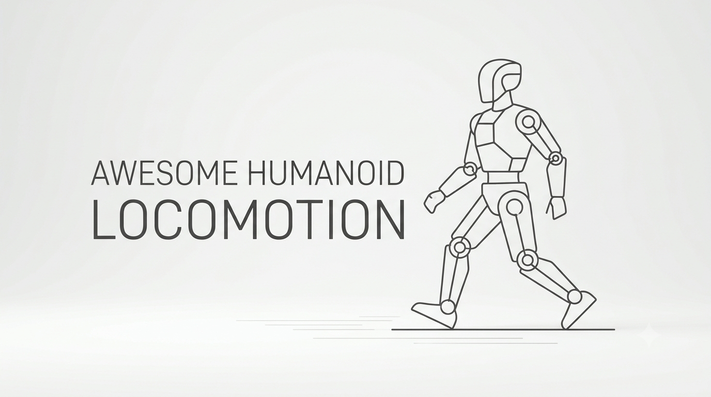

# Awesome Humanoid Locomotion · 人形机器人移动论文

[English](README.md) · [한국어](README.ko.md) · **中文**

按年份整理的 **272 篇**人形机器人及双足移动技术相关论文，每篇附有一句话概述，介绍核心方法与结果。

[2026](#2026) · [2025](#2025) · [2024](#2024) · [2023](#2023)

会议论文按会议举办年份、期刊论文按卷期年份归类；尚未确认发表场所的论文按公开年份归类。同一年内按公开月份从新到旧排列。

**范围分类：** **Core** = 行走、跑步、落足规划、地形穿越、平衡与恢复；**Enabling** = 动作跟踪与重定向、状态估计、数据集及学习/控制方法；**Related** = 导航、移动操作、非步行移动，以及在人形机器人移动任务上评估的通用机器人控制方法。分类依据论文的主要贡献，而非其全部实验。

已确认的会议与期刊条目仅标注名称和年份，研讨会（Workshop）论文单独标注。**—** 表示尚未确认发表场所（包括已投稿和审稿中的论文），并不代表未发表。书目信息截至：2026-11-11。

## 2026

| 论文 | 范围 | 会议·期刊 | 一句话概述 | 资源 |
| :--- | :--- | :--- | :--- | :--- |
| [**LHNav:** Long-Horizon Humanoid Navigation via Multirate Coordination and Physics-Grounded Action Data](https://arxiv.org/abs/2611.12136) | Related | — | 异步任务推理、局部动作生成与全身执行利用符合物理规律的示范，在长时程仿真任务中达到 75.56% 的成功率，并在实体 G1 上实现零样本多目标导航。 | [arXiv 2026.11](https://arxiv.org/abs/2611.12136) [项目](https://robbyant-research.github.io/LHNav/) |
| [**HINT-VLM:** Humanoid Interactive Navigation over Rough Terrain with Embodiment-Grounded Vision-Language Model](https://arxiv.org/abs/2611.11665) | Related | [CoRL 2026 Workshop (SISREN)](https://yzwfromk.github.io/HINT_VLM/) | 高斯过程模型利用机器人交互数据修正 VLM 对物体可移动性的预测，使实体 G1 能在崎岖地形上规划推开障碍物或绕行。 | [arXiv 2026.11](https://arxiv.org/abs/2611.11665) [项目](https://yzwfromk.github.io/HINT_VLM/) |
| [**Kimodo-Policy:** Learning Kinematic Action Models for Humanoid Loco-Manipulation](https://arxiv.org/abs/2611.11554) | Related | — | 冻结的文本生成动作模型结合视觉条件与根节点—躯体—手部分层控制，实现人形机器人移动操作，在 HumanoidArena 中成功率达 72.14%，在八项实体任务中达 60%。 | [arXiv 2026.11](https://arxiv.org/abs/2611.11554) [项目](https://kimodo-policy.github.io/) |
| [From Festival Video to the Stage: A Sim-to-Real Ladder for Long-Horizon Expressive Whole-Body Dance on a Commercial Humanoid](https://arxiv.org/abs/2611.11127) | Related | — | 通过单目视频动作恢复、重定向与 RL 跟踪，将阿波舞迁移至实体 G1，实现连续 9.7 分钟表演及向行走控制器的切换。 | [arXiv 2026.11](https://arxiv.org/abs/2611.11127) |
| [Large-Scale Hierarchical Decision-Making in Robot Control via ADMM](https://arxiv.org/abs/2611.11090) | Related | — | ADMM 求解器在中等精度下加速分层机器人控制，但 G1 踏石全身控制基准揭示了其在高精度求解要求下的劣势。 | [arXiv 2026.11](https://arxiv.org/abs/2611.11090) |
| [**RoboMoCap:** A Large-Scale Whole-Body Motion Capture Dataset with Egocentric Vision for Robot Learning](https://arxiv.org/abs/2611.10994) | Enabling | — | 采集 14 人超过 200 小时的同步第一视角视频与 120 Hz 全身动作捕捉数据，涵盖行走、地形穿越与移动操作，并提供足部接触和人形机器人动作重定向基准。 | [arXiv 2026.11](https://arxiv.org/abs/2611.10994) [项目](https://bitrobot-foundation.github.io/robomocap/) |
| [**DreamVLA:** From Generated Human Motions to Humanoid Vision-Language-Action Policies](https://arxiv.org/abs/2611.10872) | Related | [CoRL 2026 Workshops (G2A, Loco-Manipulation)](https://arxiv.org/abs/2611.10872) | 生成的人体动作指导仿真 RL，基于参考动作的 DAgger 在 VLA 失败后收集专家纠正轨迹，用于行走、拾取等全身交互任务。 | [arXiv 2026.11](https://arxiv.org/abs/2611.10872) [项目](https://ember-center-berkeley.github.io/DreamVLA/) |
| [Capturability-Aware Footstep Planning in Cluttered Environments: A Recursively Feasible Sequential MPC on Axis-Aligned Safe Corridors](https://arxiv.org/abs/2611.10169) | Core | [Humanoids 2026](https://arxiv.org/abs/2611.10169) | 序列线性倒立摆 MPC 将可捕获性约束与重叠矩形安全走廊结合，在杂乱环境仿真中维持 Digit 足步规划层的递归可行性。 | [arXiv 2026.11](https://arxiv.org/abs/2611.10169) |
| [A Unified Inertial Encoder for Human and Humanoid Motion](https://arxiv.org/abs/2611.10137) | Enabling | — | 合成 IMU 信号统一人体与人形机器人动作学习，无需真实机器人训练数据即可在实体 G1 上实现误差为 0.099 m/s 的零样本速度估计。 | [arXiv 2026.11](https://arxiv.org/abs/2611.10137) |
| [**DKWBC:** Decoupling Motion Tracking and Balancing for Humanoid Whole-Body Control](https://arxiv.org/abs/2611.09605) | Enabling | — | 逆动力学前馈与 PD 反馈负责动作跟踪，学习得到的残差力矩策略则在真实人形机器人执行不同动作、承载负载和进行物理交互时维持平衡。 | [arXiv 2026.11](https://arxiv.org/abs/2611.09605) [项目](https://robbyant-research.github.io/DKWBC/) |
| [**SUGARv2:** Learning Diverse Visual Humanoid Loco-Manipulation Skills from Synthesized Interaction References](https://arxiv.org/abs/2611.09266) | Related | — | 可复用任务模板合成机器人与物体交互的参考动作，结合模仿、视觉策略蒸馏与 RL 学习五项移动操作任务，仿真平均成功率达 91%，并迁移至真实世界。 | [arXiv 2026.11](https://arxiv.org/abs/2611.09266) [项目](https://tianshuwu.github.io/sugarv2-humanoid/) |
| [**STRIDE:** Learning Humanoid Locomotion in Minutes with Acceleration-Based Rewards](https://arxiv.org/abs/2611.08857) | Core | [CoRL 2026 Workshop (R2RL)](https://r2rl-workshop.github.io/) | 采用 IMU 可测量的指令加速度奖励、离策略 RL 与对称性增强，仅需相当于 14 分钟的样本即可在仿真 G1 和 Booster T1 上训练行走，无需机身速度估计。 | [arXiv 2026.11](https://arxiv.org/abs/2611.08857) |
| [**ForPC:** Force-Aware Whole-Body Control for Precise Humanoid Cart Pushing](https://arxiv.org/abs/2611.08664) | Related | — | 力感知残差全身策略仅使用机载观测，无需外部力传感器，经纯仿真训练后使实体 G1 以 0.5 m/s 推动载重最高 30 kg 的推车。 | [arXiv 2026.11](https://arxiv.org/abs/2611.08664) [项目](https://roboforpc.github.io/) |
| [**STEP:** Spatiotemporal Training with Explicit Prediction for Perceptive Humanoid Locomotion](https://arxiv.org/abs/2611.08097) | Core | — | 跨模态掩码预测与以动作为条件的下一状态预测联合训练感知运动策略，使 Noetix E1 在 100 次真实地形试验中成功 98 次。 | [arXiv 2026.11](https://arxiv.org/abs/2611.08097) |
| [Terrain-Indexed Motion Priors and Geometric Support for Extreme Humanoid Parkour](https://arxiv.org/abs/2611.08056) | Core | — | 三阶段模仿结合按地形索引的动作先验与手部、膝部支撑几何引导，使 Noetix E1 无需策略微调即可完成 30 次真实障碍试验中的 29 次。 | [arXiv 2026.11](https://arxiv.org/abs/2611.08056) |
| [**HITCH:** Teaching a Vision-Language Model to Operate a Humanoid through a Whole-Body Harness](https://arxiv.org/abs/2611.08039) | Related | — | 基于图像的 VLM 控制接口通过学习得到的跟踪器，将骨盆、躯干、手部、行走和视线指令转换为全身动作，使实体 G1 无需真实机器人训练数据即可将箱子搬至目标位置。 | [arXiv 2026.11](https://arxiv.org/abs/2611.08039) |
| [Perceptive Humanoid Motion from Simulation](https://arxiv.org/abs/2611.06908) | Core | — | 在 1,000 个仿真住宅中合成视觉—语言—动作数据，使具备感知能力的人形机器人系统在真实硬件上零样本执行行走、爬行及多技能任务。 | [arXiv 2026.11](https://arxiv.org/abs/2611.06908) [项目](https://apple-aiml-research.github.io/ml-halo/) |
| [Playing Soccer Like Humans Do: Learning Versatile and Agile Humanoid Soccer via Latent Motion Priors](https://arxiv.org/abs/2611.06564) | Related | [CoRL 2026](https://openreview.net/forum?id=XnyoJXimAK) | 从人类足球动作捕捉数据中学习动作先验，使分层 RL 策略融合移动、盘带、停球与踢球，并零样本迁移至 Unitree G1。 | [arXiv 2026.11](https://arxiv.org/abs/2611.06564) |
| [**H^2MARL:** Hierarchical Heterogeneous Multi-agent Reinforcement Learning for Humanoid Robot Control](https://arxiv.org/abs/2611.06523) | Core | — | 关节特定的物理描述与高层规划、底层执行的联合优化，提高了仿真中的运动稳定性和全身协调性。 | [arXiv 2026.11](https://arxiv.org/abs/2611.06523) |
| [**GRASP:** Gradient-Guided Sampling for Contact-Rich Physics-Based Motion Retargeting](https://arxiv.org/abs/2611.05754) | Enabling | — | 从历史仿真 rollout 中恢复梯度引导，无需可微仿真器即可实现接触感知动作重定向，并改善 PPO 对重定向动作的跟踪。 | [arXiv 2026.11](https://arxiv.org/abs/2611.05754) [项目](https://computationalrobotics.seas.harvard.edu/GRASP/) [代码](https://github.com/ComputationalRobotics/GRASP_code) |
| [**Ctrl-F:** Force as an Interface for Humanoid Loco-Manipulation](https://arxiv.org/abs/2611.05507) | Related | — | 显式接触力指令与在线力规划器增强人形机器人的动作跟踪，使 G1 能推、拖、踢动物体，并适应变化的负载。 | [arXiv 2026.11](https://arxiv.org/abs/2611.05507) [项目](https://forcectrl.github.io/) |
| [Online iLQR-MPC with Whole-Body Control for Robust Humanoid Locomotion](https://arxiv.org/abs/2611.04204) | Core | — | 单刚体 iLQR-MPC 以 100 Hz 联合优化足步与接触力及力矩，由 500 Hz 全身控制器执行计划，并在 G1 仿真中展示行走与抗推恢复。 | [arXiv 2026.11](https://arxiv.org/abs/2611.04204) |
| [**MAPO:** Mixture of Experts with Alternating Policy Optimization for Universal Humanoid Motion Tracking](https://arxiv.org/abs/2611.02613) | Enabling | [CoRL 2026](https://mapo-corl2026.github.io/MAPO/) | 交替优化 MoE 路由器与专家，避免策略散度估计失准，并提升通用动作跟踪性能。 | [arXiv 2026.11](https://arxiv.org/abs/2611.02613) [项目](https://mapo-corl2026.github.io/MAPO/) |
| [**FORGE:** Feasible Online Reduced-Order Reference Generation and Whole-Body Execution for Agile Humanoid Locomotion](https://arxiv.org/abs/2610.37974) | Core | [Humanoids 2026](https://arxiv.org/abs/2610.37974) | 降阶动力学模型在线生成全身参考动作，由独立策略在 G1 上跟踪，实现前进、后退、侧向移动与单腿跳跃。 | [arXiv 2026.10](https://arxiv.org/abs/2610.37974) |
| [**HC2Robot:** Hyper-Connection Transformers with Predicted Foresight for Multi-Terrain Humanoid Parkour](https://arxiv.org/abs/2610.36825) | Core | — | 基于机载感知，Transformer 接收各足着地时间、位置及支撑质量的预测，引导机器人上下楼梯和跨越间隙。 | [arXiv 2026.10](https://arxiv.org/abs/2610.36825) |
| [**REACH:** An RL-based Hierarchical Humanoid Crawling Framework for Adaptable Confined Space Traversal](https://arxiv.org/abs/2610.36546) | Core | [Humanoids 2026](https://aislab-sustech.github.io/REACH/) | G1 利用 LiDAR 预判头顶净空，并学习蹲姿行走与爬行之间的双向切换。 | [arXiv 2026.10](https://arxiv.org/abs/2610.36546) [项目](https://aislab-sustech.github.io/REACH/) |
| [**HumanoidNDM:** Closing the Training-Deployment Gap of Motion Tracking via Humanoid Neural Dynamics Model](https://arxiv.org/abs/2610.34126) | Enabling | [CoRL 2026](https://jaywu109.github.io/papers/corl-2026/) | 利用真实机器人数据训练的神经动力学模型，无需外部动作捕捉即可支持基于梯度的在线跟踪策略微调。 | [arXiv 2026.10](https://arxiv.org/abs/2610.34126) |
| [Active Reachability Learning for Humanoid Recoverability Monitoring](https://arxiv.org/abs/2610.33317) | Enabling | — | 主动采样可恢复状态的边界，降低将观测不足的状态误判为可恢复状态的风险。 | [arXiv 2026.10](https://arxiv.org/abs/2610.33317) |
| [Humanoid Mobility via Attention-based Contacts](https://arxiv.org/abs/2610.31608) | Core | — | 注意力模块预测身体下一次接触，独立控制器驱动机器人实现该接触，而非直接复制人体轨迹。 | [arXiv 2026.10](https://arxiv.org/abs/2610.31608) |
| [**MPBRS:** Multi-Potential-Based Reward Shaping for Unified Reward Configuration in Humanoid Locomotion](https://arxiv.org/abs/2610.30334) | Core | — | 基于多个势函数变化构建奖励，无需针对各机器人重新调整奖励权重即可迁移至九种人形机器人。 | [arXiv 2026.10](https://arxiv.org/abs/2610.30334) |
| [Do Earth-Trained Humanoid Controllers Walk on the Moon? Gravity, Terrain, and Soil Transfer](https://arxiv.org/abs/2610.30080) | Core | — | 仿真中，在粗糙颗粒地形上随机化重力进行训练，在地球与月球条件之间的迁移最稳定；仅在月球条件下训练的策略在地球条件下均跌倒。 | [arXiv 2026.10](https://arxiv.org/abs/2610.30080) |
| [Test-Time Motion Steering for Perceptive Humanoid Fall Recovery](https://arxiv.org/abs/2610.30061) | Core | — | 以视觉为条件的扩散规划器在测试时改变起身动作的方向、速度或路径，无需重新训练恢复策略。 | [arXiv 2026.10](https://arxiv.org/abs/2610.30061) [项目](https://osheraz.github.io/RISE/) |
| [Watch Your Step: Anticipated Perception for Humanoid Locomotion](https://arxiv.org/abs/2610.29612) | Core | — | 利用本体感知与速度指令预测下一落足点，使策略仅读取高度图中的相关局部区域，加快训练。 | [arXiv 2026.10](https://arxiv.org/abs/2610.29612) [项目](https://leggedrobotics.github.io/watch-your-step) |
| [**SuperMimic:** Scaling Humanoid Whole-Body Control with One Differentiable World Model](https://arxiv.org/abs/2610.28480) | Enabling | [CoRL 2026](https://supermimic.github.io/) | 单个可微世界模型提供想象 rollout 和解析梯度，以显著更少的计算资源将全身跟踪扩展到大规模动作库。 | [arXiv 2026.10](https://arxiv.org/abs/2610.28480) [项目](https://supermimic.github.io/) |
| [Validation of Human Motor Development Scales with Humanoid Robots](https://arxiv.org/abs/2610.25701) | Enabling | — | 将四种婴儿运动发育量表用作 RL 课程的测试表明，补回其中一种量表缺失的中间步骤后，机器人能够学会目标技能。 | [arXiv 2026.10](https://arxiv.org/abs/2610.25701) |
| [Push the Limit: Learning High-Speed Sprinting and Aggressive Cornering on a Full-Scale Humanoid](https://arxiv.org/abs/2610.14840) | Core | [CoRL 2026](https://arxiv.org/abs/2610.14840) | 对行进方向而非瞬时偏航角速度给予奖励，并为各技能设置独立动作判别器，使机器人能在冲刺中急转弯而不抑制自然的躯干运动。 | [arXiv 2026.10](https://arxiv.org/abs/2610.14840) |
| [**DAMP:** Humanoid Locomotion via Denoised Belief Learning and Adversarial Motion Priors](https://arxiv.org/abs/2610.11505) | Core | — | 循环网络从噪声观测中估计隐含运动状态，对抗动作先验则塑造实体机器人的步态风格。 | [arXiv 2026.10](https://arxiv.org/abs/2610.11505) |
| [**HuMBLE:** Human Motion-Driven Behavior Learning for Embodied Locomotion](https://arxiv.org/abs/2610.10489) | Core | — | 在人体动作上预训练后，联合微调动作模仿与任意指令跟踪，在保留步态风格的同时使 Atlas 和 G1 可受指令控制。 | [arXiv 2026.10](https://arxiv.org/abs/2610.10489) |
| [**QF3:** Fast Flow RL with Filtered Q-Gradients](https://arxiv.org/abs/2610.08789) | Enabling | — | 过滤后的 Q 梯度稳定了用于人形机器人移动与动作跟踪的离策略流模型 RL，并支持运动策略零样本迁移至硬件。 | [arXiv 2026.10](https://arxiv.org/abs/2610.08789) [项目](https://qf3-rl.github.io/) |
| [**RISE:** Learning Humanoid Loco-Manipulation with Responsibility-Induced Specialized Experts for Vision-Language-Action Models](https://rllab-snu.github.io/projects/RISE/) | Related | [IROS 2026](https://rllab-snu.github.io/projects/RISE/) | 按责任加权的 VLA 混合专家从独立示范中学习移动与操作，并将二者连接成长时程任务。 | [项目](https://rllab-snu.github.io/projects/RISE/) |
| [Reactive Humanoid Multi-Contact Using Learned Stability Models](https://arxiv.org/abs/2610.00823) | Core | — | 预测冲击后的可行压力中心区域，使机器人受推后能快速选择手部支撑点和落足位置。 | [arXiv 2026.10](https://arxiv.org/abs/2610.00823) |
| [Passive-Dynamic-Walking-Inspired Dynamics Guidance for Energy-Efficient Humanoid Locomotion](https://arxiv.org/abs/2609.35935) | Core | — | 训练早期通过倾斜重力鼓励平地上的被动前向行走，随后移除辅助，在正常重力下优化能耗。 | [arXiv 2026.09](https://arxiv.org/abs/2609.35935) |
| [Model-Informed Safe Reinforcement Learning for Bipedal Locomotion via Step-to-Step Prediction](https://arxiv.org/abs/2609.34486) | Core | [IROS 2026](https://arxiv.org/abs/2609.34486) | 降阶行走模型预测下一步的安全性，同时指导训练奖励与部署时的落足位置过滤器。 | [arXiv 2026.09](https://arxiv.org/abs/2609.34486) |
| [Generate, Track, Improve: Perceptive Multi-Skill Humanoid Locomotion with RL-Fine-Tuned Motion Generators](https://arxiv.org/abs/2609.31577) | Core | — | 生成器提出以地形为条件的参考动作，依据跟踪器实际执行结果进行离策略微调，改善新障碍物上的动作选择。 | [arXiv 2026.09](https://arxiv.org/abs/2609.31577) [项目](https://zolkin1.github.io/generate-track-improve/) |
| [Echo in the Steps: Learning Perceptive Humanoid Parkour with Gated Memory](https://arxiv.org/abs/2609.28960) | Core | [CoRL 2026](https://echo-in-the-steps.github.io/) | 门控记忆保留与落足相关的深度特征，使机器人能利用已离开相机视野的支撑面。 | [arXiv 2026.09](https://arxiv.org/abs/2609.28960) |
| [**TactileStep:** Sole Tactile Learning for Regulating Foot-Terrain Interaction in Humanoid Locomotion](https://arxiv.org/abs/2609.28959) | Core | [CoRL 2026](https://tactilestep.github.io/) | 对齐仿真与鞋垫压力特征，并分别奖励触地和支撑阶段，相比对照策略将 G1 的着地峰值冲击最多降低 48.8%。 | [arXiv 2026.09](https://arxiv.org/abs/2609.28959) |
| [Learning Expressive Humanoid Locomotion from Monocular Runway Videos for Robot Fashion Shows](https://arxiv.org/abs/2609.27003) | Core | [IROS 2026](https://arxiv.org/abs/2609.27003) | 从单目时装秀视频重建人体走秀步态，适配 Booster K1 的身体比例并在机器人上复现。 | [arXiv 2026.09](https://arxiv.org/abs/2609.27003) |
| [Humanoid Locomotion with a Fly-Inspired Recurrent Controller](https://arxiv.org/abs/2609.27001) | Core | — | 在采用果蝇启发控制器的 G1 仿真中，改变深度输入不会改变动作，但重置运动回路记忆后，参考方向上的成功次数从 19/21 降至 0/21。 | [arXiv 2026.09](https://arxiv.org/abs/2609.27001) |
| [Smoothness as a Constraint for Stable Humanoid Locomotion](https://arxiv.org/abs/2609.24552) | Core | — | 以上、下肢各自的运动限制取代单一平滑性奖励，并在运动接近各自限制时开始施加惩罚。 | [arXiv 2026.09](https://arxiv.org/abs/2609.24552) |
| [**UniPoint:** Unified Point-Level Sensor Fusion for Humanoid Locomotion Across Challenging Terrains](https://arxiv.org/abs/2609.23666) | Enabling | — | 将 360 度 LiDAR 与两个深度相机的回波融合为单一点云，再压缩为固定数量的 token，用于全身控制。 | [arXiv 2026.09](https://arxiv.org/abs/2609.23666) |
| [**FootQuery:** Future-Touchdown-Guided Retrieval from Depth History for Perceptive Humanoid Locomotion](https://arxiv.org/abs/2609.21447) | Enabling | — | 预测着地位置及其不确定性，引导检索历史深度图像，从而识别当前已不可见的落足点。 | [arXiv 2026.09](https://arxiv.org/abs/2609.21447) |
| [Learning Scene-Aware Humanoid Locomotion through 3D Clutter from Immersive Human Demonstrations](https://arxiv.org/abs/2609.21107) | Core | — | 将虚拟现实中采集的全身示范重定向至 G1，同时保留身体与周围障碍物之间的安全间隙。 | [arXiv 2026.09](https://arxiv.org/abs/2609.21107) |
| [Learning Slope-Adaptive Whole-Body Locomotion for Humanoid Robots in Roofing Construction](https://arxiv.org/abs/2609.20558) | Core | — | 通过修正足部支撑与任务位置，将斜屋顶上采集的人体示范适配到屋顶模型，使坡度变化时仍能保持工作姿态。 | [arXiv 2026.09](https://arxiv.org/abs/2609.20558) |
| [**PASSAGE:** Scaling Scene-Aligned Motion Learning for Perceptive Humanoid Traversal in Cluttered Environments](https://arxiv.org/abs/2609.18732) | Core | — | 规划器与跟踪器从与场景对齐的动作中学习，仅优化规划器即可让机器人串联越障技能，无需显式技能标签。 | [arXiv 2026.09](https://arxiv.org/abs/2609.18732) |
| [**ResSafe:** Learning Safety Filtering with Residual Reinforcement Learning for Humanoids](https://arxiv.org/abs/2609.15988) | Enabling | [CoRL 2026](https://sciautonomy.github.io/ResSafe_Web/) | 残差 RL 安全过滤器修正现有动作控制策略的输出，减少扰动下的不稳定和跌倒。 | [arXiv 2026.09](https://arxiv.org/abs/2609.15988) [项目](https://sciautonomy.github.io/ResSafe_Web/) |
| [Flow-Matched Motion Priors: Online Optimal-Transport Rewards for Imitation Learning](https://arxiv.org/abs/2609.15631) | Enabling | — | 流匹配与最优传输从 rollout 到专家轨迹的路径中学习动作先验奖励，改善 Unitree G1 前向行走训练，相比 AMP 基线取得提升。 | [arXiv 2026.09](https://arxiv.org/abs/2609.15631) |
| [**EMoG:** Emotion-Modulated Gait Generation for Expressive Humanoid Locomotion](https://arxiv.org/abs/2609.14432) | Core | — | 以情绪和行进指令为条件的周期动作生成器从演员步态中学习，再由单个策略跟踪生成的动作。 | [arXiv 2026.09](https://arxiv.org/abs/2609.14432) |
| [**DWMP:** Leveraging Dual World Models for Humanoid Obstacle Traversal](https://arxiv.org/abs/2609.12347) | Core | — | Koopman 模型编码本体感知动力学，概率视觉世界模型从深度信息编码障碍物几何，二者的预测共同指导动作。 | [arXiv 2026.09](https://arxiv.org/abs/2609.12347) |
| [**CAP:** Continuously Adaptive Perception-Blind Humanoid Locomotion via Learned Denoising](https://arxiv.org/abs/2609.11553) | Core | [CoRL 2026](https://arxiv.org/abs/2609.11553) | 深度去噪编码器与本体感知编码器联合训练，适应视觉质量逐渐下降，无需在视觉策略与盲走策略之间进行二元切换。 | [arXiv 2026.09](https://arxiv.org/abs/2609.11553) |
| [**GM-Loco:** Terrain-Adaptive Humanoid Locomotion on Granular Media](https://arxiv.org/abs/2609.10286) | Core | — | 三维阻力模型仿真足部在颗粒介质中的下陷，使机器人能够在类似沙地的地形上训练，而不限于刚性地面。 | [arXiv 2026.09](https://arxiv.org/abs/2609.10286) [项目](https://humanoid-gm-locomotion.github.io/HUMANOID-GM/) |
| [**SwingBot:** Learning Whole-Body Brachiation for Humanoid Robots](https://arxiv.org/abs/2609.10283) | Related | [CoRL 2026](https://arxiv.org/abs/2609.10283) | 仿生关键帧引导松开、摆荡与重新挂接的探索，使带被动腕钩的人形机器人能够连续穿越多根横杆。 | [arXiv 2026.09](https://arxiv.org/abs/2609.10283) |
| [**TANGO:** Humanoid Navigation in Cluttered Environments with a Whole-Body Vision-Language-Action Model](https://arxiv.org/abs/2609.09158) | Core | [CoRL 2026](https://tango-vla.github.io/) | 以语言为条件的全身 VLA 从仿真规划与 RL 跟踪中学习无碰撞穿越，并零样本迁移至 G1。 | [arXiv 2026.09](https://arxiv.org/abs/2609.09158) [项目](https://tango-vla.github.io/) |
| [**RoboDreamer:** Anticipatory Humanoid Locomotion with Predictive State-Space Models](https://arxiv.org/abs/2609.07096) | Enabling | [CoRL 2026](https://jaywu109.github.io/papers/corl-2026/) | 掩码观测训练与蒸馏使 Mamba 预测模型即使在部分观测缺失时，也能跟踪全身动作。 | [arXiv 2026.09](https://arxiv.org/abs/2609.07096) |
| [World-Model-Augmented Visual Locomotion for Humanoids on Foothold-Constrained Terrain](https://arxiv.org/abs/2609.02542) | Core | — | 与 PPO 联合训练的世界模型根据单张深度图和本体感知预测近期观测与奖励，无需落足点标签即可实现地形穿越。 | [arXiv 2026.09](https://arxiv.org/abs/2609.02542) |
| [Humanoid Safe Stop via Learned Stoppability Value](https://arxiv.org/abs/2609.02358) | Enabling | — | 系统分别估计停止策略的成功概率与物理可恢复性，仅在两项检查均通过时执行停止，否则采用阻尼控制。 | [arXiv 2026.09](https://arxiv.org/abs/2609.02358) |
| [Learning Agile Perceptive Traversal of Sparse 3D Structures for Humanoids](https://arxiv.org/abs/2608.29769) | Related | — | 将跳跃、悬挂与着陆专家蒸馏为单个策略，利用 LiDAR 和被动挂钩穿越稀疏三维结构。 | [arXiv 2026.08](https://arxiv.org/abs/2608.29769) |
| [Stay Seated: Learning Omnidirectional Humanoid Locomotion on a Passive Mobile Chair with Casters](https://arxiv.org/abs/2608.28090) | Related | — | 坐姿人形机器人仅利用身体状态与速度指令即可向任意方向驱动被动脚轮椅，无需椅子状态或接触传感器。 | [arXiv 2026.08](https://arxiv.org/abs/2608.28090) |
| [**SOLO:** Stable Omni-terrain Long-Horizon Perceptive Humanoid Locomotion](https://arxiv.org/abs/2608.26583) | Core | [CoRL 2026](https://jiahao-ma.github.io/) | 学生从深度信息重建高度图的各个栅格，并利用预测的未来师生差异学习；机器人展示了连续 1.5 km 的户外行走。 | [arXiv 2026.08](https://arxiv.org/abs/2608.26583) [项目](https://sunpihai-up.github.io/solo/) |
| [Demonstration-Guided Humanoid Stand-Up on an Emulated Deformable Surface](https://arxiv.org/abs/2608.20852) | Core | — | 让基于示范训练的起身策略逐步接触更软的地面，使机器人即使陷入支撑面也能恢复。 | [arXiv 2026.08](https://arxiv.org/abs/2608.20852) |
| [Natural Sit-to-Stand Motion Synthesis For Humanoids via Guided Assistance Curricula and Staged Rewards](https://arxiv.org/abs/2608.20823) | Core | — | 在改变座椅高度的同时逐步移除骨盆向上的辅助力，使机器人学会利用动量与压力中心转移来起立。 | [arXiv 2026.08](https://arxiv.org/abs/2608.20823) |
| [**MILD:** Tractable Terrain Modeling for Learning Improved Bipedal Locomotion on Deformable Surfaces](https://doi.org/10.1109/LRA.2025.3645520) | Core | [IEEE RA-L 2026](https://doi.org/10.1109/LRA.2025.3645520) | 离散元接触模型仿真空间变化的地面形变，策略从身体响应推断地形，从而适应真实软地面。 | [arXiv 2026.08](https://arxiv.org/abs/2608.19955) |
| [**Tac4Loco:** Learning Spatiotemporal Plantar Pressure Representations for Humanoid Locomotion](https://arxiv.org/abs/2608.15766) | Enabling | — | 保留足底压力的空间分布与时间历史，而非将其简化为单个合力，使策略了解足部哪个区域受到支撑。 | [arXiv 2026.08](https://arxiv.org/abs/2608.15766) |
| [Whole-Body Planning for Humanoids Navigating Confined Spaces via Self-Collision Avoidance References](https://arxiv.org/abs/2608.10220) | Enabling | — | 身体各部位的可达性与可微碰撞约束生成狭窄空间中的路径，为全身轨迹优化提供初值。 | [arXiv 2026.08](https://arxiv.org/abs/2608.10220) |
| [**Light-Loco-Parkour:** Versatile Perceptive Whole-Body Locomotion via Multi-Skill Distillation](https://arxiv.org/abs/2608.02653) | Core | — | 将少量示范扩展到不同障碍物几何，并蒸馏为单个策略，依据深度信息和速度指令在行走与跑酷之间切换。 | [arXiv 2026.08](https://arxiv.org/abs/2608.02653) [项目](https://light-loco-parkour.github.io/) |
| [**P3:** Probabilistic Policy Propagation for Stable VAE-Based Robot Learning](https://arxiv.org/abs/2607.25541) | Enabling | — | 矩传播与基于采样的校正降低了基于 VAE 的 PPO 更新中的偏差和方差，并在人形机器人跑酷任务中验证。 | [arXiv 2026.07](https://arxiv.org/abs/2607.25541) [代码](https://github.com/ylyem9x/P3_Open) |
| [Learning Reusable Hybrid Motion Priors for Humanoid Locomotion from Motion Imitation](https://arxiv.org/abs/2607.24083) | Enabling | — | 将人体动作专家蒸馏为冻结的离散码本和解码器，使新任务能够选择有用的动作编码，而无需重新学习动作。 | [arXiv 2026.07](https://arxiv.org/abs/2607.24083) |
| [Koopman DCM: Unstable Eigenfunctions as Data-driven Representations for Legged Balancing](https://arxiv.org/abs/2607.18760) | Enabling | — | 从实体双足机器人数据学习的不稳定 Koopman 特征函数识别平衡发散方向，并引导步态模式跟踪。 | [arXiv 2026.07](https://arxiv.org/abs/2607.18760) |
| [**GaitSpan:** Growing Humanoid Locomotion from Walking to Running](https://arxiv.org/abs/2607.12114) | Core | — | 通过改变冻结行走策略内部的节律与步幅，并仅学习剩余跟踪误差，将其扩展为跑步策略。 | [arXiv 2026.07](https://arxiv.org/abs/2607.12114) [项目](https://gaitspan2026.github.io/) |
| [Physics-Guided Biomechanical Gait Adaptation for Humanoid Locomotion on Extreme Sloped Terrains](https://arxiv.org/abs/2607.07830) | Core | [CoRL 2026](https://www.linkedin.com/posts/addison-lin-wang-62542b222_corl26-bioinspired-mechanical-activity-7507799470663974912-zQeE) | 相对于坡面的零力矩点指导平衡，训练鼓励上坡时髋部推进、下坡时膝部制动，执行时仅需本体感知。 | [arXiv 2026.07](https://arxiv.org/abs/2607.07830) |
| [**ADP:** Adversarial Dynamics Priors for Physically Grounded Humanoid Locomotion](https://arxiv.org/abs/2607.03454) | Enabling | — | 模仿判别器学习区分轨迹优化产生的动力学特征，而非姿态外观，从而鼓励具有良好物理特性的步态。 | [arXiv 2026.07](https://arxiv.org/abs/2607.03454) |
| [Reinforcement Learning-Based Control for an Inline Skating Humanoid Robot](https://arxiv.org/abs/2606.31807) | Related | [IROS 2026](https://arxiv.org/abs/2606.31807) | Booster T1 无需人体示范，通过控制轮滑鞋的落点与倾角，学会穿普通直排轮滑鞋推进和转向。 | [arXiv 2026.06](https://arxiv.org/abs/2606.31807) |
| [**FastDSAC:** Enhancing Policy Plasticity via Constrained Exploration for Scalable Humanoid Locomotion](https://arxiv.org/abs/2606.31691) | Enabling | [IROS 2026](https://2026.ieee-iros.org/program/paper_index/) | 截断高斯探索限制大规模并行离策略 RL 中的极端动作，减少频繁更新对价值估计及策略持续学习能力的损害。 | [arXiv 2026.06](https://arxiv.org/abs/2606.31691) [代码](https://github.com/luge66/FastDSAC) |
| [**ReactiveBFM:** Reactive Closed-Loop Motion Planning Towards Universal Humanoid Whole-Body Control](https://arxiv.org/abs/2606.30362) | Enabling | [CoRL 2026](https://xiao-chen.tech/reactivebfm/) | 生成式动作规划器与跟踪控制器闭环重规划，学习纠正偏差，避免开环误差累积。 | [arXiv 2026.06](https://arxiv.org/abs/2606.30362) [项目](https://xiao-chen.tech/reactivebfm/) |
| [Booster Lab: A Data-Centric Pipeline for Learning Deployable Humanoid Locomotion Policies](https://arxiv.org/abs/2606.27813) | Enabling | — | 为 Booster T1 建立串联动作数据选择、基于实测的仿真器校准、对抗动作先验训练与硬件部署的流程。 | [arXiv 2026.06](https://arxiv.org/abs/2606.27813) |
| [**WOLF-VLA:** Whole-Body Humanoid Optimal Locomotion Framework for Vision-Language-Action Learning](https://arxiv.org/abs/2606.25591) | Core | [IROS 2026](https://www.dfki.de/en/web/research/projects-and-publications/publication/17788) | 最优控制轨迹为以语言指令驱动全身移动的视觉—语言—动作模型提供物理可行的示范。 | [arXiv 2026.06](https://arxiv.org/abs/2606.25591) |
| [Vision-Assisted Bipedal Locomotion on Challenging Terrains via Terrain-Related Adversarial Motion Priors](https://doi.org/10.1109/LRA.2026.3707326) | Core | [IEEE RA-L 2026](https://doi.org/10.1109/LRA.2026.3707326) | 单阶段深度与本体感知 RL 将地形感知混合专家控制与对抗步态先验结合，用于斜坡、楼梯和间隙。 | [IEEE 2026.06](https://doi.org/10.1109/LRA.2026.3707326) |
| [**TACT-ful:** Multi-Channel Terrain Affordance and Compliance Training for Payload-Robust Perceptive Humanoid Locomotion](https://arxiv.org/abs/2606.20645) | Core | — | 平整度、坡度与可达高度指导落足点选择，仿真负载力及力矩则训练机器人在负重时保持柔顺。 | [arXiv 2026.06](https://arxiv.org/abs/2606.20645) [项目](https://fai-rl-tech.github.io/tact-locomotion.github.io/) |
| [Comparative Study on Agility, Efficiency, and Impact Absorption of Bipedal Robots with Active Toes](https://arxiv.org/abs/2606.19699) | Core | — | 在相同 RL 训练条件下，主动脚趾在 1.33 m/s 的仿真中将运输成本降低 17.5%，足跟着地地面反作用力降低 5.0%。 | [arXiv 2026.06](https://arxiv.org/abs/2606.19699) |
| [**ADAPT:** Analytical Disturbance-Aware Policy Training for Humanoid Locomotion](https://arxiv.org/abs/2606.16542) | Core | [CoRL 2026](https://blyu413.github.io/adapt-locomotion/) | 全身动力学观测器无需力传感器即可估计外力与力矩，帮助 G1 应对躯干推力或单手负载。 | [arXiv 2026.06](https://arxiv.org/abs/2606.16542) |
| [**GuideWalk:** Learning Unified Autonomous Navigation and Locomotion for Humanoid Robots across Versatile Terrains](https://arxiv.org/abs/2606.10449) | Core | — | 将导航速度指令与地形穿越教师的动作蒸馏为单个策略，统一面向目标的避障与落足控制。 | [arXiv 2026.06](https://arxiv.org/abs/2606.10449) [项目](https://guide-walk.github.io/GuideWalk) |
| [**MARCH:** Model-Assisted Reinforcement Learning for the Perceptive Control of Humanoids over Sparse Footholds](https://arxiv.org/abs/2606.10288) | Core | [CoRL 2026](https://openreview.net/forum?id=IY6ti85pg0) | 降阶模型为采用控制李雅普诺夫函数奖励训练的教师提供安全轨迹，蒸馏后的视觉策略能够穿越稀疏踏石。 | [arXiv 2026.06](https://arxiv.org/abs/2606.10288) |
| [**UniReLo:** Learning a Unified Humanoid Policy from Fall Recovery to Locomotion across Diverse Terrains](https://arxiv.org/abs/2606.08922) | Core | — | 根据起身进展持续调整模仿信号并评估可用支撑，使机器人在不同表面跌倒后恢复行走。 | [arXiv 2026.06](https://arxiv.org/abs/2606.08922) [项目](https://vsislab.github.io/UniReLo/) |
| [Mind Your Steps: A General Learning Framework for Accurate Humanoid Foothold Tracking](https://roboticsproceedings.org/rss22/p028.html) | Core | [RSS 2026](https://roboticsproceedings.org/rss22/p028.html) | 策略跟踪足部三维位姿指令，而非机身速度，使高层规划器能够精确指定落足位置。 | [arXiv 2026.06](https://arxiv.org/abs/2606.08253) |
| [Predictive Style Matching: Natural and Robust Humanoid Locomotion](https://arxiv.org/abs/2606.07083) | Core | — | 根据近期下肢动作与速度预测风格目标，而非规定按时间索引的人体姿态，避免妨碍扰动后的恢复。 | [arXiv 2026.06](https://arxiv.org/abs/2606.07083) |
| [**T-GMP:** Terrain-conditioned Generative Motion Priors for Versatile and Natural Humanoid Locomotion](https://arxiv.org/abs/2606.06944) | Core | — | 以地形为条件的判别器调整期望动作风格，独立惩罚项抑制不安全落足，从而结合自然步态与落足点选择。 | [arXiv 2026.06](https://arxiv.org/abs/2606.06944) |
| [**TAGA:** Terrain-aware Active Gaze Learning for Generalizable Agile Humanoid Locomotion](https://arxiv.org/abs/2606.05880) | Core | — | RL 联合学习视线方向与移动控制，无需视线标签即可将机器人视野引向落足点和间隙。 | [arXiv 2026.06](https://arxiv.org/abs/2606.05880) |
| [**LadderMan:** Learning Humanoid Perceptive Ladder Climbing](https://arxiv.org/abs/2606.05873) | Core | [CoRL 2026](https://ladderman-submission.github.io/) | 将基于跟踪的攀爬专家蒸馏为深度驱动的 RL 策略，并迁移至不同的实体梯子。 | [arXiv 2026.06](https://arxiv.org/abs/2606.05873) [项目](https://ladderman-submission.github.io/) |
| [**CoRe-MoE:** Contrastive Reweighted Mixture of Experts for Multi-Terrain Humanoid Locomotion with Gait Adaptation](https://arxiv.org/abs/2606.04718) | Core | — | 对比学习选择地形特定专家并分配权重，将其输出用于增强共享行走策略。 | [arXiv 2026.06](https://arxiv.org/abs/2606.04718) |
| [Global-Local Attention Decomposition for Terrain Encoding in Humanoid Perceptive Locomotion](https://doi.org/10.1109/LRA.2026.3743710) | Enabling | [IEEE RA-L 2026](https://doi.org/10.1109/LRA.2026.3743710) | 独立注意力路径分别编码整体地形形状与下一落足点附近的精细几何，保留高度图中小型支撑面的细节。 | [arXiv 2026.06](https://arxiv.org/abs/2606.00637) |
| [**SSR:** Scaling Surefooted and Symmetric Humanoid Traversal to the Open World](https://arxiv.org/abs/2605.30770) | Core | [CoRL 2026](https://nosb-robotics.com/en/work.html) | 在着地前评估摆动足的潜在接触面积，并训练左右对称性，减少地形边缘的打滑。 | [arXiv 2026.05](https://arxiv.org/abs/2605.30770) |
| [**SPRINT:** Efficient Spectral Priors for Humanoid Athletic Sprints](https://arxiv.org/abs/2605.28549) | Core | — | 从五段人体动作的频域结构生成比示范更快的参考动作，使实体 G1 冲刺速度最高达到 6 m/s。 | [arXiv 2026.05](https://arxiv.org/abs/2605.28549) [项目](https://anonymous.4open.science/w/SPRINT-138A/) |
| [**ParkourFormer:** Integrating Predictive Supervision and Sequence Modeling into Parkour Locomotion](https://arxiv.org/abs/2605.25782) | Core | — | 训练 Transformer 预测短期状态变化，使其在选择跑酷动作时预判接触切换。 | [arXiv 2026.05](https://arxiv.org/abs/2605.25782) [项目](https://mronaldo-gif.github.io/parkourformer.github.io/) |
| [**MuGen:** Multi-Skill Generative Locomotion Controller for Humanoid Robots](https://arxiv.org/abs/2605.24592) | Enabling | — | 利用 VQ-VAE 将人体动作离散化，并蒸馏为执行策略，以跟踪未见动作，并将动作编码复用于其他任务。 | [arXiv 2026.05](https://arxiv.org/abs/2605.24592) |
| [Unified Walking, Running, and Recovery for Humanoids via State-Dependent Adversarial Motion Priors](https://arxiv.org/abs/2605.18611) | Core | — | 身体大幅倾斜时使用恢复判别器，其余情况使用与速度对应的步态判别器，仅凭三段示范学习行走、跑步与恢复。 | [arXiv 2026.05](https://arxiv.org/abs/2605.18611) |
| [Terrain Consistent Reference-Guided RL for Humanoid Navigation Autonomy](https://arxiv.org/abs/2605.15517) | Core | — | 训练中将参考足步移至可行支撑面，并调整摆动足和质心轨迹，使机器人能根据平面导航指令穿越崎岖地形。 | [arXiv 2026.05](https://arxiv.org/abs/2605.15517) |
| [Explicit Stair Geometry Conditioning for Robust Humanoid Locomotion](https://arxiv.org/abs/2605.09944) | Core | — | 直接将台阶高度、踏面深度和接近角度作为策略条件，使其无需高维地形编码即可调整步幅与抬脚高度。 | [arXiv 2026.05](https://arxiv.org/abs/2605.09944) |
| [Stability of Control Lyapunov Function Guided Reinforcement Learning](https://arxiv.org/abs/2605.01978) | Enabling | [CDC 2026](https://www.zacholkin.com/research/stability_of_clf_rl/) | 将采用控制李雅普诺夫函数奖励的 RL 视为最优控制，在给定假设下证明最优控制器在连续和离散时间中的指数稳定性。 | [arXiv 2026.05](https://arxiv.org/abs/2605.01978) |
| [**QuietWalk:** Physics-Informed Reinforcement Learning for Ground Reaction Force-Aware Humanoid Locomotion Under Diverse Footwear](https://arxiv.org/abs/2604.23702) | Core | — | 受逆动力学约束的网络估计各足竖直地面反作用力，用于 RL 冲击惩罚，使机器人无需力传感器也能在不同鞋履下柔和行走。 | [arXiv 2026.04](https://arxiv.org/abs/2604.23702) |
| [**RecoverFormer:** End-to-End Contact-Aware Recovery for Humanoid Robots](https://arxiv.org/abs/2604.22911) | Core | — | 利用观测历史同时预测恢复策略及墙面、扶手等附近表面，使仿真 G1 能借助这些支撑恢复平衡。 | [arXiv 2026.04](https://arxiv.org/abs/2604.22911) |
| [Reinforcement Learning Enabled Adaptive Multi-Task Control for Bipedal Soccer Robots](https://arxiv.org/abs/2604.19104) | Related | — | 振荡器提供基础步态，RL 调整足球动作，并根据机器人姿态决定启动寻球、踢球或跌倒恢复。 | [arXiv 2026.04](https://arxiv.org/abs/2604.19104) |
| [Multi-Gait Learning for Humanoid Robots Using Reinforcement Learning with Selective Adversarial Motion Prior](https://arxiv.org/abs/2604.19102) | Core | — | 对抗动作先验约束行走、爬楼梯等需要周期性的技能，同时为跑步与跳跃保留更自由的动作探索空间。 | [arXiv 2026.04](https://arxiv.org/abs/2604.19102) |
| [Learning Whole-Body Humanoid Locomotion via Motion Generation and Motion Tracking](https://arxiv.org/abs/2604.17335) | Core | [IEEE RA-L 2026](https://doi.org/10.1109/LRA.2026.3710365) | 扩散模型生成以地形为条件的全身参考动作，固定生成器并仅微调 RL 跟踪器，使其能够应对不完美的参考动作。 | [arXiv 2026.04](https://arxiv.org/abs/2604.17335) |
| [Model-Based Reinforcement Learning Exploits Passive Body Dynamics for High-Performance Biped Robot Locomotion](https://arxiv.org/abs/2604.14565) | Core | — | 在带被动部件的双足机器人上开展基于模型的 RL，揭示身体与地面交互产生的稳定周期如何提升鲁棒性与能效。 | [arXiv 2026.04](https://arxiv.org/abs/2604.14565) |
| [**DreamControl-v2:** Simpler and Scalable Autonomous Humanoid Skills via Trainable Guided Diffusion Priors](https://arxiv.org/abs/2604.00202) | Related | [IROS 2026](https://sudarshan-s-harithas.github.io/) | 可训练的引导扩散动作先验引导 RL 学习可行的自主全身技能，用于接触密集的移动操作。 | [arXiv 2026.04](https://arxiv.org/abs/2604.00202) |
| [**CReF:** Cross-modal and Recurrent Fusion for Depth-conditioned Humanoid Locomotion](https://arxiv.org/abs/2603.29452) | Core | [IEEE RA-L 2026](https://www.ieee-ras.org/news/cref-cross-modal-and-recurrent-fusion-for-depth-conditioned-humanoid-locomotion/) | 循环网络融合前向深度图与身体状态，直接学习行走动作，无需中间高度图或教师—学生阶段。 | [arXiv 2026.03](https://arxiv.org/abs/2603.29452) |
| [Cost-Matching Model Predictive Control for Efficient Reinforcement Learning in Humanoid Locomotion](https://arxiv.org/abs/2603.28243) | Enabling | — | 将 MPC 预测成本与存储的行走轨迹中的观测回报匹配，学习控制器参数，无需在每个训练步骤重新求解 MPC。 | [arXiv 2026.03](https://arxiv.org/abs/2603.28243) |
| [Chasing Autonomy: Dynamic Retargeting and Control Guided RL for Performant and Controllable Humanoid Running](https://arxiv.org/abs/2603.25902) | Core | [IROS 2026](https://2026.ieee-iros.org/program/paper_index/) | 在动力学约束下将一段人体跑步示范重定向为多条周期轨迹，并结合以指令速度为条件的控制奖励。 | [arXiv 2026.03](https://arxiv.org/abs/2603.25902) |
| [**PCHC:** Enabling Preference Conditioned Humanoid Control via Multi-Objective Reinforcement Learning](https://arxiv.org/abs/2603.24047) | Related | — | 将目标权重作为策略输入，使单个控制器在偏好变化时无需重新训练即可产生不同的行为。 | [arXiv 2026.03](https://arxiv.org/abs/2603.24047) |
| [Learning Safe-Stoppability Monitors for Humanoid Robots](https://arxiv.org/abs/2603.22703) | Enabling | [IROS 2026](https://2026.ieee-iros.org/program/paper_index/) | 监测器预测特定停止策略能否从当前状态安全停止，并将采样集中于成功与失败边界附近的罕见情况。 | [arXiv 2026.03](https://arxiv.org/abs/2603.22703) |
| [Evaluating Factor-Wise Auxiliary Dynamics Supervision for Latent Structure and Robustness in Simulated Humanoid Locomotion](https://arxiv.org/abs/2603.21268) | Enabling | — | 仿真中，分别监督五个动力学因素并未证实学得的潜在表示能够分离这些因素，或可靠地恢复它们。 | [arXiv 2026.03](https://arxiv.org/abs/2603.21268) |
| [**AGILE:** A Comprehensive Workflow for Humanoid Loco-Manipulation Learning](https://arxiv.org/abs/2603.20147) | Related | [IROS 2026](https://robotics.gatech.edu/gt-iros-2026) | 可复现流程连接移动与全身技能学习、评估和部署，并包含真实人形机器人测试。 | [arXiv 2026.03](https://arxiv.org/abs/2603.20147) |
| [**PRIOR:** Perceptive Learning for Humanoid Locomotion with Reference Gait Priors](https://arxiv.org/abs/2603.18979) | Core | — | 动作捕捉步态生成器、基于深度的循环地形估计器与落足点奖励相结合，无需对抗训练即可实现崎岖地形行走。 | [arXiv 2026.03](https://arxiv.org/abs/2603.18979) [项目](https://prior-iros2026.github.io/) |
| [**ADAPT:** Adaptive Dual-projection Architecture for Perceptive Traversal](https://arxiv.org/abs/2603.16328) | Enabling | — | 水平高度图与竖直距离图描述地形，策略学会在高速时看得更远，在杂乱环境中关注更靠近身体的区域。 | [arXiv 2026.03](https://arxiv.org/abs/2603.16328) |
| [Task-Specified Compliance Bounds for Humanoids via Lipschitz-Constrained Policies](https://arxiv.org/abs/2603.16180) | Related | — | 将任务空间不同方向的刚度上下界映射为策略雅可比约束，使机器人对不同方向的力表现出不同的柔顺性。 | [arXiv 2026.03](https://arxiv.org/abs/2603.16180) |
| [Load-Aware Locomotion Control for Humanoid Robots in Industrial Transportation Tasks](https://arxiv.org/abs/2603.14308) | Core | — | 机器人从状态历史估计上肢作业与负载造成的扰动，并在标称下肢姿态上叠加残差动作，以在搬运物体时维持平衡。 | [arXiv 2026.03](https://arxiv.org/abs/2603.14308) |
| [**SPARK:** Skeleton-Parameter Aligned Retargeting on Humanoid Robots with Kinodynamic Trajectory Optimization](https://arxiv.org/abs/2603.11480) | Enabling | [IROS 2026](https://renkunzhao.github.io/publications/spark/) | 先进行骨架对齐，再进行分阶段运动学与动力学优化，将人体示范转换为可行的参考动作和力矩轨迹。 | [arXiv 2026.03](https://arxiv.org/abs/2603.11480) [项目](https://renkunzhao.github.io/publications/spark/) |
| [**SteadyTray:** Learning Object Balancing Tasks in Humanoid Tray Transport via Residual Reinforcement Learning](https://arxiv.org/abs/2603.10306) | Related | [IROS 2026](https://ucsdarclab.com/autopublication/steadytray-learning-object-balancing-tasks-in-humanoid-tray-transport-via-residual-reinforcement-learning/) | 在基础行走策略上叠加残差 RL，稳定托盘上未固定的载荷，减少步态引起的晃动且不损害双足平衡。 | [arXiv 2026.03](https://arxiv.org/abs/2603.10306) [项目](https://steadytray.github.io/) |
| [**SCDP:** Learning Humanoid Locomotion from Partial Observations via Mixed-Observation Distillation](https://arxiv.org/abs/2603.09574) | Core | — | 扩散策略仅以传感器历史为输入，但从未来仿真状态和动作轨迹中学习，帮助其在部分可观测条件下推断缺失信息。 | [arXiv 2026.03](https://arxiv.org/abs/2603.09574) |
| [Omnidirectional Humanoid Locomotion on Stairs via Unsafe Stepping Penalty and Sparse LiDAR Elevation Mapping](https://arxiv.org/abs/2603.07928) | Core | [IROS 2026](https://2026.ieee-iros.org/program/paper_index/) | 累积稀疏 LiDAR 回波生成楼梯高程图，通过惩罚接近不安全落足位置的行为，训练机器人沿不同方向通过楼梯。 | [arXiv 2026.03](https://arxiv.org/abs/2603.07928) |
| [**GeoLoco:** Leveraging 3D Geometric Priors from Visual Foundation Model for Robust RGB-Only Humanoid Locomotion](https://arxiv.org/abs/2603.07624) | Core | [IROS 2026](https://2026.ieee-iros.org/program/paper_index/) | 冻结的视觉基础模型从单个 RGB 相机提取三维几何，机器人行走状态选择相关特征，无需深度传感器。 | [arXiv 2026.03](https://arxiv.org/abs/2603.07624) |
| [Learning From Failures: Efficient Reinforcement Learning Control with Episodic Memory](https://arxiv.org/abs/2603.07110) | Enabling | — | 独立记忆存储跌倒前的短时经历，并在类似情境中检索，避免反复进入相同失败状态。 | [arXiv 2026.03](https://arxiv.org/abs/2603.07110) |
| [Moving Through Clutter: Scaling Data Collection and Benchmarking for 3D Scene-Aware Humanoid Locomotion via Virtual Reality](https://arxiv.org/abs/2603.05993) | Enabling | — | 虚拟现实数据集包含 145 个杂乱场景中的 348 条全身轨迹，支持对障碍密度、穿越稳定性和碰撞的基准评估。 | [arXiv 2026.03](https://arxiv.org/abs/2603.05993) |
| [**X-Loco:** Towards Generalist Humanoid Locomotion Control via Synergetic Policy Distillation](https://roboticsproceedings.org/rss22/p022.html) | Core | [RSS 2026](https://roboticsproceedings.org/rss22/p022.html) | 根据上下文选择专家，将起身、行走与越障蒸馏为单个视觉策略，由速度指令而非参考动作驱动。 | [arXiv 2026.03](https://arxiv.org/abs/2603.03733) [项目](https://x-loco-humanoid.github.io/) |
| [**CMoE:** Contrastive Mixture of Experts for Motion Control and Terrain Adaptation of Humanoid Robots](https://doi.org/10.1109/ICRA57385.2026.11696024) | Core | [ICRA 2026](https://doi.org/10.1109/ICRA57385.2026.11696024) | 对比目标鼓励相似地形激活相似专家、不同地形激活不同专家，帮助 G1 学习差异化落足策略。 | [arXiv 2026.03](https://arxiv.org/abs/2603.03067) |
| [**OmniXtreme:** Breaking the Generality Barrier in High-Dynamic Humanoid Control](https://arxiv.org/abs/2602.23843) | Enabling | [RSS 2026](https://roboticsproceedings.org/rss22/p031.html) | 对可扩展的流匹配跟踪器进行执行器可行性优化，使真实人形机器人在多种高动态动作中保持跟踪保真度。 | [arXiv 2026.02](https://arxiv.org/abs/2602.23843) |
| [Biomechanical Comparisons Reveal Divergence of Human and Humanoid Gaits](https://arxiv.org/abs/2602.21666) | Enabling | — | 在 28 种速度下，即使步态看起来相似，人类与人形机器人行走在对称性、关节协调和能量分布上仍存在系统性差异。 | [arXiv 2026.02](https://arxiv.org/abs/2602.21666) |
| [Generalizing from References using a Multi-Task Reference and Goal-Driven RL Framework](https://arxiv.org/abs/2602.20375) | Enabling | [RSS 2026](https://roboticsproceedings.org/rss22/p026.html) | 多任务 RL 在优化目标驱动技能的同时将参考动作作为行为先验，提高超越固定模仿轨迹的适应能力。 | [arXiv 2026.02](https://arxiv.org/abs/2602.20375) |
| [Perceptive Humanoid Parkour: Chaining Dynamic Human Skills via Motion Matching](https://arxiv.org/abs/2602.15827) | Core | [RSS 2026](https://roboticsproceedings.org/rss22/p020.html) | 动作匹配组合重定向的人体技能，RL 跟踪与深度感知使实体 G1 能连续执行动态跑酷动作。 | [arXiv 2026.02](https://arxiv.org/abs/2602.15827) |
| [**MeshMimic:** Geometry-Aware Humanoid Motion Learning through 3D Scene Reconstruction](https://arxiv.org/abs/2602.15733) | Enabling | [CoRL 2026](https://meshmimic.github.io/) | 从单目视频重建人体动作与地形网格，接触感知重定向为 RL 提供符合物理规律的示范。 | [arXiv 2026.02](https://arxiv.org/abs/2602.15733) [项目](https://meshmimic.github.io/) |
| [**PMG:** Parameterized Motion Generator for Human-like Locomotion Control](https://arxiv.org/abs/2602.12656) | Enabling | [ICRA 2026](https://pmg-icra26.github.io/) | 对小型人体动作数据集进行紧凑参数化，响应高维控制指令在线生成全身参考动作。 | [arXiv 2026.02](https://arxiv.org/abs/2602.12656) [项目](https://pmg-icra26.github.io/) |
| [**FAST:** General Humanoid Whole-Body Control via Pretraining and Fast Adaptation](https://arxiv.org/abs/2602.11929) | Enabling | [CoRL 2026](https://research.beingbeyond.com/fast) | 残差策略使预训练全身跟踪器适应新动作，并通过考虑质心的控制保持平衡。 | [arXiv 2026.02](https://arxiv.org/abs/2602.11929) [项目](https://research.beingbeyond.com/fast) |
| [**APEX:** Learning Adaptive High-Platform Traversal for Humanoid Robots](https://arxiv.org/abs/2602.11143) | Core | [IROS 2026](https://2026.ieee-iros.org/program/paper_index/) | 奖励超越此前最佳位置的进展而非速度，使机器人学会在高平台上攀爬、下降、爬行与起身。 | [arXiv 2026.02](https://arxiv.org/abs/2602.11143) [项目](https://apex-humanoid.github.io/) |
| [**TeleGate:** Whole-Body Humanoid Teleoperation via Gated Expert Selection with Motion Prior](https://arxiv.org/abs/2602.09628) | Enabling | [RSS 2026](https://roboticsproceedings.org/rss22/p025.html) | 轻量门控选择动作跟踪专家，而非将其蒸馏为单个策略，在敏捷全身遥操作中保持精度。 | [arXiv 2026.02](https://arxiv.org/abs/2602.09628) |
| [**ECO:** Energy-Constrained Optimization with Reinforcement Learning for Humanoid Walking](https://doi.org/10.1109/TASE.2026.3662755) | Core | [IEEE T-ASE 2026](https://doi.org/10.1109/TASE.2026.3662755) | 通过拉格朗日乘子显式施加能量与参考动作约束，而非将能量混入奖励，降低实体 BRUCE 机器人的行走能耗。 | [arXiv 2026.02](https://arxiv.org/abs/2602.06445) [项目](https://sites.google.com/view/eco-humanoid) [代码](https://github.com/bigai-ai/ECO-humanoid) |
| [Now You See That: Learning End-to-End Humanoid Locomotion from Raw Pixels](https://roboticsproceedings.org/rss22/p027.html) | Core | [RSS 2026](https://roboticsproceedings.org/rss22/p027.html) | 仿真双目相机误差，并将使用干净高度图的教师蒸馏为接收含噪深度图的策略，实现使用真实相机的地形穿越。 | [arXiv 2026.02](https://arxiv.org/abs/2602.06382) |
| [**HiWET:** Hierarchical World-Frame End-Effector Tracking for Long-Horizon Humanoid Loco-Manipulation](https://arxiv.org/abs/2602.06341) | Related | [RSS 2026](https://roboticsproceedings.org/rss22/p030.html) | 分层 RL 在机身运动漂移的情况下仍跟踪世界坐标系中的末端执行器目标，支持长时程行走与操作。 | [arXiv 2026.02](https://arxiv.org/abs/2602.06341) |
| [A Hybrid Autoencoder for Robust Heightmap Generation from Fused Lidar and Depth Data for Humanoid Robot Locomotion](https://arxiv.org/abs/2602.05855) | Enabling | — | 空间 CNN 与时间 GRU 融合 LiDAR、深度和 IMU 观测，生成比单传感器输入更准确的高度图。 | [arXiv 2026.02](https://arxiv.org/abs/2602.05855) |
| [Scalable and General Whole-Body Control for Cross-Humanoid Locomotion](https://proceedings.mlr.press/v306/xue26g.html) | Core | [ICML 2026](https://proceedings.mlr.press/v306/xue26g.html) | 符合物理规律的形态随机化，以及含义一致的动作与观测，使单个全身策略能够控制不同人形机器人。 | [arXiv 2026.02](https://arxiv.org/abs/2602.05791) |
| [**TOLEBI:** Learning Fault-Tolerant Bipedal Locomotion via Online Status Estimation and Fallibility Rewards](https://arxiv.org/abs/2602.05596) | Core | [ICRA 2026](https://arxiv.org/abs/2602.05596) | 通过关节锁定、驱动故障与扰动训练，并在实体 TOCABI 上根据观测分类关节状态，实现故障后的持续行走。 | [arXiv 2026.02](https://arxiv.org/abs/2602.05596) |
| [**HoRD:** Robust Humanoid Control via History-Conditioned Reinforcement Learning and Online Distillation](https://arxiv.org/abs/2602.04412) | Enabling | — | 教师利用观测历史适应环境变化，并在线蒸馏为 Transformer，使其能在未见动力学条件下根据稀疏关节关键点跟踪动作。 | [arXiv 2026.02](https://arxiv.org/abs/2602.04412) |
| [**CMR:** Contractive Mapping Embeddings for Robust Humanoid Locomotion on Unstructured Terrains](https://arxiv.org/abs/2602.03511) | Core | — | 对比学习与 Lipschitz 正则化保留对行走重要的地形差异，同时使小幅观测扰动在潜在表示中随时间衰减。 | [arXiv 2026.02](https://arxiv.org/abs/2602.03511) |
| [**HUSKY:** Humanoid Skateboarding System via Physics-Aware Whole-Body Control](https://arxiv.org/abs/2602.03205) | Related | [RSS 2026](https://roboticsproceedings.org/rss22/p019.html) | 具备物理感知的 AMP 控制器学习滑板蹬地、倾身转向与平滑过渡，使 G1 能在真实世界滑行。 | [arXiv 2026.02](https://arxiv.org/abs/2602.03205) |
| [**RPL:** Learning Robust Humanoid Perceptive Locomotion on Challenging Terrains](https://arxiv.org/abs/2602.03002) | Core | [CoRL 2026](https://rpl-humanoid.github.io/) | 将地形特定的高度图专家蒸馏为多深度相机策略，结合以指令为条件的视觉特征与侧向掩码，实现多方向移动。 | [arXiv 2026.02](https://arxiv.org/abs/2602.03002) |
| [Curriculum-Enhanced Reinforcement Learning for Robust Humanoid Locomotion](https://doi.org/10.1109/TASE.2026.3669985) | Core | [IEEE T-ASE 2026](https://doi.org/10.1109/TASE.2026.3669985) | Mamba-2 actor-critic 与指令引导课程改善人形机器人速度指令跟踪的鲁棒性及仿真到现实部署。 | [IEEE 2026.01](https://doi.org/10.1109/TASE.2026.3669985) |
| [Efficiently Learning Robust Torque-based Locomotion Through Reinforcement with Model-Based Supervision](https://doi.org/10.1109/LRA.2026.3664534) | Core | [IEEE RA-L 2026](https://doi.org/10.1109/LRA.2026.3664534) | 可获取精确仿真动力学的模型教师监督残差力矩策略，帮助其学习补偿模型失配与传感器噪声。 | [arXiv 2026.01](https://arxiv.org/abs/2601.16109) |
| [Collision-Free Humanoid Traversal in Cluttered Indoor Scenes](https://arxiv.org/abs/2601.16035) | Core | [IEEE RA-L 2026](https://zczeng.com/) | 人形机器人势场表示引导 RL 学习跨栏、下蹲与侧身挤过杂乱三维室内空间的技能。 | [arXiv 2026.01](https://arxiv.org/abs/2601.16035) [项目](https://axian12138.github.io/CAT/) |
| [**FastStair:** Learning to Run Up Stairs with Humanoid Robots](https://ieeexplore.ieee.org/document/11554391) | Core | [IEEE RA-L 2026](https://ieeexplore.ieee.org/document/11554391) | 从落足点规划器学习安全上楼梯并结合不同速度的专家后，实体 Oli 在 12 秒内爬完 33 级、每级高 17 cm 的旋转楼梯。 | [arXiv 2026.01](https://arxiv.org/abs/2601.10365) |
| [**AME-2:** Agile and Generalized Legged Locomotion via Attention-Based Neural Map Encoding](https://doi.org/10.1109/TRO.2026.3742243) | Enabling | [IEEE T-RO 2026](https://doi.org/10.1109/TRO.2026.3742243) | 深度与里程计联合估计高度及其不确定性，对局部与全局地图特征的注意力帮助机器人在遮挡或噪声下识别有效支撑面。 | [arXiv 2026.01](https://arxiv.org/abs/2601.08485) |
| [Hiking in the Wild: A Scalable Perceptive Parkour Framework for Humanoids](https://arxiv.org/abs/2601.07718) | Core | [CoRL 2026](https://project-instinct.github.io/hiking-in-the-wild/) | 端到端、以深度为条件的 RL 策略学习在不平整且不连续的自然地形上进行感知跑酷。 | [arXiv 2026.01](https://arxiv.org/abs/2601.07718) [项目](https://project-instinct.github.io/hiking-in-the-wild/) |
| [**Walk the PLANC:** Physics-Guided RL for Agile Humanoid Locomotion on Constrained Footholds](https://arxiv.org/abs/2601.06286) | Core | [IROS 2026](https://2026.ieee-iros.org/program/paper_index/) | 降阶规划器通过控制李雅普诺夫函数奖励提供动力学可行的足步，引导机器人精准落足于狭窄、分离的踏石。 | [arXiv 2026.01](https://arxiv.org/abs/2601.06286) [项目](https://caltech-amber.github.io/planc/) |
| [**SKATER:** Synthesized Kinematics for Advanced Traversing Efficiency on a Humanoid Robot via Roller Skate Swizzles](https://arxiv.org/abs/2601.04948) | Related | [Humanoids 2026](https://arxiv.org/abs/2601.04948) | 每只脚安装四个被动轮后，人形机器人学会通过双脚张开与收拢滑行，相比行走降低冲击与运输成本。 | [arXiv 2026.01](https://arxiv.org/abs/2601.04948) |
| [Locomotion Beyond Feet](https://arxiv.org/abs/2601.03607) | Core | — | 关键帧教授使用手部及其他非足部接触的技能，视觉规划器选择适合地形的技能与恢复动作。 | [arXiv 2026.01](https://arxiv.org/abs/2601.03607) [项目](https://locomotion-beyond-feet.github.io/) |
| [Gait-Adaptive Perceptive Humanoid Locomotion with Real-Time Under-Base Terrain Reconstruction](https://ieeexplore.ieee.org/document/11395279) | Core | [IEEE RA-L 2026](https://ieeexplore.ieee.org/document/11395279) | 向下看的深度相机与紧凑 U-Net 在每个控制周期重建双足周围地形，引导步态选择与全身动作。 | [arXiv 2025.12](https://arxiv.org/abs/2512.07464) |
| [**H-Zero:** Cross-Humanoid Locomotion Pretraining Enables Few-shot Novel Embodiment Transfer](https://arxiv.org/abs/2512.00971) | Core | [ICRA 2026](https://minghuanliu.com/) | 跨多种人形机器人预训练行走策略，支持直接或经短暂微调迁移至此前未见的形态。 | [arXiv 2025.12](https://arxiv.org/abs/2512.00971) |
| [Beyond Topology: A Morphological Symmetry Graph Representation for Locomotion Policy Learning](https://arxiv.org/abs/2512.00727) | Enabling | [CoRL 2026 Workshop (R2RL)](https://r2rl-workshop.github.io/) | 在机器人图中编码关节互换与符号翻转，将形态对称性融入 actor 和 critic，无需对称性奖励或数据增强。 | [arXiv 2025.12](https://arxiv.org/abs/2512.00727) [项目](https://msppo.github.io/) |
| [Reference-Free Sampling-Based Model Predictive Control](https://arxiv.org/abs/2511.19204) | Core | [ICRA 2026](https://arxiv.org/abs/2511.19204) | 可在 CPU 上运行的采样 MPC 无需固定步态参考即可发现接触模式，研究展示了 Go2 实体移动与人形机器人仿真移动。 | [arXiv 2025.11](https://arxiv.org/abs/2511.19204) |
| [**AMS:** Agility Meets Stability: Versatile Humanoid Control with Heterogeneous Data](https://arxiv.org/abs/2511.17373) | Enabling | [ICRA 2026](https://github.com/OpenDriveLab/AMS) | 利用异构人体与机器人动作训练，将敏捷动态技能与稳定全身动作控制结合。 | [arXiv 2025.11](https://arxiv.org/abs/2511.17373) [项目](https://github.com/OpenDriveLab/AMS) |
| [**MOBIUS:** A Multi-Modal Bipedal Robot that can Walk, Crawl, Climb, and Roll](https://arxiv.org/abs/2511.01774) | Core | [RSS 2026](https://roboticsproceedings.org/rss22/p024.html) | 混合架构将 RL 移动控制与基于模型的接触控制、模式规划结合，使双足机器人能够行走、爬行、攀爬和翻滚。 | [arXiv 2025.11](https://arxiv.org/abs/2511.01774) |
| [**PHUMA:** Physically Reliable Humanoid Locomotion Dataset](https://davian-robotics.github.io/PHUMA/) | Enabling | [CoRL 2026](https://davian-robotics.github.io/PHUMA/) | 过滤动作捕捉与网络视频中的悬浮、穿透和滑脚，再在物理约束下重定向，形成 73 小时的人形机器人移动数据。 | [arXiv 2025.10](https://arxiv.org/abs/2510.26236 "PHUMA: Physically-Grounded Humanoid Locomotion Dataset") |
| [**SoftMimic:** Learning Compliant Whole-body Control from Examples](https://arxiv.org/abs/2510.17792) | Enabling | [ICRA 2026](https://ras.papercept.net/conferences/conferences/ICRA26/program/ICRA26_ContentListWeb_5.html) | 由 IK 生成的柔顺参考动作变体训练 RL 跟踪器，使其能够顺应外力而不失去姿态与平衡。 | [arXiv 2025.10](https://arxiv.org/abs/2510.17792) [项目](https://github.com/Improbable-AI/softmimic) |
| [**AdaMimic:** Towards Adaptable Humanoid Control via Adaptive Motion Tracking](https://arxiv.org/abs/2510.14454) | Enabling | [ICRA 2026](https://taohuang13.github.io/adamimic.github.io/) | 自适应动作跟踪利用稀疏关键帧和动作编辑扩充单个示范，在指令变化时保持模仿质量。 | [arXiv 2025.10](https://arxiv.org/abs/2510.14454) [项目](https://taohuang13.github.io/adamimic.github.io/) |
| [**PolygMap:** A Perceptive Locomotion Framework for Humanoid Robot Stair Climbing](https://ieeexplore.ieee.org/document/11696224) | Enabling | [ICRA 2026](https://ieeexplore.ieee.org/document/11696224) | 利用 LiDAR、RGB-D 与 IMU 测量将楼梯平面分割为多边形地图，实时输入机载全身规划器。 | [arXiv 2025.10](https://arxiv.org/abs/2510.12346) |
| [Ego-Vision World Model for Humanoid Contact Planning](https://arxiv.org/abs/2510.11682) | Enabling | [ICRA 2026](https://ras.papercept.net/conferences/conferences/ICRA26/program/ICRA26_ContentListWeb_4.html) | 学习得到的自我中心世界模型与采样 MPC 利用离线数据规划接触密集的人形机器人动作，无需任务特定的在线 RL。 | [arXiv 2025.10](https://arxiv.org/abs/2510.11682) [项目](https://ego-vcp.github.io/) |
| [**NaviGait:** Navigating Dynamically Feasible Gait Libraries using Deep Reinforcement Learning](https://arxiv.org/abs/2510.11542) | Core | [ICRA 2026](https://arxiv.org/abs/2510.11542) | RL 选择、修改并稳定轨迹优化步态库中的条目，在响应扰动的同时保留参考风格。 | [arXiv 2025.10](https://arxiv.org/abs/2510.11542) [项目](https://dynamicmobility.github.io/navigait/) |
| [**DPL:** Depth-only Perceptive Humanoid Locomotion via Realistic Depth Synthesis and Cross-Attention Terrain Reconstruction](https://doi.org/10.1109/LRA.2026.3703584) | Core | [IEEE RA-L 2026](https://doi.org/10.1109/LRA.2026.3703584) | 合成深度图复现自遮挡与传感器噪声，交叉注意力仅从深度相机重建地形，实现自适应行走。 | [arXiv 2025.10](https://arxiv.org/abs/2510.07152) |
| [Retargeting Matters: General Motion Retargeting for Humanoid Motion Tracking](https://arxiv.org/abs/2510.02252) | Enabling | [ICRA 2026](https://pei-xu.github.io/GMR) | 通用重定向流程在 RL 训练前减少滑脚和物理不可行的参考动作，提高全身跟踪鲁棒性。 | [arXiv 2025.10](https://arxiv.org/abs/2510.02252) [项目](https://pei-xu.github.io/GMR) |
| [**OmniRetarget:** Interaction-Preserving Data Generation for Humanoid Whole-Body Loco-Manipulation and Scene Interaction](https://arxiv.org/abs/2509.26633) | Enabling | [ICRA 2026](https://doi.org/10.1109/ICRA57385.2026.11696487) | 保留交互关系的重定向在转换人体示范时保持身体与场景接触一致，用于基于 RL 的跑酷和移动操作。 | [arXiv 2025.09](https://arxiv.org/abs/2509.26633) [项目](https://omniretarget.github.io/) |
| [RL-augmented Adaptive Model Predictive Control for Bipedal Locomotion over Challenging Terrain](https://doi.org/10.1109/ICRA57385.2026.11697426) | Core | [ICRA 2026](https://doi.org/10.1109/ICRA57385.2026.11697426) | RL 自适应调整单刚体 MPC 模型、摆动腿控制与步态频率，以应对不平整或湿滑地面。 | [arXiv 2025.09](https://arxiv.org/abs/2509.18466) |
| [**DreamControl:** Human-Inspired Whole-Body Humanoid Control for Scene Interaction via Guided Diffusion](https://arxiv.org/abs/2509.14353) | Related | [ICRA 2026](https://genrobo.github.io/DreamControl/) | 引导扩散在 RL 训练期间提供人体动作先验，使人形机器人学会与周围物体进行协调的全身交互。 | [arXiv 2025.09](https://arxiv.org/abs/2509.14353) [项目](https://genrobo.github.io/DreamControl/) |
| [**Any2Track:** Track Any Motions under Any Disturbances](https://arxiv.org/abs/2509.13833) | Enabling | [ICRA 2026](https://ras.papercept.net/conferences/conferences/ICRA26/program/ICRA26_ContentListWeb_5.html) | 通用动作跟踪器针对多样参考动作和扰动训练，在外部扰动出现时仍保持动作执行。 | [arXiv 2025.09](https://arxiv.org/abs/2509.13833) [项目](https://zzk273.github.io/Any2Track/) |
| [**CLF-RL:** Control Lyapunov Function Guided Reinforcement Learning](https://doi.org/10.1109/LRA.2026.3653329) | Core | [IEEE RA-L 2026](https://doi.org/10.1109/LRA.2026.3653329) | 由倒立摆规划器或全身步态库导出的控制李雅普诺夫函数奖励，训练策略快速减小关节与末端执行器误差，而非仅维持较小误差。 | [arXiv 2025.08](https://arxiv.org/abs/2508.09354) |
| [**BeyondMimic:** From Motion Tracking to Versatile Humanoid Control via Guided Diffusion](https://arxiv.org/abs/2508.08241) | Enabling | [Science Robotics 2026](https://doi.org/10.1126/scirobotics.adx8924) | 将高保真动作跟踪技能蒸馏为扩散策略，通过测试时引导实现导航与避障。 | [arXiv 2025.08](https://arxiv.org/abs/2508.08241) [项目](https://beyondmimic.github.io/) |
| [Coordinated Humanoid Robot Locomotion with Symmetry Equivariant Reinforcement Learning Policy](https://doi.org/10.1609/aaai.v40i22.38918) | Core | [AAAI 2026](https://doi.org/10.1609/aaai.v40i22.38918) | 等变架构在机器人左右镜像时相应镜像动作、保持价值不变，无需对称性奖励即可促进全身协调。 | [arXiv 2025.08](https://arxiv.org/abs/2508.01247) |
| [**UniTracker:** Learning Universal Whole-Body Motion Tracker for Humanoid Robots](https://arxiv.org/abs/2507.07356) | Enabling | [IEEE RA-L 2026](https://doi.org/10.1109/LRA.2026.3692091) | 特权信息教师与 CVAE 学生学习通用全身跟踪，并通过轻量适配阶段处理困难动作。 | [arXiv 2025.07](https://arxiv.org/abs/2507.07356) |
| [**GMT:** General Motion Tracking for Humanoid Whole-Body Control](https://arxiv.org/abs/2506.14770) | Enabling | [IROS 2026](https://zixuan.ai/) | 自适应动作采样与混合专家架构训练单个策略，使实体人形机器人能够跟踪多种全身动作。 | [arXiv 2025.06](https://arxiv.org/abs/2506.14770) [项目](https://gmt-humanoid.github.io/) |
| [**DoublyAware:** Dual Planning and Policy Awareness for Temporal Difference Learning in Humanoid Locomotion](https://doi.org/10.1109/LRA.2025.3648611) | Enabling | [IEEE RA-L 2026](https://doi.org/10.1109/LRA.2025.3648611) | 在 TD-MPC 中分离规划与策略不确定性，过滤高风险候选轨迹，并针对各候选组调整策略更新幅度。 | [arXiv 2025.06](https://arxiv.org/abs/2506.12095) |
| [**AURA:** Autonomous Upskilling with Retrieval-Augmented Agents](https://arxiv.org/abs/2506.02507) | Related | [ICRA 2026](https://aura-research.org/) | LLM 智能体根据此前训练结果迭代设计奖励函数与课程，并展示人形机器人移动和硬件部署。 | [arXiv 2025.06](https://arxiv.org/abs/2506.02507) [项目](https://aura-research.org/) |
| [Dribble Master: Learning Agile Humanoid Dribbling Through Legged Locomotion](https://doi.org/10.1109/ICRA57385.2026.11697201) | Related | [ICRA 2026](https://doi.org/10.1109/ICRA57385.2026.11697201) | 对行走策略进行盘带微调，并奖励将球保持在视野内，使实体人形机器人能够边移动边控球。 | [arXiv 2025.05](https://arxiv.org/abs/2505.12679) |
| [**HWC-Loco:** A Hierarchical Whole-Body Control Approach to Robust Humanoid Locomotion](https://proceedings.iclr.cc/paper_files/paper/2026/hash/8c854e7870dc67e0b410a266cd45e0ad-Abstract-Conference.html) | Core | [ICLR 2026](https://proceedings.iclr.cc/paper_files/paper/2026/hash/8c854e7870dc67e0b410a266cd45e0ad-Abstract-Conference.html) | 分层结构权衡任务跟踪与恢复，在正常行走时避免过度保守，并在失去平衡时优先恢复。 | [arXiv 2025.03](https://arxiv.org/abs/2503.00923) [项目](https://simonlinsx.github.io/HWC_Loco/) |
| [**VB-Com:** Learning Vision-Blind Composite Humanoid Locomotion Against Deficient Perception](https://doi.org/10.1109/ICRA57385.2026.11695836) | Core | [ICRA 2026](https://doi.org/10.1109/ICRA57385.2026.11695836) | 控制器在地形清晰可见时使用视觉，在移动地面或传感器噪声使视觉信息产生误导时切换到盲走策略。 | [arXiv 2025.02](https://arxiv.org/abs/2502.14814) [项目](https://renjunli99.github.io/vbcom.github.io/) |
| [**ExBody2:** Advanced Expressive Humanoid Whole-Body Control](https://arxiv.org/abs/2412.13196) | Enabling | [ICRA 2026](https://ieeexplore.ieee.org/abstract/document/11696204) | 将动作关键点跟踪与速度指令分离，并蒸馏特权信息教师，实现真实世界中的行走、下蹲与舞蹈。 | [arXiv 2024.12](https://arxiv.org/abs/2412.13196) |
| [Deep reinforcement learning for robotic bipedal locomotion: a brief survey](https://doi.org/10.1007/s10462-025-11451-z) | Enabling | [Artificial Intelligence Review 2026](https://doi.org/10.1007/s10462-025-11451-z) | 综述比较双足移动中的端到端传感器到动作学习与分层控制，梳理各方法的架构、优势和局限。 | [arXiv 2024.04](https://arxiv.org/abs/2404.17070 "Deep Reinforcement Learning for Bipedal Locomotion: A Brief Survey") |

## 2025

| 论文 | 范围 | 会议·期刊 | 一句话概述 | 资源 |
| :--- | :--- | :--- | :--- | :--- |
| [Contact-Implicit Whole-Body Trajectory Optimization for Dynamic Humanoid Locomotion on Parameterizable Uneven Terrain](https://doi.org/10.1109/LRA.2025.3614066) | Core | [IEEE RA-L 2025](https://doi.org/10.1109/LRA.2025.3614066) | 平滑地形表示与接触隐式全身优化无需预定义接触序列即可生成不平整地面上的动态人形机器人轨迹，并开展初步 ErgoCub 测试。 | [arXiv 2026.11](https://arxiv.org/abs/2611.05585) |
| [**RoboMirror:** Understand Before You Imitate for Video to Humanoid Locomotion](https://arxiv.org/abs/2512.23649) | Enabling | — | 扩散策略模仿从第一或第三人称视频提取的运动意图，无需显式人体姿态重建或动作重定向。 | [arXiv 2025.12](https://arxiv.org/abs/2512.23649) |
| [**E-SDS:** Environment-aware See it, Do it, Sorted - Automated Environment-Aware Reinforcement Learning for Humanoid Locomotion](https://arxiv.org/abs/2512.16446) | Enabling | — | 视觉—语言模型根据示范和地形传感信息编写奖励，在人工设计奖励失败的案例中实现下楼梯。 | [arXiv 2025.12](https://arxiv.org/abs/2512.16446) |
| [Learning Terrain Aware Bipedal Locomotion via Reduced Dimensional Perceptual Representations](https://arxiv.org/abs/2512.12993) | Enabling | — | 通过比较紧凑地形表示确定行走所需信息，再通过蒸馏训练学生直接从深度图估计考虑历史的表示。 | [arXiv 2025.12](https://arxiv.org/abs/2512.12993) |
| [Sim2Real Reinforcement Learning for Soccer skills](https://arxiv.org/abs/2512.12437) | Related | — | 足球踢球、行走与跳跃策略在仿真中得到改善，但作者未能将其成功迁移到实体机器人。 | [arXiv 2025.12](https://arxiv.org/abs/2512.12437) |
| [Learning Sim-to-Real Humanoid Locomotion in 15 Minutes](https://arxiv.org/abs/2512.01996) | Core | — | 在作者的设置中，并行 FastSAC 或 FastTD3 配合简单奖励，在单张 RTX 4090 上用 15 分钟训练出可迁移至硬件的行走策略。 | [arXiv 2025.12](https://arxiv.org/abs/2512.01996) |
| [A Hierarchical Framework for Humanoid Locomotion with Supernumerary Limbs](https://arxiv.org/abs/2512.00077) | Core | — | 底层策略负责行走，高层控制器利用额外附加肢体维持平衡，并比较主动使用这些肢体与仅将其作为被动负载携带的效果。 | [arXiv 2025.12](https://arxiv.org/abs/2512.00077) |
| [Human Imitated Bipedal Locomotion with Frequency Based Gait Generator Network](https://arxiv.org/abs/2511.17387) | Core | — | 利用人体步态的频率分量生成 RL 周期步态参考，在控制训练成本的同时鼓励自然行走。 | [arXiv 2025.11](https://arxiv.org/abs/2511.17387) |
| [Heuristic Step Planning for Learning Dynamic Bipedal Locomotion: A Comparative Study of Model-Based and Model-Free Approaches](https://arxiv.org/abs/2511.00840) | Core | — | 比较由速度误差驱动的 Raibert 式落足规则与倒立摆规划器，表明较简单的规则也能在不平整地面保持鲁棒性。 | [arXiv 2025.11](https://arxiv.org/abs/2511.00840) |
| [**GaussGym:** An open-source real-to-sim framework for learning locomotion from pixels](https://arxiv.org/abs/2510.15352) | Enabling | — | GPU 并行高斯泼溅仿真训练基于像素的移动策略，包括仿真 Booster T1 坡面导航与四足机器人爬楼梯迁移。 | [arXiv 2025.10](https://arxiv.org/abs/2510.15352) |
| [Architecture Is All You Need: Diversity-Enabled Sweet Spots for Robust Humanoid Locomotion](https://arxiv.org/abs/2510.14947) | Core | — | 将快速盲感稳定控制与较慢的视觉适应分离，使实体 G1 能通过以单一频率训练的策略无法完成的楼梯和台阶。 | [arXiv 2025.10](https://arxiv.org/abs/2510.14947) |
| [Preference-Conditioned Multi-Objective RL for Integrated Command Tracking and Force Compliance in Humanoid Locomotion](https://arxiv.org/abs/2510.10851) | Core | — | 用户指定的偏好在同一行走策略中连续调节指令跟踪与对外力的柔顺响应之间的权衡。 | [arXiv 2025.10](https://arxiv.org/abs/2510.10851) |
| [Stabilizing Humanoid Robot Trajectory Generation via Physics-Informed Learning](https://arxiv.org/abs/2509.24697) | Enabling | [IROS 2025](https://arxiv.org/abs/2509.24697) | 物理损失使支撑足速度保持接近零，减少生成轨迹中的滑脚，使实体 ergoCub 更易跟踪。 | [arXiv 2025.09](https://arxiv.org/abs/2509.24697) |
| [**LocoFormer:** Generalist Locomotion via Long-Context Adaptation](https://proceedings.mlr.press/v305/liu25a.html) | Enabling | [CoRL 2025](https://proceedings.mlr.press/v305/liu25a.html) | 跨回合保留观测历史，使运动策略能够利用此前试验中的跌倒经验，改善在陌生机器人或电机故障后的后续行走。 | [arXiv 2025.09](https://arxiv.org/abs/2509.23745) [项目](https://generalist-locomotion.github.io/) |
| [**RuN:** Residual Policy for Natural Humanoid Locomotion](https://arxiv.org/abs/2509.20696) | Core | — | 预训练动作生成器提供自然关节运动，RL 仅学习应对地面接触与其他真实动力学所需的残差修正。 | [arXiv 2025.09](https://arxiv.org/abs/2509.20696) |
| [Chasing Stability: Humanoid Running via Control Lyapunov Function Guided RL](https://arxiv.org/abs/2509.19573) | Core | — | 优化后的跑步轨迹与控制李雅普诺夫函数奖励训练策略减小跟踪误差，无需依赖一组人工调参的跑步奖励。 | [arXiv 2025.09](https://arxiv.org/abs/2509.19573) |
| [Reduced-Order Model-Guided RL for Demonstration-Free Humanoid Locomotion](https://arxiv.org/abs/2509.19023) | Core | — | 降阶模型取代人体示范，对抗训练使全身 SAC 策略的步态特征分布与参考分布对齐。 | [arXiv 2025.09](https://arxiv.org/abs/2509.19023) |
| [LIPM-Guided Reinforcement Learning for Stable and Perceptive Locomotion in Bipedal Robots](https://arxiv.org/abs/2509.09106) | Core | — | 跟踪倒立摆质心轨迹，并在必要时优先保证稳定性而非速度，同时稳定行走中的相机视角。 | [arXiv 2025.09](https://arxiv.org/abs/2509.09106) |
| [Learning to Walk in Costume: Adversarial Motion Priors for Aesthetically Constrained Humanoids](https://arxiv.org/abs/2509.05581) | Core | [Humanoids 2025](https://arxiv.org/abs/2509.05581) | 对抗动作先验与定制随机化使 Cosmo 克服服装式外形带来的质量分布和关节活动范围限制，学会站立与行走。 | [arXiv 2025.09](https://arxiv.org/abs/2509.05581) |
| [Multi-Embodiment Locomotion at Scale with extreme Embodiment Randomization](https://arxiv.org/abs/2509.02815) | Enabling | — | 从 50 种足式机器人设计扩展形态变化，使单个策略能直接迁移到未见过的实体人形和四足机器人。 | [arXiv 2025.09](https://arxiv.org/abs/2509.02815) |
| [Traversing Narrow Paths: A Two-Stage RL Framework for Robust and Safe Humanoid Walking](https://arxiv.org/abs/2508.20661) | Core | — | 平地策略先学习模型生成的落足位置，再由 RL 在狭窄路径上调整落足点，使双足远离边缘。 | [arXiv 2025.08](https://arxiv.org/abs/2508.20661) |
| [No More Marching: Learning Humanoid Locomotion for Short-Range SE(2) Targets](https://doi.org/10.1109/HUMANOIDS65713.2025.11203149) | Core | [Humanoids 2025](https://doi.org/10.1109/HUMANOIDS65713.2025.11203149) | 直接优化附近目标位置与朝向而非速度指令，检验机器人能否以少量步数到达目标且不原地踏步。 | [arXiv 2025.08](https://arxiv.org/abs/2508.14098) |
| [No More Blind Spots: Learning Vision-Based Omnidirectional Bipedal Locomotion for Challenging Terrain](https://doi.org/10.1109/HUMANOIDS65713.2025.11203175) | Core | [Humanoids 2025](https://doi.org/10.1109/HUMANOIDS65713.2025.11203175) | 盲走控制器与教师训练配备多方向深度相机的学生，使其能够应对侧方和后方地形，无需在每个 RL 步骤进行昂贵的全向渲染。 | [arXiv 2025.08](https://arxiv.org/abs/2508.11929) |
| [Geometry-Aware Predictive Safety Filters on Humanoids](https://arxiv.org/abs/2508.11129) | Enabling | [Humanoids 2025](https://arxiv.org/abs/2508.11129) | 从感知障碍物几何导出的泊松安全函数作为非线性 MPC 中的控制障碍函数约束，修正轨迹以避免未来碰撞。 | [arXiv 2025.08](https://arxiv.org/abs/2508.11129) |
| [**MASH:** Cooperative-Heterogeneous Multi-Agent RL for Single Humanoid Robot Locomotion](https://arxiv.org/abs/2508.10423) | Core | — | 将各条手臂和腿分别作为智能体，并共享全身 critic，使各肢体能够分工学习而不失去协调性。 | [arXiv 2025.08](https://arxiv.org/abs/2508.10423) |
| [End-to-End Humanoid Robot Safe and Comfortable Locomotion Policy](https://arxiv.org/abs/2508.07611) | Core | — | 策略将 LiDAR 点云序列映射为电机指令，将避碰视为约束，并以独立奖励鼓励在人群周围进行可预测、威胁更小的运动。 | [arXiv 2025.08](https://arxiv.org/abs/2508.07611) |
| [Learning a Vision-Based Footstep Planner for Hierarchical Walking Control](https://doi.org/10.1109/Humanoids65713.2025.11203087) | Core | [Humanoids 2025](https://doi.org/10.1109/Humanoids65713.2025.11203087) | 高层 RL 规划器根据局部高程图选择 Cassie 的下一足步，底层操作空间控制器跟踪生成的轨迹。 | [arXiv 2025.08](https://arxiv.org/abs/2508.06779) |
| [Constrained Reinforcement Learning for Unstable Point-Feet Bipedal Locomotion Applied to the Bolt Robot](https://doi.org/10.1109/HUMANOIDS65713.2025.11203104) | Core | [Humanoids 2025](https://doi.org/10.1109/HUMANOIDS65713.2025.11203104) | 在欠驱动点足机器人 Bolt 上，通过约束违反后终止回合并随机化环境，学习能应对推力与滑动的行走。 | [arXiv 2025.08](https://arxiv.org/abs/2508.02194) |
| [Success in Humanoid Reinforcement Learning under Partial Observation](https://arxiv.org/abs/2507.18883) | Core | — | 在人形机器人前向行走基准中，仅观测原始状态变量的三分之一至三分之二的策略，也能达到与全状态策略相当的表现。 | [arXiv 2025.07](https://arxiv.org/abs/2507.18883) |
| [Robust RL Control for Bipedal Locomotion with Closed Kinematic Chains](https://arxiv.org/abs/2507.10164) | Core | — | 对闭链动力学建模而非以串联关节替代，结合对称性损失与对抗训练，改善 TopA 双足机器人在不平整地形上的行走。 | [arXiv 2025.07](https://arxiv.org/abs/2507.10164) |
| [Learning Humanoid Arm Motion via Centroidal Momentum Regularized Multi-Agent Reinforcement Learning](https://doi.org/10.1109/LRA.2025.3614078) | Core | [IEEE RA-L 2025](https://doi.org/10.1109/LRA.2025.3614078) | 分别训练手臂与腿部智能体，并为手臂设置角动量目标，使摆臂抵消腿部运动并帮助身体平衡。 | [arXiv 2025.07](https://www.arxiv.org/abs/2507.04140) |
| [Mechanical Intelligence-Aware Curriculum RL for Humanoids with Parallel Actuation](https://doi.org/10.1109/Humanoids65713.2025.11203130) | Core | [Humanoids 2025](https://doi.org/10.1109/Humanoids65713.2025.11203130) | GPU 仿真直接建模滑轮及四杆、五杆机构，而非将其近似为串联关节，使策略能够迁移至实体 BRUCE 人形机器人。 | [arXiv 2025.07](https://arxiv.org/abs/2507.00273) |
| [Attention-Based Map Encoding for Learning Generalized Legged Locomotion](https://doi.org/10.1126/scirobotics.adv3604) | Enabling | [Science Robotics 2025](https://doi.org/10.1126/scirobotics.adv3604) | 以本体感知为条件对高度图施加注意力，使机器人无需独立足步规划器即可识别稀疏支撑面。 | [arXiv 2025.06](https://arxiv.org/abs/2506.09588) |
| [**MoRE:** Mixture of Residual Experts for Humanoid Lifelike Gaits Learning on Complex Terrains](https://arxiv.org/abs/2506.08840) | Core | — | 完成基于深度的地形训练后，残差专家与判别器训练机器人根据指令，在相同地形上改变拟人步态风格。 | [arXiv 2025.06](https://arxiv.org/abs/2506.08840) [项目](https://more-humanoid.github.io/) |
| [A Gait Driven RL Framework for Humanoid Robots](https://arxiv.org/abs/2506.08416) | Core | — | 两个平面倒立摆模型在线生成三维步态的关节参考，三个相关奖励引导周期行走。 | [arXiv 2025.06](https://arxiv.org/abs/2506.08416) |
| [**FastTD3:** Simple, Fast, and Capable Reinforcement Learning for Humanoid Control](https://arxiv.org/abs/2505.22642) | Enabling | — | 将 TD3 与并行仿真、大批量训练和分布式价值表示的 critic 结合，在单张 A100 上不到三小时训练出多个 HumanoidBench 任务的策略。 | [arXiv 2025.05](https://arxiv.org/abs/2505.22642) [项目](https://younggyo.me/fast_td3/) |
| [Gait-Conditioned RL with Multi-Phase Curriculum for Humanoid Locomotion](https://doi.org/10.1109/Humanoids65713.2025.11203058) | Core | [Humanoids 2025](https://doi.org/10.1109/Humanoids65713.2025.11203058) | 伸膝支撑与手臂—腿部协调奖励配合逐步扩展的步态及指令课程，无需动作捕捉即可学习站立、行走和跑步之间的转换。 | [arXiv 2025.05](https://arxiv.org/abs/2505.20619) |
| [One Policy but Many Worlds: A Scalable Unified Policy for Versatile Humanoid Locomotion](https://arxiv.org/abs/2505.18780) | Core | — | 扩散世界模型从地形特定专家的 rollout 中学习，并合成未来训练目标，使单个策略能够穿越此前未见的地形组合。 | [arXiv 2025.05](https://arxiv.org/abs/2505.18780) |
| [**TD-GRPC:** Temporal Difference Learning with Group Relative Policy Constraint for Humanoid Locomotion](https://arxiv.org/abs/2505.13549) | Enabling | — | 对 TD-MPC 候选轨迹进行组内相对比较，并限制潜在动作空间中的策略更新，减少规划器与学习策略之间的不匹配。 | [arXiv 2025.05](https://arxiv.org/abs/2505.13549) |
| [Bracing for Impact: Robust Humanoid Push Recovery and Locomotion with Reduced Order Models](https://doi.org/10.1109/Humanoids65713.2025.11203086) | Core | [Humanoids 2025](https://doi.org/10.1109/Humanoids65713.2025.11203086) | 单刚体 MPC 与倒立摆步态模型结合，使受推的人形机器人能够调整足步、撑墙并调节手部接触力。 | [arXiv 2025.05](https://arxiv.org/abs/2505.11495) |
| [**SHIELD:** Safety on Humanoids via CBFs In Expectation on Learned Dynamics](https://doi.org/10.1109/IROS60139.2025.11247065) | Enabling | [IROS 2025](https://doi.org/10.1109/IROS60139.2025.11247065) | 从真实行走数据学习动力学误差与不确定性，使概率控制障碍函数过滤器无需重新训练基础策略即可施加约束。 | [arXiv 2025.05](https://arxiv.org/abs/2505.11494) |
| [Let Humanoids Hike! Integrative Skill Development on Complex Trails](https://openaccess.thecvf.com/content/CVPR2025/html/Lin_Let_Humanoids_Hike_Integrative_Skill_Development_on_Complex_Trails_CVPR_2025_paper.html) | Core | [CVPR 2025](https://openaccess.thecvf.com/content/CVPR2025/html/Lin_Let_Humanoids_Hike_Integrative_Skill_Development_on_Complex_Trails_CVPR_2025_paper.html) | 时序视觉 Transformer 预测复杂山径上的局部目标，分层策略将导航与全身行走连接起来以到达这些目标。 | [arXiv 2025.05](https://arxiv.org/abs/2505.06218) |
| [**VideoMimic:** Visual Imitation Enables Contextual Humanoid Control](https://proceedings.mlr.press/v305/allshire25a.html) | Core | [CoRL 2025](https://proceedings.mlr.press/v305/allshire25a.html) | 从日常视频同时重建人与周围环境，训练单个策略在相应真实场景中上下楼梯、坐下和起立。 | [arXiv 2025.05](https://arxiv.org/abs/2505.03729 "VideoMimic: Visual imitation enables contextual humanoid control") [项目](https://www.videomimic.net/) |
| [Teacher Motion Priors: Enhancing Robot Locomotion over Challenging Terrain](https://doi.org/10.1109/IROS60139.2025.11247486) | Enabling | [IROS 2025](https://doi.org/10.1109/IROS60139.2025.11247486) | 特权信息教师通过对抗学习传递动作分布，而非逐个指定动作，使学生仅凭含噪本体感知即可学习崎岖地形行走。 | [arXiv 2025.04](https://arxiv.org/abs/2504.10390) |
| [**PPF:** Pre-Training and Preservative Fine-Tuning of Humanoid Locomotion via Model-Assumption-Based Regularization](https://doi.org/10.1109/LRA.2025.3608637) | Core | [IEEE RA-L 2025](https://doi.org/10.1109/LRA.2025.3608637) | 由模型控制器初始化的 RL 策略仅在模型假设成立的状态下保留教师动作，减少微调中已有技能的丢失。 | [arXiv 2025.04](https://arxiv.org/abs/2504.09833) |
| [Spectral Normalization for Lipschitz-Constrained Policies on Learning Humanoid Locomotion](https://arxiv.org/abs/2504.08246) | Enabling | — | 限制权重的谱范数而非显式计算输入梯度，以更低的 GPU 显存开销抑制高频动作变化。 | [arXiv 2025.04](https://arxiv.org/abs/2504.08246) |
| [Learning Bipedal Locomotion on Gear-Driven Humanoid Robot Using Foot-Mounted IMUs](https://doi.org/10.1109/HUMANOIDS65713.2025.11203170) | Core | [Humanoids 2025](https://doi.org/10.1109/HUMANOIDS65713.2025.11203170) | 足部 IMU 直接测量足部运动，减少对高减速比齿轮驱动精确辨识的依赖，帮助机器人在软地面和地形转换时恢复平衡。 | [arXiv 2025.04](https://arxiv.org/abs/2504.00614) |
| [**StyleLoco:** Generative Adversarial Distillation for Natural Humanoid Robot Locomotion](https://arxiv.org/abs/2503.15082) | Core | — | 独立判别器将 RL 教师的敏捷性和人体动作捕捉的风格传递给同一个学生策略。 | [arXiv 2025.03](https://arxiv.org/abs/2503.15082) |
| [Natural Humanoid Robot Locomotion with Generative Motion Prior](https://arxiv.org/abs/2503.09015) | Enabling | — | 在重定向人体动作上预训练条件 VAE 并将其冻结，在移动 RL 训练中生成自然的关节角与关键点参考。 | [arXiv 2025.03](https://arxiv.org/abs/2503.09015) |
| [**LiPS:** Large-Scale Humanoid Robot RL with Parallel-Series Structures](https://arxiv.org/abs/2503.08349) | Enabling | — | 将串联与并联机构的真实多体动力学纳入大规模训练，减少部署时将理想化关节指令转换到真实机构产生的误差。 | [arXiv 2025.03](https://arxiv.org/abs/2503.08349) |
| [**Distillation-PPO:** A Novel Two-Stage RL Framework for Humanoid Robot Perceptive Locomotion](https://doi.org/10.1109/IROS60139.2025.11245929) | Core | [IROS 2025](https://doi.org/10.1109/IROS60139.2025.11245929) | 学生在向特权信息教师学习的同时，在部分观测条件下优化自身 PPO 目标，而非仅模仿教师动作。 | [arXiv 2025.03](https://arxiv.org/abs/2503.08299) |
| [**VMTS:** Vision-Assisted Teacher-Student Reinforcement Learning for Multi-Terrain Locomotion in Bipedal Robots](https://doi.org/10.1109/IROS60139.2025.11245927) | Core | [IROS 2025](https://doi.org/10.1109/IROS60139.2025.11245927) | 教师—学生架构结合视觉与地形特定专家选择，使单个双足策略能够穿越多种地形。 | [arXiv 2025.03](https://arxiv.org/abs/2503.07049) |
| [Learning Perceptive Humanoid Locomotion over Challenging Terrain](https://doi.org/10.1109/IROS60139.2025.11247685) | Core | [IROS 2025](https://doi.org/10.1109/IROS60139.2025.11247685) | 学生模仿使用干净地形高度的教师，同时通过带变分信息瓶颈的世界模型去噪并估计状态，以应对不可靠的地形感知。 | [arXiv 2025.03](https://arxiv.org/abs/2503.00692) |
| [Think on your feet: Seamless Transition between Human-like Locomotion in Response to Changing Commands](https://doi.org/10.1109/ICRA55743.2025.11127948) | Core | [ICRA 2025](https://doi.org/10.1109/ICRA55743.2025.11127948) | 基于 Wasserstein 的模仿、隐状态与速度估计以及探索奖励，使机器人随速度指令变化在拟人步态间平滑切换。 | [arXiv 2025.02](https://arxiv.org/abs/2502.18901) |
| [Humanoid Whole-Body Locomotion on Narrow Terrain via Dynamic Balance and Reinforcement Learning](https://doi.org/10.1109/IROS60139.2025.11246060) | Core | [IROS 2025](https://doi.org/10.1109/IROS60139.2025.11246060) | 基于扩展零力矩点的平衡奖励协调手臂与腿部，使实体 H1-2 无需地形相机也能在狭窄路径上平衡并抵抗意外扰动。 | [arXiv 2025.02](https://arxiv.org/abs/2502.17219) |
| [Learning Humanoid Locomotion with World Model Reconstruction](https://arxiv.org/abs/2502.16230) | Enabling | — | 本体感知估计器为策略显式重建周围环境，同时阻止策略梯度回传至估计器。 | [arXiv 2025.02](https://arxiv.org/abs/2502.16230) |
| [**BeamDojo:** Learning Agile Humanoid Locomotion on Sparse Footholds](https://www.roboticsproceedings.org/rss21/p068.html) | Core | [RSS 2025](https://www.roboticsproceedings.org/rss21/p068.html) | 机器人先在物理上平坦的地面上学习对准可见踏石，再在踩空真实落足点会产生后果的地形上微调。 | [arXiv 2025.02](https://arxiv.org/abs/2502.10363) [项目](https://why618188.github.io/beamdojo/) |
| [**HiLo:** Learning Whole-Body Human-like Locomotion with Motion Tracking Controller](https://arxiv.org/abs/2502.03122) | Enabling | — | 开环动作与学习得到的残差修正共同负责拟人全身动作跟踪，仅随机化外力和动作延迟以简化迁移。 | [arXiv 2025.02](https://arxiv.org/abs/2502.03122) |
| [Gait-Net-augmented Implicit Kino-dynamic MPC for Dynamic Variable-frequency Humanoid Locomotion over Discrete Terrains](https://roboticsproceedings.org/rss21/p069.html) | Core | [RSS 2025](https://roboticsproceedings.org/rss21/p069.html) | Gait-Net 与序列凸 MPC 联合优化足部位置、步长时间和接触力，使步态频率适应不连续地形。 | [arXiv 2025.02](https://arxiv.org/abs/2502.02934) |
| [Learning Humanoid Locomotion with Perceptive Internal Model](https://doi.org/10.1109/ICRA55743.2025.11128333) | Core | [ICRA 2025](https://doi.org/10.1109/ICRA55743.2025.11128333) | 内部模型在训练时接收精确的仿真障碍物高度，部署时从机载高程图采样，使行走控制能预判地形。 | [arXiv 2024.11](https://arxiv.org/abs/2411.14386) |
| [Learning Smooth Humanoid Locomotion through Lipschitz-Constrained Policies](https://doi.org/10.1109/IROS60139.2025.11246506) | Core | [IROS 2025](https://doi.org/10.1109/IROS60139.2025.11246506) | 限制策略输入梯度，避免小幅观测变化引发关节指令突变，无需输出低通滤波器或平滑性奖励。 | [arXiv 2024.10](https://arxiv.org/abs/2410.11825) [项目](https://lipschitz-constrained-policy.github.io/) [代码](https://github.com/zixuan417/smooth-humanoid-locomotion) |
| [**FRASA:** An End-to-End Reinforcement Learning Agent for Fall Recovery and Stand Up of Humanoid Robots](https://doi.org/10.1109/ICRA55743.2025.11128664) | Core | [ICRA 2025](https://doi.org/10.1109/ICRA55743.2025.11128664) | CrossQ 在小型足球人形机器人 Sigmaban 上训练起身与跌倒恢复行为，相比固定关键帧方式能应对更广泛的扰动。 | [arXiv 2024.10](https://arxiv.org/abs/2410.08655) |
| [**L2T:** Learn to Teach: Sample-Efficient Privileged Learning for Humanoid Locomotion Over Real-World Uneven Terrain](https://arxiv.org/abs/2402.06783) | Core | [IEEE RA-L 2025](https://doi.org/10.1109/LRA.2025.3592131) | 利用共享 rollout 联合训练特权信息教师与可部署学生，减少样本需求，并迁移至 Digit 上十余种地形。 | [arXiv 2024.02](https://arxiv.org/abs/2402.06783) [项目](https://feiyangwu.com/Blog/2026-10-27-learn-to-teach/) |
| [Reinforcement Learning for Versatile, Dynamic, and Robust Bipedal Locomotion Control](https://doi.org/10.1177/02783649241285161) | Core | [IJRR 2025](https://doi.org/10.1177/02783649241285161) | 分别处理长期和近期输入输出历史的网络路径，支持行走、跑步等周期任务以及跳跃、站立等非周期任务。 | [arXiv 2024.01](https://arxiv.org/abs/2401.16889) |

## 2024

| 论文 | 范围 | 会议·期刊 | 一句话概述 | 资源 |
| :--- | :--- | :--- | :--- | :--- |
| [Robust Humanoid Walking on Compliant and Uneven Terrain with Deep RL](https://doi.org/10.1109/Humanoids58906.2024.10769793) | Core | [Humanoids 2024](https://doi.org/10.1109/Humanoids58906.2024.10769793) | 训练中逐步随机化松软、不平整表面，使实体 HRP-5P 仅凭本体感知即可在多种室内外地面行走。 | [arXiv 2025.04](https://arxiv.org/abs/2504.13619) |
| [Real-Time Polygonal Semantic Mapping for Humanoid Robot Stair Climbing](https://doi.org/10.1109/Humanoids58906.2024.10769917) | Enabling | [Humanoids 2024](https://doi.org/10.1109/Humanoids58906.2024.10769917) | 保边去噪与 GPU 平面提取将楼梯深度图转换为多边形落足地图，更新速度超过每秒 30 帧。 | [arXiv 2024.11](https://arxiv.org/abs/2411.01919) [代码](https://github.com/BTFrontier/polygon_mapping) |
| [Enhancing Model-Based Step Adaptation for Push Recovery through Reinforcement Learning of Step Timing and Region](https://doi.org/10.1109/Humanoids58906.2024.10769960) | Core | [Humanoids 2024](https://doi.org/10.1109/Humanoids58906.2024.10769960) | RL 调整模型恢复控制器中的可行着地区域与迈步时机，使机器人在遭受强侧向推力后能够交叉迈步恢复。 | [arXiv 2024.11](https://arxiv.org/abs/2411.01000) |
| [Online DNN-driven Nonlinear MPC for Stylistic Humanoid Robot Walking with Step Adjustment](https://doi.org/10.1109/Humanoids58906.2024.10769894) | Core | [Humanoids 2024](https://doi.org/10.1109/Humanoids58906.2024.10769894) | 神经网络提供期望的人类行走风格，非线性 MPC 调整足步与质心轨迹，使动作可行。 | [arXiv 2024.10](https://arxiv.org/abs/2410.07849) [项目](https://sites.google.com/view/dnn-mpc-walking) |
| [Learning Humanoid Locomotion over Challenging Terrain](https://arxiv.org/abs/2410.03654) | Core | — | 在平地观测—动作序列上预训练 Transformer，再在崎岖地形上用 RL 微调，使其无需外部地形传感器即可应对坡面和可变形地面。 | [arXiv 2024.10](https://arxiv.org/abs/2410.03654) [项目](https://humanoid-challenging-terrain.github.io/) |
| [Adapting Humanoid Locomotion over Challenging Terrain via Two-Phase Training](https://proceedings.mlr.press/v270/cui25a.html) | Core | [CoRL 2024](https://proceedings.mlr.press/v270/cui25a.html) | 两阶段 RL 结合指令课程与适配人形机器人的 DreamWaQ，旨在减少崎岖地形和高速运动中的跟踪误差，以及实体关节振荡。 | 收录于 2024.10 [项目](https://sites.google.com/view/adapting-humanoid-locomotion/two-phase-training) [OpenReview](https://openreview.net/forum?id=O0oK2bVist) |
| [Bi-Level Motion Imitation for Humanoid Robots](https://proceedings.mlr.press/v270/zhao25a.html) | Enabling | [CoRL 2024](https://proceedings.mlr.press/v270/zhao25a.html) | 交替优化机器人策略与目标动作，调整物理不可行的人体动作捕捉示范，而非要求精确模仿。 | 收录于 2024.10 [项目](https://sites.google.com/view/bmi-corl2024) [OpenReview](https://openreview.net/forum?id=wH7Wv0nAm8) |
| [Advancing Humanoid Locomotion: Mastering Challenging Terrains with Denoising World Model Learning](https://roboticsproceedings.org/rss20/p058.html) | Core | [RSS 2024](https://roboticsproceedings.org/rss20/p058.html) | 去噪世界模型与移动 RL 联合训练，使同一策略无需额外训练即可在真实雪地、楼梯、坡面和不平整地面行走。 | [arXiv 2024.08](https://arxiv.org/abs/2408.14472) |
| [Humanoid Parkour Learning](https://proceedings.mlr.press/v270/zhuang25a.html) | Core | [CoRL 2024](https://proceedings.mlr.press/v270/zhuang25a.html) | 单个基于视觉的全身策略无需参考动作即可学习跑酷，包括跳上 42 cm 高的平台和跨越 80 cm 间隙。 | [arXiv 2024.06](https://arxiv.org/abs/2406.10759) [项目](https://humanoid4parkour.github.io/) |
| [Humanoid Locomotion as Next Token Prediction](https://proceedings.neurips.cc/paper_files/paper/2024/hash/90afd20dc776bc8849c31d61a0763a0b-Abstract-Conference.html) | Enabling | [NeurIPS 2024](https://proceedings.neurips.cc/paper_files/paper/2024/hash/90afd20dc776bc8849c31d61a0763a0b-Abstract-Conference.html) | 对观测与动作序列进行下一 token 预测，使无动作标签的人体视频能够与控制器和动作捕捉数据一起用于移动学习。 | [arXiv 2024.02](https://arxiv.org/abs/2402.19469) [项目](https://humanoid-next-token-prediction.github.io/) |
| [Whole-body Humanoid Robot Locomotion with Human Reference](https://doi.org/10.1109/IROS58592.2024.10801451) | Core | [IROS 2024](https://doi.org/10.1109/IROS58592.2024.10801451) | 实体 Adam 人形机器人的设计考虑人体动作模仿，对抗动作先验训练手臂与腿部协调的全身行走。 | [arXiv 2024.02](https://arxiv.org/abs/2402.18294) [项目](https://greatsjk.github.io/Adam-PNDbotics/) |
| [Learning to Walk and Fly with Adversarial Motion Priors](https://doi.org/10.1109/IROS58592.2024.10802391) | Related | [IROS 2024](https://doi.org/10.1109/IROS58592.2024.10802391) | 利用人形行走示范和轨迹优化飞行数据训练对抗动作先验，使机器人能够根据周围环境在行走与飞行之间切换。 | [arXiv 2023.09](https://arxiv.org/abs/2309.12784) |
| [Real-World Humanoid Locomotion with Reinforcement Learning](https://doi.org/10.1126/scirobotics.adi9579) | Core | [Science Robotics 2024](https://doi.org/10.1126/scirobotics.adi9579) | 在多种仿真条件下利用本体感知与动作历史训练因果 Transformer，使其无需更新权重即可在真实户外地形适应动作。 | [arXiv 2023.03](https://arxiv.org/abs/2303.03381) [项目](https://learning-humanoid-locomotion.github.io/) |

## 2023

| 论文 | 范围 | 会议·期刊 | 一句话概述 | 资源 |
| :--- | :--- | :--- | :--- | :--- |
| [Optimizing Bipedal Locomotion for The 100m Dash With Comparison to Human Running](https://ieeexplore.ieee.org/document/10160436) | Core | [ICRA 2023](https://ieeexplore.ieee.org/document/10160436) | 优化 Cassie 在不同速度下的跑步步态，与人类跑步进行生物力学比较，并整合为从静止起跑到完全停止的实体 100 m 跑步控制。 | [arXiv 2025.08](https://arxiv.org/abs/2508.03070) |
| [Benchmarking Potential Based Rewards for Learning Humanoid Locomotion](https://doi.org/10.1109/ICRA48891.2023.10160885) | Enabling | [ICRA 2023](https://doi.org/10.1109/ICRA48891.2023.10160885) | 比较基于势函数的奖励与传统奖励发现，前者仅略微改善收敛速度，但对奖励幅值变化更不敏感。 | [arXiv 2023.07](https://arxiv.org/abs/2307.10142) |
| [Robust and Versatile Bipedal Jumping Control through Reinforcement Learning](https://roboticsproceedings.org/rss19/p052.html) | Core | [RSS 2023](https://roboticsproceedings.org/rss19/p052.html) | 针对任务分阶段训练使用长短期输入输出历史的策略，使实体双足机器人 Cassie 能朝不同目标位置与朝向跳跃。 | [arXiv 2023.02](https://arxiv.org/abs/2302.09450) |
